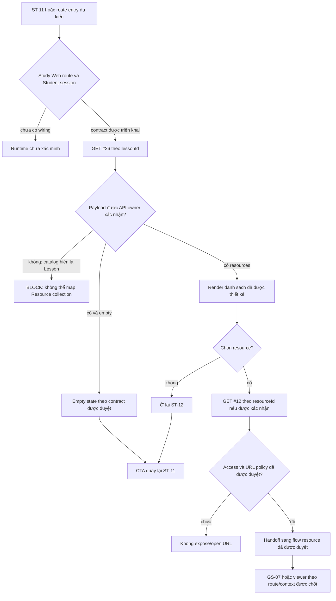

# ST-12 — Tài liệu kèm bài học

## A. Tổng quan màn hình

| Thuộc tính | Đặc tả |
|---|---|
| Screen ID / tên | `ST-12` — Tài liệu kèm bài học (Bảng) |
| Mục tiêu kỳ vọng | Cho Student xem tài nguyên gắn với lesson, lấy metadata của tài nguyên được chọn khi cần, rồi quay lại bài học hoặc mở luồng xem tài nguyên đã được duyệt. |
| Actor | Student theo AC-15 và catalog API #26. Tên/avatar `Nguyễn Văn A` trong prototype là dữ liệu tĩnh, không chứng minh danh tính hiện tại. |
| Route đề xuất | `/student/lessons/:lessonId/resources`; chưa có Study Web router/source để xác minh. |
| AC | AC-15 — Xem nội dung bài học; precondition là Student có quyền xem lesson. |
| API thiết kế | #26 `GET /api/v1/lessons/{lesson_id}/resources`, sau đó #12 `GET /api/v1/resources/{resource_id}` nếu đã có `resource_id` hợp lệ và policy xác nhận cần gọi API chi tiết. |
| Màn hình liên quan | ST-11 là lesson context; GS-07 là màn hình xem/tải resource. Inventory liệt kê ST-11, GS-07; đường truyền ID và điểm quay lại chưa được wire. |
| Tài sản | [`screen.png`](./screen.png) nguyên trạng 1600×1504; [`code.html`](./code.html) prototype tĩnh; [`screen_annotated.png`](./screen_annotated.png) là bản đánh số riêng. |
| Trạng thái | `DD BLOCKED` · `IMPLEMENTATION BLOCKED` · `RUNTIME NOT VERIFIED`. Đây là ba nhãn độc lập. |

### EXPECTED_BEHAVIOR — điều được yêu cầu/khai báo

- `list_screen.md` ST-12 đề xuất route Student, gọi #26 để lấy tài nguyên lesson, gọi #12 khi đã có resource ID hợp lệ, không tự mở URL ngoài chính sách; liên kết ST-11 và GS-07.
- API catalog yêu cầu Bearer JWT với role Student cho #26, `lesson_id:int64!`, không query/body, nhưng lại khai báo `ApiEnvelope<Lesson>`. API #26 DD đang Draft và xác nhận type/cardinality/empty behavior chưa chốt.
- AC-15 yêu cầu Student có quyền xem lesson và hậu điều kiện hiển thị nội dung, tài nguyên, điều hướng bài tiếp theo. Diagram mô tả API #26 trong luồng đó; đây là expected design, không phải runtime.
- Ảnh ST-12 thể hiện một trạng thái không có tài liệu khả dụng và copy bảo mật. Nó không định nghĩa response/API condition tạo ra trạng thái này.

### CURRENT_BEHAVIOR — bằng chứng hiện tại

- Trong checkout không có editable Study Web app source, package manifest hoặc Student router. Subcontext Study Web ghi `UNWIRED`; compiled `dist` chỉ có root `/`, không có route ST-12. Không có browser/runtime evidence.
- `screen.png` là ảnh thiết kế ở trạng thái unavailable/fallback. HTML có cấu trúc tĩnh cùng nội dung, tải Tailwind/font ngoài; không có page-level `fetch`, listener, timer hoặc router. Các anchor đều `href="#"`; `data-path` chỉ là attribute trong HTML.
- Không tìm thấy API #26 route/module/query/test trong `apps/study-server/app` và `apps/study-server/tests`.
- API #12 có route/module/test source hiện tại. Route public trả resource metadata và URL lấy trực tiếp từ `resources.url`; source không gọi signer và không kiểm tra visibility/enrollment. Test source được đọc, không chạy trong phiên này.
- Cover của API #12 DD vẫn ghi chưa xác minh runtime/OpenAPI, dù current tree có route, module và focused test source (trong đó có OpenAPI-path assertion). Đây là discrepancy tài liệu/source; test không được chạy và API DD vẫn `Draft — Needs Confirmation`.
- `infra/postgres/study-server/DB.sql` là DDL candidate legacy BIGINT; `resources.lesson_id` nullable, không có `visibility`. Scoped search trong V1-PILOT `infra/postgres/02_study_db.sql` không thấy table `resources`; đây là schema model riêng. Không chứng minh live schema hoặc mapping giữa hai model.

### Điều kiện vào/ra

- **Precondition kỳ vọng:** route có `lessonId` hợp lệ và người dùng là Student có quyền xem lesson theo AC-15. Catalog #26 khai báo Student Bearer; authorization predicate/claim binding chưa được API owner chốt.
- **Postcondition kỳ vọng:** danh sách Resource được hiển thị theo contract đã duyệt; khi chọn item, metadata/open action tuân theo policy; người học có thể quay lại ST-11 với context đã được xác nhận.
- **Hiện tại:** chưa có route, request, list payload, user session hoặc transition nào được xác minh ở Study Web. Không được diễn giải fallback copy thành kết quả HTTP empty/403.

## B. Luồng tổng thể

1. **Vào màn hình:** route dự kiến nhận `lessonId` từ lesson flow. ST-11 source hiện là unavailable fallback và không có resource control; việc điều hướng sang ST-12 chưa được xác minh.
2. **Authentication/authorization:** AC-15 yêu cầu quyền xem lesson. Catalog #26 yêu cầu Student Bearer. Không có Study Web client/router/session source để xác minh guard, token storage, refresh hoặc cách xử lý session hết hạn.
3. **Nạp danh sách:** inventory kỳ vọng `GET #26` theo `lessonId`; không query/body. Tuy nhiên route/module/test vắng mặt. Catalog và AC diagram trả `ApiEnvelope<Lesson>`, không nêu `Resource[]`, thứ tự, trang hoặc empty shape. Không thể ánh xạ item hay kết luận empty.
4. **Hiển thị:** ảnh chỉ có một empty/unavailable panel và hai thẻ trạng thái kỹ thuật. Không có card/row resource, tên tệp, type, dung lượng, URL hoặc hành động mở. Không giả lập các giá trị này.
5. **Lấy chi tiết:** API #12 chỉ có thể được cân nhắc sau khi một `resource_id` được cung cấp từ contract/list đã duyệt. Ảnh hiện không có resource selection. Source #12 là public, trả stored URL và thiếu visibility/signer/auth, do đó response hiện tại chưa đủ làm bằng chứng an toàn để tự mở/tải.
6. **Quay lại/đi tiếp:** CTA quay lại ST-11 và link diễn đàn chỉ là anchor prototype `href="#"`. Route/state/ID handoff chưa được triển khai. GS-07 là link nghiệp vụ theo inventory, nhưng route/return context cho ST-12 còn mở.
7. **Lỗi và phiên:** catalog #26 khai báo 401/403/404/500; current #12 source có 404/500 ngoài success. Không có UI mapping, retry, timeout, cache, polling hoặc session recovery implementation. Text “Tự động làm mới mỗi 30s” không có timer trong HTML.

### Sơ đồ màn hình liên kết

| Nguồn | Hành động/đầu vào dự kiến | Đích | Hiện trạng |
|---|---|---|---|
| ST-11 | Mở panel tài nguyên với `lessonId` | ST-12 `/student/lessons/:lessonId/resources` | Inventory và lazy #26 kỳ vọng; ST-11 asset hiện không có resource control; route/runtime chưa có. |
| ST-12 | Chọn Resource, truyền `resourceId` | GS-07 `/resources/:resourceId` hoặc viewer được duyệt | Inventory liên kết GS-07; ST-12 screenshot không có Resource item; API #26 chưa có list contract runnable. |
| ST-12 | CTA quay lại lesson | ST-11 `/student/lessons/:lessonId` | `data-path` ghi tên logical route, nhưng `href="#"`; giữ playback position/history chưa có contract. |
| ST-12 | Link “Diễn đàn Thảo luận” | Destination chưa xác nhận | `href="#"`; không có `courseId` trong route/asset để chọn đúng room. |

## C. Đặc tả element

`Visible in prototype` mô tả ảnh/HTML tĩnh, không khẳng định runtime. Nhãn chính sách, trạng thái và nội dung kỹ thuật dưới đây là copy trong mockup trừ khi có nguồn backend cụ thể.

| # / Element ID | Tên, loại, vị trí, mục đích | Thuộc tính/nguồn/trạng thái | Sự kiện |
|---|---|---|---|
| #1 `ST12-EL-01` | Thương hiệu Study2Work LMS và navigation ở header. | Static HTML anchors; các mục Trang chủ/Khóa học của tôi/Tiến độ/Thảo luận/Thông báo dùng `href="#"`. Không phải current nav. | `ST12-EV-05`; route target chưa có. |
| #2 `ST12-EL-02` | Tóm tắt người học và avatar ở góc phải header. | Tên “Nguyễn Văn A”, role “Học viên” và icon được hard-code; không có API/session mapping. | Không có event/control được xác nhận. |
| #3 `ST12-EL-03` | Breadcrumb Trang chủ → Khóa học của tôi → ST-11 → Tài liệu kèm bài học. | Static anchors và current text; không chứa runtime IDs. | `ST12-EV-05`; `lessonId` handoff chưa có. |
| #4 `ST12-EL-04` | Route badge ở đầu nội dung. | Hiển thị chuỗi `/student/lessons/:lessonId/resources`; route label là design metadata. | Không có event. |
| #5 `ST12-EL-05` | Badge `ST-12 RESOURCE PANEL` và `DESIGN_ONLY (D)`. | Static label, không phải status API/deployment. | Không có event. |
| #6 `ST12-EL-06` | H1 “Tài liệu kèm bài học” và mô tả purpose. | Static Vietnamese copy; không lấy từ API. | Không có event. |
| #7 `ST12-EL-07` | Thẻ “Zero Information Disclosure Enforced”. | Static security claim. Current #12 source trả `name/type/url` public; không chứng minh zero disclosure hoặc policy enforcement. | Không có event; cần duyệt/cập nhật copy. |
| #8 `ST12-EL-08` | Icon folder ở empty/fallback panel. | Trang trí; không có accessibility alternative/status semantics được xác minh. | Không có event. |
| #9 `ST12-EL-09` | Badge “Chính sách kiểm soát truy cập tập trung”. | Static copy; chưa có policy/service source hỗ trợ. | Không có event. |
| #10 `ST12-EL-10` | Empty/unavailable heading và giải thích về tài liệu hoặc phân quyền đang cấu hình. | Copy cố định; không phân biệt `200 empty`, 401/403, 404, 500, network error hay setup issue. Không có `Resource` fields. | Trạng thái dự kiến do `ST12-EV-01`; hiện không có mapper. |
| #11 `ST12-EL-11` | CTA “Quay lại trình học bài (ST-11)”. | Anchor button-style, cao 48px trong HTML; `data-path="student-lessons-lessonId"`, `href="#"`. Không có ID/state binding. | `ST12-EV-03`; hiện chỉ là placeholder anchor. |
| #12 `ST12-EL-12` | Dải claims “Chuẩn mã hóa E2E”, “Không công khai metadata”, “Token xác thực một lần”. | Ba static claims, không có backend/identity/storage evidence; không được ghi như tính năng đã triển khai. | Không có event. |
| #13 `ST12-EL-13` | Heading “Trạng thái kiểm định khả năng kết nối”. | Static section title/icon; không có diagnostic API/source. | Không có event. |
| #14 `ST12-EL-14` | Badge “Tự động làm mới mỗi 30s”. | Static text. Không có `setInterval`, timer, request hoặc focus/visibility behavior trong HTML. | Không tạo polling event nếu chưa có yêu cầu/cost/error policy. |
| #15 `ST12-EL-15` | Thẻ API #26: “Schema Mismatch (Blocked)”, “Type: Lesson”. | Phản ánh mismatch catalog/DD, không phải runtime health check. Catalog: Student Bearer; GET; `lesson_id:int64!`; response `ApiEnvelope<Lesson>`; declared 200/401/403/404/500. Runtime route/module/test không tìm thấy. | `ST12-EV-01`; không thể đọc dữ liệu hiện tại. |
| #16 `ST12-EL-16` | Thẻ API #12: “Design Only (Locked)”, “Pending Auth”. | Nhãn `Pending Auth` sai với current #12 route/catalog public/no Bearer. API DD còn Draft; source trả direct stored URL và thiếu auth/visibility/signer. | `ST12-EV-02`; không khẳng định auth pending là server behavior. |
| #17 `ST12-EL-17` | Header Hand-off Technical Notes và subtitle. | Static annotation hướng frontend, không cấu hình/capability contract. | Không có event. |
| #18 `ST12-EL-18` | Note cấm mở URL ngoài chính sách bảo mật. | Design recommendation; allowlist domain, URL parser, scheme, redirects và behavior chưa định nghĩa. | Liên quan `ST12-EV-02`; chưa đủ để triển khai an toàn. |
| #19 `ST12-EL-19` | Note không giả lập tên/extension/size/URL. | Quy tắc prototype phù hợp yêu cầu không bịa dữ liệu; metadata thật chưa có do #26 contract/source thiếu. | Áp dụng khi thiết kế resource item; hiện không có item. |
| #20 `ST12-EL-20` | Note WCAG 2.1 AA/focus visible. | Claim trên mockup chưa được kiểm thử. `.agents/web-study/design.md` yêu cầu contrast, focus-visible, keyboard order và hit target tối thiểu 44px. | Không có event; tiêu chí UX cho implementation. |
| #21 `ST12-EL-21` | Note Ocean brand và màu `#0B5F8A`. | Khớp token `ocean-primary` của Study Web guide ở icon/note; các màu Tailwind của HTML còn có `#004AC6`/`#2563EB`, cần thống nhất khi triển khai. | Không có event. |
| #22 `ST12-EL-22` | Footer panel tag `ST-12 v2.4` và `Valid Spec`. | Static version/validity claim, không phải approval record. Tài liệu DD hiện BLOCKED. | Không có event; không dùng làm trạng thái DD. |
| #23 `ST12-EL-23` | Help card title/copy mời liên hệ giảng viên/trợ giảng. | Static content; không có recipient, course context hoặc service/link logic. | Liên quan `ST12-EV-04`; không có request/action riêng. |
| #24 `ST12-EL-24` | Link “Truy cập Diễn đàn Thảo luận”. | `data-path="thao-luan"`, `href="#"`; không có `courseId`/destination. | `ST12-EV-04`; destination cần xác nhận. |
| #25 `ST12-EL-25` | Footer copyright “© 2025 Study2Work LMS”. | Static copy; không có nguồn cấu hình năm. | Không có event. |
| #26 `ST12-EL-26` | Badge “WCAG 2.1 AA Compliant”. | Static claim; chưa có runtime accessibility audit. | Không có event. |
| #27 `ST12-EL-27` | Nhóm Điều khoản dịch vụ/Chính sách bảo mật/Trợ giúp. | Ba anchors `href="#"`, `data-path` tĩnh; destination chưa được wire. | `ST12-EV-05`; không suy ra route. |

## D. Đặc tả sự kiện

### ST12-EV-01 — Vào route và tải tài nguyên theo lesson

| Trường | Đặc tả |
|---|---|
| Element / loại | Route entry; `Load` theo inventory. Không có marker control riêng; thẻ trạng thái #15 mô tả contract. |
| Điều kiện tiên quyết | Expected: route có `lessonId`, Student session hợp lệ và có quyền xem lesson (AC-15/catalog). Current: route/router/auth client không có trong checkout. |
| Input | `lessonId` từ route; catalog khai báo required `int64`. Bearer Student theo catalog. Không query/body/header tùy biến nào khác được khai báo cho #26. |
| Request kỳ vọng | `GET /api/v1/lessons/{lesson_id}/resources`; #26 được xem là API declared-only, không có current route/module/query/test. |
| Bước xử lý | 1) Route/session kiểm tra thuộc tính đầu vào theo contract sau khi được duyệt. 2) Catalog yêu cầu gọi dưới Student Bearer; token transport/storage hiện không có source. 3) Gửi path `lesson_id`, không tự thêm pagination/filter. 4) Response hiện khai báo `ApiEnvelope<Lesson>`; không thể diễn giải thành `Resource[]` hoặc chọn `Lesson.id` làm `resource_id`. 5) Dừng mapping cho tới khi API owner chốt response/cardinality. 6) Chỉ render empty/list/error theo semantics được chốt, không dựa trên fallback screenshot. |
| Response/status khai báo | 200 `DESIGN_RESOURCE_RETRIEVED`; 401 `DESIGN_AUTHENTICATION_REQUIRED`; 403 `DESIGN_ACCESS_DENIED`; 404 `DESIGN_RESOURCE_NOT_FOUND`; 500 `DESIGN_INTERNAL_ERROR`. Catalog chưa đủ schema để quy định payload/error fields chi tiết. |
| Kết quả/ngoại lệ | #26 hiện `NOT_FOUND`; không có response runtime để map. Empty list, 404-vs-empty, order, retry, timeout, cache và refresh policy đều `OPEN`. Session/access UI không được suy ra từ screenshot. |
| Chống lặp/tác dụng phụ | GET được khai báo read-only; không có client dedupe/cache/retry policy hay server side effect source để xác nhận. Không bật refresh mỗi 30 giây từ badge tĩnh. |

### ST12-EV-02 — Chọn resource và đọc metadata qua API #12

| Trường | Đặc tả |
|---|---|
| Element / loại | Resource selection/`Click` dự kiến; không có resource row/card/control trong ST-12 asset hiện tại. |
| Điều kiện tiên quyết | Chỉ có thể thực hiện sau khi API #26 trả Resource item theo contract đã duyệt, có `resource_id`, và owner xác định #12 có còn cần gọi hay không. Access/URL policy phải được phê duyệt trước khi expose hoặc mở URL. |
| Input | `resource_id` từ Resource item được xác nhận. API #12 catalog: positive-format requirement chưa nêu, path `int64` required, public/no Bearer, không query/body. Current source thực thi positive signed-int64. |
| Request hiện có | `GET /api/v1/resources/{resource_id}`. Route đăng ký trong `apps/study-server/app/api/v1.py`, gọi `get_resource_detail`, sau đó `validate_resource_id` → `find_resource` (Q1) → nếu `lesson_id != null`, `find_published_parent_course` (Q2). |
| Current success mapping | 200 `DESIGN_RESOURCE_RETRIEVED`, message `Resource metadata retrieved`; `data` gồm `id`, `name`, `type` (alias từ `resource_type`), `url` (giá trị lưu trong DB, model cho phép null), `lesson_id`; `meta`/`traceId` theo response helper. Source không select/serialize `visibility`. |
| Current access/publish behavior | Route không có auth guard. Nếu `lesson_id` có giá trị, source chỉ yêu cầu lesson không `DELETED` và course `PUBLISHED`; không kiểm tra Student enrollment/entitlement hoặc Resource visibility. Nếu `lesson_id=null`, bỏ qua parent check. |
| Status/lỗi source | Invalid/non-positive/overflow ID hoặc resource/parent không thỏa điều kiện → 404 `DESIGN_RESOURCE_NOT_FOUND`; SQLAlchemy error rollback rồi trả 500 `DESIGN_INTERNAL_ERROR`; Pydantic mapping failure cũng trả 500. Current source không có 401/403/410, signer, expiry hoặc storage call. |
| Bước tiếp theo | Không tự mở `data.url`, tạo `<iframe>`, tải tệp hoặc coi `url` là signed URL. Current API trả direct stored URL; behavior mở chỉ được thiết kế khi access, origin/scheme allowlist, MIME/preview/download và expiry policy được duyệt. Handoff GS-07/ST-12 còn cần giữ đúng entry context. |
| Kết quả/ngoại lệ | API #12 source-backed nhưng API DD `Draft — Needs Confirmation`; source tests được đọc, không chạy. Không có UI control để kích hoạt trong screenshot và không có e2e evidence. |

### ST12-EV-03 — Quay lại trình học bài (ST-11)

| Trường | Đặc tả |
|---|---|
| Element / loại | #11, click anchor. |
| Input | `lessonId` hiện tại nếu route đã được triển khai; trạng thái video/playback position nếu muốn khôi phục cần contract riêng. |
| Hiện trạng | HTML có `data-path="student-lessons-lessonId"` và `href="#"`; không có router handler. Native target hiện không truyền `lessonId`. |
| Luồng kỳ vọng | Sau khi route/lesson context được xác nhận, điều hướng về `/student/lessons/:lessonId`; chỉ giữ playback position/history nếu có nguồn state đã duyệt. Không gọi API bởi click quay lại. |
| Ngoại lệ | Thiếu/invalid `lessonId`, hết session, hoặc lesson access bị thu hồi cần recovery policy; hiện chưa có UI/runtime mapping. |

### ST12-EV-04 — Mở diễn đàn để xin tài liệu

| Trường | Đặc tả |
|---|---|
| Element / loại | #24, click anchor sau copy hỗ trợ ở #23. |
| Input | HTML chỉ có `data-path="thao-luan"`; không có `courseId`, discussion ID hoặc destination URL. |
| Hiện trạng | `href="#"`; không có API call/router. |
| Kết quả kỳ vọng | Product cần xác định room/route nào tiếp nhận yêu cầu và dữ liệu context nào được truyền. Không tự map sang ST-23 vì inventory/route đó cần course context chưa có ở asset này. |

### ST12-EV-05 — Navigation và legal links của shell

| Trường | Đặc tả |
|---|---|
| Element / loại | #1, #3, #27; click anchors. |
| Input | Các `data-path` metadata: `trang-chu`, `khoa-hoc-cua-toi`, `tien-do`, `thao-luan`, `thong-bao`, `dieu-khoan-dich-vu`, `chinh-sach-bao-mat`, `tro-giup`; không có route table trong HTML. |
| Hiện trạng/kết quả | Tất cả `href="#"`, không có router script. Không xác định route, auth gating hay data handoff từ mockup. Cần app shell/route contract trước khi triển khai. |

### Badge “Tự động làm mới mỗi 30s” không phải event

HTML không chứa polling/timer hoặc request handler. Không tạo `setInterval`, retry hay refresh API dựa trên text này. Nếu product thật sự yêu cầu polling, cần xác định endpoint, visibility state, overlap/cancel, timeout, backoff, focus/tab behavior và chi phí trước khi cập nhật thiết kế.

## E. Ma trận trạng thái

| State | Điều kiện/nguồn | UI/transition | Current status |
|---|---|---|---|
| Design fallback | Ảnh hiện tại | Hiển thị thông điệp #10, CTA ST-11 và status cards. | `VISIBLE IN PROTOTYPE`; không biết HTTP condition. |
| Route/session checking | Student mở route | Xác thực `lessonId`/session theo contract; không hiển thị resource data trước khi quyền được xác nhận. | Chưa có client route/session source. |
| Resources loading | #26 request đang chạy | Cần loading state đã được thiết kế. | Không hiện trong screenshot/HTML; API #26 chưa có source. |
| Empty resources | Response collection hợp lệ rỗng | Cần product/API xác nhận 200 empty hay response khác và copy/UI riêng. | `OPEN`; fallback hiện tại không chứng minh đây là empty result. |
| Resources available | Response có Resource items | Cần danh sách/card design, field mapping và trigger chọn item. | Không có UI hoặc payload hiện tại. |
| #26 authentication/access error | Catalog 401/403 | Cần session/login/recovery copy và policy 403. | Declared only; current source `NOT_FOUND`. |
| #26 missing/server/network error | Catalog 404/500 hoặc network failure | Cần inline/page error và retry policy. | Declared only; network/retry UI chưa có. |
| Resource detail loading | Chọn item và gọi #12 nếu được duyệt | Cần busy state, tránh mở URL trước response/access approval. | Không có selector/control trong asset. |
| Resource detail success | #12 trả 200 | Source trả `id/name/type/url/lesson_id`; URL direct, visibility omitted. Chưa đủ điều kiện tự mở. | API source-backed; UI/open policy blocked. |
| Resource detail not found/internal error | #12 404/500 | Cần inline/error destination policy; không tự dùng SH-06. | API source-backed; screen mapping chưa chốt. |
| Safe open/preview/download | Access, origin, type, MIME và URL policy đã được duyệt | Chỉ sau khi quyết định viewer/handoff. | Chưa có contract; signed URL/410/expiry không tồn tại trong #12 source. |

## F. Quy tắc nghiệp vụ, bảo mật và tiếp cận

1. Không xem `href`, `data-path`, badge `Valid Spec`, tên người học hay security copy trong mockup là bằng chứng route/session/policy.
2. Catalog #26 yêu cầu Student Bearer nhưng không có source thực thi entitlement. Mỗi endpoint phải có access rule riêng sau khi được chốt; không coi một lần kiểm tra phía client là authorization.
3. API #12 hiện public, không access-check resource visibility/enrollment, và trả stored URL. Không nói rằng #12 ký URL hoặc yêu cầu auth chỉ vì badge #12 ghi “Pending Auth”.
4. Reusable `Resource.visibility` không có cột tương ứng trong candidate `resources` DDL; không tạo visibility value/predicate ở UI.
5. Không hiển thị tên file, extension, dung lượng, URL, download action hay preview khi backend chưa cung cấp payload được duyệt.
6. Study Web design target yêu cầu ocean-primary `#0B5F8A`, focus-visible, keyboard order, contrast WCAG AA, semantic link/button, text alternative phù hợp, responsive reflow 320px và target điều khiển ≥44px. Ảnh 1600×1504 chỉ là desktop design; WCAG claim trong ảnh chưa được kiểm chứng.
7. HTML lấy font/Tailwind từ CDN. Tailwind config dùng `#004AC6`/`#2563EB` cho primary, trong khi design guide dùng `#0B5F8A`; cần đồng nhất khi có frontend source, không thay đổi asset nguồn trong task này.

## G. Discrepancy và blocker

| ID | Discrepancy/blocker | Bằng chứng | Ảnh hưởng |
|---|---|---|---|
| ST12-B01 | Study Web route/runtime không có trong checkout. | `.agents/web-work/study/INDEX.md`; không có `apps/study-client/src`, package hoặc router. | Không thể xác minh auth, request, route, UI state hoặc runtime. |
| ST12-B02 | API #26 khai báo `ApiEnvelope<Lesson>` nhưng use case cần Resource collection. | `docs/lists/list_api.md`, AC-15 diagram, API #26 DD Q-26-01. | Không thể map item, empty state hoặc `resource_id`. |
| ST12-B03 | API #26 không có route/module/query/test source. | Search `apps/study-server/app` và `tests`; `.agents/server-study/apis/declared-routes.md`. | API catalog là declaration, không phải runnable endpoint. |
| ST12-B04 | #26 list semantics/access còn mở. | API #26 Q-26-02..07: cardinality/order/empty, Student entitlement, visibility, URL/signer, 404/error, path/schema. | Chặn screen data flow và error-state decisions. |
| ST12-B05 | API #12 source public/direct URL khác signed/private expectation. | Route/view/query/model/test #12; current source không auth/visibility/signer; trả `resources.url`. | Chặn safe expose/open/download từ ST-12 hoặc GS-07. |
| ST12-B06 | Mockup trạng thái #12 “Pending Auth” không khớp source/catalog public/no Bearer. | Catalog/API #12 route. | Cần sửa copy hoặc chốt contract; không được mô tả như current auth. |
| ST12-B07 | Mockup security/refresh/compliance claims chưa được chứng minh. | HTML tĩnh, không timer/guard/test evidence; #12 trả URL/metadata. | Claims không được ghi thành behavior đã triển khai. |
| ST12-B08 | Không có danh sách resource hoặc trigger chọn item, mặc dù inventory định tuyến #26 → #12. | `screen.png`/`code.html`. | Không có `resource_id` hợp lệ để gọi #12; cần loaded-state design/contract. |
| ST12-B09 | Back, discussion, header/footer destinations chưa wire/context. | HTML `href="#"`, `data-path`; ST-11/GS-07 DD. | Không xác định lesson position, course discussion hay return destination. |
| ST12-B10 | Candidate schema/contract khác nhau; live schema chưa xác minh. | Resource contract có `visibility`; legacy `DB.sql` không có field đó và `lesson_id` nullable; V1-PILOT UUID model không có `resources` table declaration. | Không suy đoán visibility, mandatory parent, schema mapping hoặc production DB behavior. |
| ST12-B11 | API #12 DD cover nói chưa có runtime/OpenAPI verification, không phản ánh route/test source hiện tại. | Current `app/api/v1.py`, API #12 module và focused test source có route/response/OpenAPI-path assertion; API DD vẫn Draft; test chưa chạy. | Giữ `SOURCE_BACKED LOCALLY` khác với DD approval/test/runtime verification; không dùng stale cover làm trạng thái source. |

**Phân loại cuối:** `DD BLOCKED`; `IMPLEMENTATION BLOCKED`; `RUNTIME NOT VERIFIED`. Tài liệu này ghi trace hiện có và quyết định còn thiếu; không tuyên bố đạt DD READY.

## H. Tiêu chí nghiệm thu

- [x] Tài sản nguồn và HTML tĩnh được phân biệt với runtime.
- [x] 27 marker có mapping duy nhất sang 27 element trong §C.
- [x] API #26 declaration/absence và API #12 current route/source được mô tả riêng.
- [x] Các event có input, precondition, steps, endpoint/response/error và kết quả hoặc blocker.
- [x] Empty/loading/error/authorization/navigation states không bị gán nhầm cho screenshot fallback.
- [x] Resource URL, visibility, signer, route return và no-data claims được ghi đúng trạng thái mở.
- [x] Relative links được kiểm tra tĩnh.
- [ ] API #26 response/cardinality/access/empty policy được duyệt; required để DD READY.
- [ ] Safe URL/access/preview/download policy, loaded-state UI và route handoff được duyệt; required để DD READY/implementation.
- [ ] Study Web implementation và browser flow được chạy/verify; hiện ngoài evidence.

## I. Nguồn truy vết

- Inventory/flow/API index: [`list_screen.md`](../../../list_screen.md) — ST-12, F04, API index, G-07.
- API catalog: [`list_api.md`](../../../../../../docs/lists/list_api.md) — #12, #26 và `Resource` schema.
- AC-15: [`AC API index`](../../../../../../apps/study-server/docs/diagrams/AC_UNICA/00_AC_API_INDEX.md), [`Student Learning diagram`](../../../../../../apps/study-server/docs/diagrams/AC_UNICA/AC_02_STUDENT_LEARNING.drawio).
- API #26: [cover](../../../../../../apps/study-server/docs/dd/26_lessons_resources/00_Cover.md), [open questions](../../../../../../apps/study-server/docs/dd/26_lessons_resources/OPEN_QUESTIONS.md).
- API #12: [current route](../../../../../../apps/study-server/app/api/v1.py), [view](../../../../../../apps/study-server/app/modules/guest/api_12_resources_detail/view.py), [query](../../../../../../apps/study-server/app/modules/guest/api_12_resources_detail/query.py), [tests — read, not run](../../../../../../apps/study-server/tests/modules/guest/api_12_resources_detail/test_resources_detail.py), [API DD](../../../../../../apps/study-server/docs/dd/12_resources_detail/00_Cover.md).
- Candidate DB: [`DB.sql`](../../../../../../infra/postgres/study-server/DB.sql) — không phải live-schema evidence.
- Linked screens: [`ST-11`](../ST-11_trinh-hoc-bai-lesson-player/ST-11.md), [`GS-07`](../../02_guest_discovery/GS-07_xem-tai-tai-nguyen/GS-07.md).
- Study Web target/status: [design guide](../../../../../../.agents/web-study/design.md), [Study Web index](../../../../../../.agents/web-work/study/INDEX.md).
