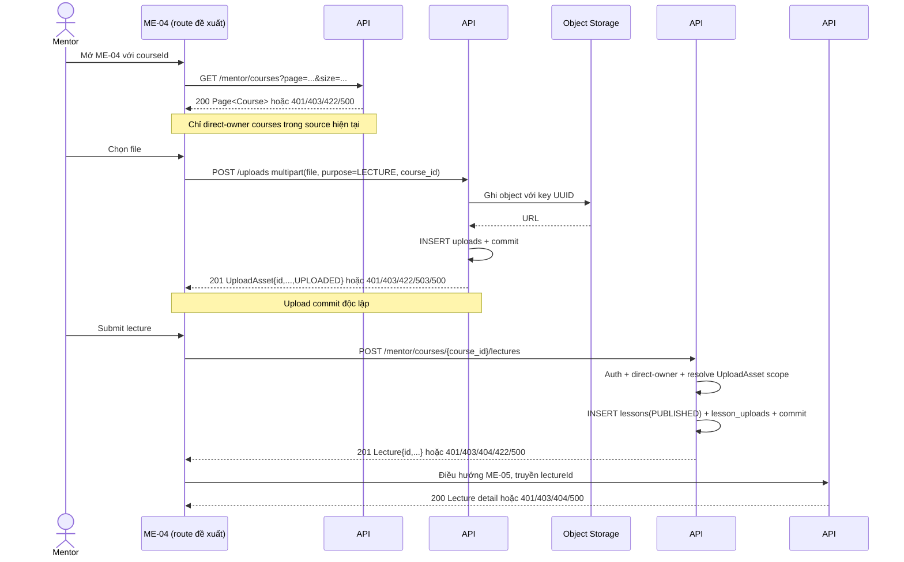

# ME-04 — Tải lên và tạo bài giảng

> **DD status:** `DD BLOCKED` — chưa đủ contract để chuyển sang DD READY.
> **Implementation status:** `IMPLEMENTATION BLOCKED`.
> **Runtime status:** `RUNTIME NOT VERIFIED` — Study Web route/source/serving không có trong checkout.
> **Scope phiên:** chỉ Screen ID ME-04.

## 1. Tổng quan

| Thuộc tính | Đặc tả |
|---|---|
| Screen ID | ME-04 |
| Tên | Tải lên và tạo bài giảng |
| Mục tiêu | Tạo lecture trong course, tải media/tài liệu qua API #34 rồi gửi metadata và asset references qua API #47. |
| Actor dự kiến | Mentor đã đăng nhập. AC-21 cho phép sở hữu hoặc được phân công course; current APIs chỉ chấp nhận trực tiếp owner. |
| Route đề xuất | `/mentor/courses/:courseId/lectures/new`; route chưa được wire. `courseId` phải tương thích signed int64 của #34/#47. |
| Trước màn hình | ME-03 workspace/course context hoặc deep link; authenticated MENTOR session; quyền truy cập course cần được xác minh. |
| Sau thành công | ME-05 `/mentor/lectures/:lectureId`; ME-05 dùng GET #48 để đọc lại lecture và asset links. Quay lại ME-03 dùng course context hiện tại. |
| API | GET #46 context; POST #34 upload; POST #47 create; GET #48 downstream read. |
| Thiết kế được cung cấp | `screen.png` và `code.html`; đây là sample/mockup, không phải runtime. |

### 1.1 Trạng thái bằng chứng

| Nhóm | Kết luận | Bằng chứng |
|---|---|---|
| Expected behavior | Form metadata, thứ tự, media, tạo lecture; inventory nêu #46 → #34 → #47 và trạng thái draft/uploading/creating/422/error. | [`list_screen.md` ME-04](../../../list_screen.md#L164), AC-21. |
| Current UI | Không có Study Web `src/`, package manifest hoặc router; HTML không có file input/form/contenteditable/API. CTA chỉ hiển thị giả lập thành công sau 900 ms. | Checkout hiện tại; [code.html](code.html). |
| Current backend source | #34, #46, #47, #48 có route/module source; #34/#47 side effects và response được ghi ở dưới. | [`app/api/v1.py`](../../../../../../apps/study-server/app/api/v1.py#L697), module source liên kết ở §10. |
| API tests | Test source có cho các nhánh chính; đã đọc nhưng **không chạy trong phiên này**. Test DB/provider giả không xác minh live deployment. | Test files ở §10; `.agents/server-study/tests.md`. |
| Persistence/runtime | SQL legacy BIGINT và migrations 004/005 có trong repo; live DB, migration deployment, object storage credentials/network chưa xác minh. | `infra/postgres/study-server/DB.sql`, migrations 004/005. |

## 2. Luồng tổng thể và ranh giới dữ liệu

### 2.1 Khởi tạo course context — API #46

- Source route: `GET /api/v1/mentor/courses`; Authorization `Bearer <JWT>`, role `MENTOR`.
- Query hiện hành: `status?: DRAFT|PUBLISHED`, `page=1`, `size=20`, `1≤size≤100`. Bỏ `status` để lấy cả trạng thái hiện có.
- Current view xác thực trước DB, count rồi list; SQL giới hạn `courses.mentor_id = JWT sub`, thứ tự `created_at DESC, id ASC`. Response là `ApiEnvelope<Page<Course>>`; Course có `id`, `title`, `description`, `thumbnail_url`, `price`, `status`, Mentor projection. Page rỗng là success.
- Lỗi: 401 `DESIGN_AUTHENTICATION_REQUIRED`; 403 `DESIGN_ACCESS_DENIED`; 422 `DESIGN_VALIDATION_ERROR`; 500 `DESIGN_INTERNAL_ERROR`.
- Không có endpoint detail theo `courseId`, module hierarchy, course code hay lecture order. Nếu ID không nằm trong trang hiện tại, quy tắc lấy trang tiếp/không tìm thấy chưa được inventory hoặc source xác định; không tự duyệt toàn bộ danh sách trong client.
- AC-21 cho phép Mentor được phân công; #46 chỉ lấy owner trực tiếp. Không coi course code `FE-REACT-ENT-2025` trên mockup là `courseId` số.

### 2.2 Tải từng asset — API #34

- Source route: `POST /api/v1/uploads`, `multipart/form-data`, required parts `file` và `purpose`, optional `course_id`.
- Đối với Mentor, `purpose=LECTURE` bắt buộc có signed-int64 `course_id`; current view kiểm tra `courses.mentor_id = JWT sub` trước khi gọi storage. Không có `owner_id` do client chọn.
- Current source không đặt MIME allowlist hoặc application size cap. Nó đo `size_bytes` từ file stream, filename rỗng thành `upload`, MIME rỗng thành `application/octet-stream`; tạo key server-side `uploads/<UUID>`.
- Upload provider tương thích S3, cấu hình qua environment; object được ghi trước, sau đó insert/commit hàng `uploads` với `UPLOADED`. Success HTTP 201 `DESIGN_RESOURCE_CREATED` trả `{id,name,url,content_type,size_bytes,status}`.
- Errors: 401 auth; 403 role/purpose/owner scope; 422 field/purpose/course validation; 503 `DESIGN_DEPENDENCY_UNAVAILABLE` khi storage lỗi; 500 `DESIGN_INTERNAL_ERROR` khi metadata/DB lỗi. DB failure có rollback và best-effort object delete; real provider chưa được chạy.
- Mỗi file upload là một transaction/request độc lập. Khi #34 thành công rồi người dùng hủy hoặc #47 lỗi, object và metadata #34 không nằm trong transaction #47. Không tìm thấy API delete upload trong route source; remove trên UI chỉ được mô tả là bỏ selection cục bộ cho tới khi có cleanup contract.

### 2.3 Tạo lecture — API #47

- Source route: `POST /api/v1/mentor/courses/{course_id}/lectures`; Bearer JWT role `MENTOR`; `Content-Type: application/json`; không có query.
- Strict body (extra fields bị từ chối):

| Field | Kiểu/constraint source | Current mapping |
|---|---|---|
| `title` | string required, tối đa 200 ký tự; không có min/trim rule | `lessons.name`; response `data.title` |
| `content` | signed int64 required | Lưu `str(content)` vào `lessons.content`; response là chuỗi thập phân. Không phải rich-text body. |
| `asset_refs` | string required chứa JSON array ordered unique signed-int64 IDs; `"[]"` hợp lệ | Resolve #34 uploads cùng owner, purpose `LECTURE`, course; response `assets` theo request order. |
| `order` | signed int32 required; source không đặt positivity rule | `lessons.sort_order`; response `data.order` |

- View: MENTOR JWT guard → path signed-int64 validation → parse `asset_refs` → SELECT course → check direct owner → resolve mọi asset → INSERT `lessons` với status `PUBLISHED` và `CURRENT_TIMESTAMP` → INSERT `lesson_uploads` theo thứ tự (nếu có) → commit → response `Lecture`.
- Course status không bị lọc; API có thể tạo lecture trên course DRAFT nếu Mentor sở hữu. API không tạo `resources`, không mutate upload metadata.
- Errors source-backed: 401; 403 course khác owner; 404 course thiếu hoặc asset ID thiếu/ngoài scope (asset dùng lỗi 404 chung); 422 sai path/body/range/title/asset_refs; 500 query/mapping/transaction. DB failure rollback phần #47.
- API #47 local DD ghi `Draft — Needs Confirmation` do target live schema/migration chưa xác minh. Q1/Q2 ở API DD ghi local wire decision cho `content:int64` và `asset_refs`, nhưng không tạo mapping editor rich-text cho ME-04.

### 2.4 Đọc sau khi tạo — API #48 / ME-05

- ME-05 route đề xuất `/mentor/lectures/:lectureId` dùng `GET /api/v1/mentor/lectures/{lecture_id}`; source kiểm tra MENTOR role, parse ID, xác minh direct owner qua lecture→course, rồi đọc các UploadAsset liên kết theo `asset_position`.
- Success 200 trả `Lecture` hiện lưu, có `status` và `assets`; errors 401/403/404/500. Đây là read-only; không thay thế kết quả POST #47.
- Route điều hướng phía Study Web vẫn chưa có source. Không mô tả UI success giả lập trong HTML như API result.

## 3. Ma trận element

Tọa độ marker là pixel trên ảnh nguồn; `screen_annotated.png` xuất 2×. Element nhóm chỉ gộp các control con khi cùng vùng/chức năng; toolbar và editor vẫn liệt kê control con tại cột nội dung. Mọi ID dưới đây ánh xạ duy nhất tới marker cùng số.

Sau visual review, marker #3 và #25 được chuyển khỏi vùng nhãn/marker lân cận; JSON, SVG và annotated PNG được tạo lại sau bản tọa độ cuối trong `ME-04_PLAN.md` rồi xem lại.

| Element ID | Tên/loại/vị trí | Data, default, validation, hiển thị/trạng thái | Event |
|---|---|---|---|
| ME04-EL-01 | Logo/brand, global header | Static mockup; đích route không được wire. | EV-21 |
| ME04-EL-02 | Navigation Mentor | Dashboard, course list, grading, support, notifications trong mockup; tất cả `href="#"`. | EV-21 |
| ME04-EL-03 | Search input header | Mockup text; không có query source/API/handoff ở ME-04. | EV-21 |
| ME04-EL-04 | Notification icon + badge | Badge `3` là sample; API Mentor notification #63/#64 có trong backend source nhưng target/link của header chưa được xác định tại screen này. | EV-21 |
| ME04-EL-05 | Mentor identity/avatar | Tên/chức danh mẫu, không lấy từ #46 course list; không coi là authenticated profile runtime. | — |
| ME04-EL-06 | Link quay lại Workspace | Target đề xuất ME-03 với cùng `courseId`; chưa có browser route/history policy. | EV-20 |
| ME04-EL-07 | Breadcrumb tên course | Giá trị sample; nguồn có thể đối chiếu từ #46 `Course.title`, nhưng không có detail endpoint. | EV-01 |
| ME04-EL-08 | Course code sample | `FE-REACT-ENT-2025` không có trong Course projection #46; không phải route ID theo source. | EV-01 |
| ME04-EL-09 | Page title | Static title “Thêm bài giảng mới vào giáo trình”. | — |
| ME04-EL-10 | Badge Authoring | Static status badge; không biểu thị persisted draft/status. | — |
| ME04-EL-11 | Auto-save status label | Text “Đã tự động lưu…” nhưng HTML không có autosave timer/API. Không được hiển thị như persisted status. | — |
| ME04-EL-12 | Preview button | Không có preview API/state/route contract cho unsaved lecture. | EV-11 |
| ME04-EL-13 | Metadata section header | Section container; no backend object mapping. | — |
| ME04-EL-14 | Select chương/module | Sample options; #46 không trả module hierarchy, #47 không nhận module ID. | EV-02 |
| ME04-EL-15 | Bloom-Tech level text | Static classification; không có field/rule trong #46/#47. | — |
| ME04-EL-16 | Select order/lesson position | Sample `Bài số 16/48`; only #47 `order:int32`, no max/order lookup or positivity rule. | EV-02 |
| ME04-EL-17 | Input title | Mockup prefilled; #47 requires string ≤200, no minimum/trim rule. UI required marker is not runtime validation. | EV-03 |
| ME04-EL-18 | Character counter | `78/120` sample contradicts #47 max 200; needs approved UI limit. | EV-03 |
| ME04-EL-19 | Duration input | Text sample “35 phút”; no duration field in #47 request/response. | EV-03 |
| ME04-EL-20 | Difficulty indicator | Four-dot/“Senior Standard” sample; no #47 field or scoring formula. | — |
| ME04-EL-21 | Media section header | Group container for media actions. | — |
| ME04-EL-22 | `API #34 Upload CDN` chip | Static annotation, not upload status or provider guarantee. | EV-04/05 |
| ME04-EL-23 | Existing uploaded video card | Filename, length, codec, HLS and URL are mock data; current #34 response provides only UploadAsset metadata. | EV-04/05/06 |
| ME04-EL-24 | Video thumbnail | Static preview; no thumbnail generation/URL contract in #34 response. | EV-05 |
| ME04-EL-25 | File name/size/duration/encoding metadata | Only `name` and `size_bytes` map to #34 UploadAsset; duration and encoding/transcode state have no source. | EV-05 |
| ME04-EL-26 | Progress/completion indicator | “100% Hoàn tất” sample. #34 source returns after upload completion; streaming progress events are not part of response. | EV-04/05 |
| ME04-EL-27 | Preview media button | Mockup control; preview source and modal/player behavior unspecified. | EV-11 |
| ME04-EL-28 | Replace media button | No replace endpoint; a new #34 upload would create another persisted asset. | EV-06 |
| ME04-EL-29 | Remove media button | No upload delete route; client-only deselection is not remote cleanup. | EV-07 |
| ME04-EL-30 | Drag/drop/select zone | Mockup has no `<input type=file>`, form, drop handler or click handler. API #34 needs multipart binary. | EV-04 |
| ME04-EL-31 | File type/size guidance | Mockup claims MP4/WebM/MOV, codecs, 2 GB; #34 source has no MIME allowlist or app size cap. | EV-04 |
| ME04-EL-32 | Stream URL input | URL sample; #47 has no `video_url` field and #34 uploads file bytes only. | EV-08 |
| ME04-EL-33 | Summary/editor header | Static heading; no persisted editor schema in current API. | — |
| ME04-EL-34 | Markdown toggle | Mockup button only; no client state handler/editor library. | EV-09 |
| ME04-EL-35 | WYSIWYG toggle | Mockup button only; no client state handler/editor library. | EV-09 |
| ME04-EL-36 | Formatting toolbar composite | Child actions B/I/U/H2/H3/list/quote/code/image; grouped marker; HTML has buttons but no listeners. | EV-09 |
| ME04-EL-37 | Rich-text/code content surface | Sample paragraphs/code; HTML has no textarea/contenteditable. #47 accepts `content:int64` then stores decimal string. | EV-03/09 |
| ME04-EL-38 | Attachment section heading | Static label “Tài liệu đính kèm & Mã nguồn mẫu”. | EV-10 |
| ME04-EL-39 | Add attachment control | No listener/file picker in HTML. Future upload must use #34 then retain asset ID. | EV-04/10 |
| ME04-EL-40 | PDF attachment card | `name/size` sample; #47 can return linked UploadAsset once ID resolved. | EV-10 |
| ME04-EL-41 | Remove PDF control | No server delete. Removing ID locally after upload leaves the #34 record/object. | EV-07 |
| ME04-EL-42 | ZIP attachment card | Same source boundary as PDF card. | EV-10 |
| ME04-EL-43 | Remove ZIP control | No server delete. | EV-07 |
| ME04-EL-44 | Publish configuration header | Static section, not API state. | — |
| ME04-EL-45 | Radio “Video bài giảng chính” | One of three static types; #47 has no type field. | EV-12 |
| ME04-EL-46 | Radio “Bài đọc chuyên sâu” | Same unsupported type field. | EV-12 |
| ME04-EL-47 | Radio “Hướng dẫn thực hành Lab” | Same unsupported type field. | EV-12 |
| ME04-EL-48 | Guest Preview toggle | No API #47 field or guest-access policy. | EV-13 |
| ME04-EL-49 | Prerequisite toggle | No prerequisite field, relationship, or validation endpoint. | EV-14 |
| ME04-EL-50 | Radio “Lưu nháp” | #47 always persists `PUBLISHED`; no draft endpoint. | EV-15/16 |
| ME04-EL-51 | Radio “Gửi duyệt (Publish)” | Label conflicts with #47 immediate `PUBLISHED` insertion; no review state in response. | EV-15/17 |
| ME04-EL-52 | QA panel heading | Mock quality panel, no QA API. | — |
| ME04-EL-53 | “100% Đạt” badge | Unsupported calculated result; no rule/evidence source. | — |
| ME04-EL-54 | QA explanatory copy | Claims conditions/policy not returned by #47. | — |
| ME04-EL-55 | QA checklist group | SEO, video codec, code snippet, microlearning rules are mockup-only; no validation service/formula. | — |
| ME04-EL-56 | Primary create/submit button | Current HTML fake handler only; intended future action is #47 after uploads and approved data mapping. | EV-17/18/19 |
| ME04-EL-57 | “Lưu bản nháp” button | No API to persist draft; do not call #47 because that publishes. | EV-16 |
| ME04-EL-58 | Cancel button | Intended return ME-03; dirty-state confirmation/upload cleanup not specified. | EV-20 |
| ME04-EL-59 | ISO/EduTrust/AC reference note | Static copy; not a validation/certification response. | — |
| ME04-EL-60 | Footer links/content | Static `span`/copy and placeholder targets; route destinations not established. | EV-21 |

## 4. Đặc tả sự kiện

Mọi event mô tả trạng thái mục tiêu dựa trên inventory/backend source; không event nào bên dưới khẳng định current Study Web đã hoạt động.

### ME04-EV-01 — Mở route và xác minh course

- **Kích hoạt:** page enter, reload hoặc deep link; element #06/#07/#08.
- **Input:** URL `courseId`, Mentor Bearer session; current #46 query/page contract.
- **Xử lý:** (1) Parse route ID thành signed int64 theo yêu cầu #34/#47. (2) Không xem course code string trong mockup là ID. (3) Gọi #46 với page/size trong contract để xác minh một `Course.id` thuộc owner hiện tại. (4) Chỉ bind `Course.title/status` từ response; module/order chưa có nguồn. (5) Nếu target page chưa chứa ID, không tự đoán; cần quyết định pagination/deep-link policy.
- **Kết quả/lỗi:** route context loading → ready only after matching row. #46 401 session/auth; 403 access; 422 query; 500 server. Missing/assigned course mapping chưa có status đủ chính xác.
- **Blocker:** AC-21 assigned-course và current direct-owner #46 chưa khớp; #46 không có detail path.

### ME04-EV-02 — Chọn module và vị trí bài

- **Kích hoạt:** change select #14/#16.
- **Input:** lựa chọn module/order từ nguồn server chưa xác định; route course ID.
- **Xử lý:** Không dùng các option `Chương 02`, `Bài số 16/48` như dữ liệu thật. Chỉ lưu value khi có API/schema hợp lệ; giữ `order` int32 và không áp rule không âm/unique/next-order khi chưa duyệt.
- **Kết quả/lỗi:** hiện là static mockup control; chưa có source để populate hoặc validate module/order.
- **Blocker:** module hierarchy và order allocation.

### ME04-EV-03 — Nhập metadata lecture

- **Kích hoạt:** input/change #17/#19/#37.
- **Input:** title text, duration text, editor content; các giá trị hiện tại trên ảnh là mẫu.
- **Xử lý:** giữ local form state. Chỉ title có API field: #47 yêu cầu string, tối đa 200; source không xác định min length hoặc trim. Duration không có field. Editor #47 chỉ nhận signed int64, nên không chuyển text thành số, không ép `Number`, không lưu content giả để vượt validation.
- **Kết quả/lỗi:** UI validation/error rule cho title, duration và content cần quyết định; #47 type/range lỗi trả 422 `DESIGN_VALIDATION_ERROR`.
- **Blocker:** rich-text mapping và metadata fields.

### ME04-EV-04 — Chọn/kéo thả và tải file qua #34

- **Kích hoạt:** chọn file/kéo thả trên #30 hoặc #39; HTML hiện không có file input/drop event.
- **Input:** file binary; `purpose=LECTURE`; `course_id` lấy từ route dưới dạng int64; Authorization Bearer.
- **Request:** `POST /api/v1/uploads`, `multipart/form-data`; parts `file`, `purpose`, `course_id`. Để multipart encoder tạo boundary. Upload từng file độc lập; không tự đặt giới hạn MIME/2 GB từ copy mockup vì source #34 chưa có policy tương ứng.
- **Xử lý server:** MENTOR auth → purpose-role/course validation → direct-owner check → measure byte size → S3-compatible object upload → insert/commit UploadAsset metadata.
- **Response:** 201 `DESIGN_RESOURCE_CREATED`, data `{id,name,url,content_type,size_bytes,status}`. UI phải giữ `id` để gửi #47; không gửi URL thay ID.
- **Lỗi:** 401 auth; 403 purpose/owner; 422 multipart/purpose/course; 503 storage; 500 DB. Metadata failure rollback DB và best-effort delete object. Live S3/provider chưa verify.

### ME04-EV-05 — Hiển thị kết quả upload/progress

- **Kích hoạt:** response #34 success hoặc upload transport progress.
- **Input:** `UploadAsset` response; client-level byte progress nếu implementation chọn hỗ trợ.
- **Xử lý:** thêm asset ID vào danh sách local theo thứ tự; map name/size/type/status từ response. Chỉ hiển thị “hoàn tất” khi #34 trả 201. API response không trả transcoding, duration, thumbnail hay HLS processing state.
- **Kết quả:** uploaded asset ready-for-link local; screen không được nói “transcoded/ready to stream” từ `UPLOADED`.
- **Blocker:** progress/live processing contract và UI retry/partial batch policy.

### ME04-EV-06 — Thay thế hoặc tải lại media

- **Kích hoạt:** #28 hoặc retry sau upload error.
- **Input:** binary mới, current course ID, current Mentor.
- **Xử lý:** API hiện tại chỉ hỗ trợ thêm upload #34. Nó không thay thế file cũ và không có idempotency key. Retry sau ambiguous network có thể tạo asset thứ hai; không blind-retry trước khi có reconciliation rule.
- **Kết quả:** nếu upload mới thành công, có UploadAsset ID mới. Asset cũ vẫn tồn tại đến khi có cleanup contract.

### ME04-EV-07 — Gỡ file khỏi form

- **Kích hoạt:** #29/#41/#43.
- **Input:** UploadAsset ID đã upload hoặc file chưa upload.
- **Xử lý:** chưa upload thì có thể bỏ local selection; đã upload thì UI chỉ có thể bỏ ID khỏi local `asset_refs` draft. Không gọi API xóa vì route không tồn tại.
- **Kết quả/lỗi:** uploaded object/row vẫn tồn tại và có thể không link lecture nếu người dùng bỏ. Thời hạn dọn file/owner policy chưa được quy định.

### ME04-EV-08 — Nhập URL stream

- **Kích hoạt:** input #32.
- **Input:** URL Vimeo/HLS sample.
- **Xử lý:** không có field `video_url` trong #47 và #34 nhận binary, không nhận URL. Không gửi URL trong body ngoài schema strict (extra fields 422), không tự tạo UploadAsset từ URL.
- **Kết quả:** field chưa thể persist; cần quyết định product/API/allowlist/security trước khi bật.

### ME04-EV-09 — Chọn editor mode, toolbar và sửa nội dung

- **Kích hoạt:** #34/#35/#36/#37.
- **Input:** Markdown/WYSIWYG text, snippets, formatting commands.
- **Xử lý:** mockup không có editor state/textarea/contenteditable hay toolbar listeners. Nếu editor được duyệt, cần canonical serialization/content schema. Không biến rich text thành `content:int64` bằng giả định; current #47 sẽ lưu số đó dưới dạng decimal string.
- **Kết quả/lỗi:** nội dung chưa có payload mapping, error state hoặc autosave API.

### ME04-EV-10 — Thêm attachment

- **Kích hoạt:** #39 hoặc drop file vào #30.
- **Input:** binary + course ID.
- **Xử lý:** upload #34 với `purpose=LECTURE`, lấy `id`, giữ `id` trong thứ tự người dùng. Khi tạo lecture gửi `asset_refs` là JSON string, ví dụ `"[34001,34002]"`; mỗi ID duy nhất. #47 trả `assets` theo đúng order input.
- **Ngoại lệ:** `"[]"` hợp lệ. Một ID thiếu hoặc sai owner/purpose/course khiến #47 trả generic 404; toàn bộ create thất bại, uploads trước đó vẫn tồn tại.

### ME04-EV-11 — Xem trước lecture chưa lưu

- **Kích hoạt:** #12 hoặc #27.
- **Input:** current local editor/media state.
- **Xử lý:** chưa có preview endpoint, route, modal hoặc serialization contract được xác nhận. Không điều hướng sang ME-05 vì ME-05 đọc lecture đã lưu.
- **Kết quả:** feature ở trạng thái blocked; không đánh dấu là implemented.

### ME04-EV-12 — Chọn loại Video/Paper/Lab

- **Kích hoạt:** radio #45/#46/#47.
- **Input:** enum mẫu.
- **Xử lý:** #47 không nhận `type`; không map loại thành `content` hoặc file extension. Chờ enum và persistence contract.
- **Kết quả:** hiện là static options, chưa persist.

### ME04-EV-13 — Guest Preview

- **Kích hoạt:** toggle #48.
- **Input:** boolean mẫu.
- **Xử lý:** không có preview/access field hoặc policy trong #47; không suy luận from PUBLISHED status.
- **Kết quả:** chưa thể áp dụng; cần course/lesson visibility decision.

### ME04-EV-14 — Prerequisite

- **Kích hoạt:** toggle #49.
- **Input:** boolean và sample “hoàn tất bài số 15”.
- **Xử lý:** không có prerequisite ID, dependency API, cycle validation hoặc server rule; không lưu như `order`.
- **Kết quả:** chưa persist; cần model/API và validation policy.

### ME04-EV-15 — Chọn Draft hoặc Publish

- **Kích hoạt:** #50/#51.
- **Input:** lifecycle choice.
- **Xử lý:** current #47 ignores no such field and always inserts `PUBLISHED`. UI choice cannot select lifecycle. “Gửi duyệt” also does not match current immediate status.
- **Kết quả:** do not submit until product/API state machine is settled; no silent publish from a Draft click.

### ME04-EV-16 — Lưu bản nháp

- **Kích hoạt:** #57.
- **Input:** current form state and possibly uploaded IDs.
- **Xử lý:** no draft-create endpoint/body or local draft storage contract is present. Do not call #47 because it publishes. Autosave text #11 does not evidence persistence.
- **Kết quả:** unsupported; button must be disabled/removed in implementation until contract approved.

### ME04-EV-17 — Tạo bài giảng

- **Kích hoạt:** #56.
- **Điều kiện:** valid route/course authorization; approved body schema/content mapping; all intended uploads succeeded; no prior request pending.
- **Request source:** `POST /api/v1/mentor/courses/{course_id}/lectures`, Bearer MENTOR, `application/json`, strict body `title`, `content:int64`, `asset_refs:string`, `order:int32`.
- **Xử lý:** #47 validates path/body/asset refs → checks direct owner → resolves all assets under same Mentor/LECTURE/course → inserts `lessons` as PUBLISHED and ordered `lesson_uploads` links in one transaction → commits.
- **Success:** 201 `DESIGN_RESOURCE_CREATED`, map `data.id`, course/title/content string/assets/order/status; hand off `lectureId` to ME-05. Success response is source behavior, not proof browser route is wired.
- **Errors:** 401 expired/missing auth; 403 owner mismatch; 404 course/assets not found (asset error is intentionally generic); 422 body/path validation; 500 safe internal error. #47 DB rollback does not roll back successful #34 uploads.
- **Retry/idempotency:** no idempotency key/source duplicate prevention identified; if network outcome is ambiguous, blind resubmit may create another lesson. Required duplicate-submit resolution is a blocker.

### ME04-EV-18 — Điều hướng sang ME-05

- **Kích hoạt:** #47 201 with `data.id`.
- **Input:** `lectureId`, course context if ME-05 needs a return link.
- **Xử lý:** proposed route `/mentor/lectures/:lectureId`; ME-05 requests #48 and renders its response. Use returned persisted values rather than local mock values.
- **Lỗi:** #48 401/403/404/500 handled by ME-05 states. Navigation/return-state remains proposed because Study Web router is absent.

### ME04-EV-19 — Validation, API/network errors and repeated submit

- **Kích hoạt:** #34/#47 validation response, transport error, or repeated click.
- **Xử lý:** before request, prevent only duplicate concurrent click in client; this is not a server idempotency guarantee. For #34 show per-file failure for 401/403/422/503/500. For #47 retain local form on failure; render supplied `errors[]` against fields when present and a safe summary for 401/403/404/500. Do not expose DB/S3 internals. #34 success already committed remains an unlinked asset after #47 failure.
- **Network ambiguity:** no API operation-status lookup or idempotency key is found for #34/#47. Do not claim safe automatic retry; need a retry/reconciliation decision.

### ME04-EV-20 — Hủy và quay về ME-03

- **Kích hoạt:** #58 or breadcrumb #06.
- **Input:** `courseId`, current local dirty state, uploaded asset IDs.
- **Xử lý:** target ME-03 with the same course context. Unsaved prompt, browser back policy, persistence of draft and cleanup of already-uploaded files have no approved behavior. Do not imply Cancel reverses API #34.
- **Kết quả:** navigation remains proposed; any committed uploads remain until separate cleanup policy exists.

### ME04-EV-21 — Global nav, search, notification và footer

- **Kích hoạt:** #01–#05/#60.
- **Current HTML:** header anchors use `href="#"`; search has no submit/API; notification badge is static; footer items are spans.
- **Expected:** route only to the inventory-defined screen that owns each action, carrying IDs only where its contract specifies. ME-04 does not define header search or notification behavior. No navigation event is considered runtime-wired.

## 5. Ma trận trạng thái

| State | Điều kiện vào | Hành vi/thoát | Current vs expected |
|---|---|---|---|
| `route-loading` | Enter proposed route | Parse `courseId`; load/validate #46 context. | Expected only; route absent. |
| `course-ready` | Matching authorized course context | Bind course title and allow approved form fields. | Blocked by assigned owner/detail lookup gap. |
| `course-not-found-or-out-of-page` | No matching row/page | Show not-found only after lookup policy known. | Current #46 page can be empty; direct detail endpoint absent. |
| `access-denied` | #46/#34/#47 returns 403 | Stop course-dependent actions; retain safe message. | Backend source-backed locally; assigned-course discrepancy. |
| `form-pristine` | Course context ready | Static/default values are not trusted sample data. | No client state implementation. |
| `form-dirty` | User changes input | Keep local state until persistence contract exists. | Draft persistence unresolved. |
| `uploading` | #34 request in flight | Per-file pending/progress; disable relevant controls. | Inventory expected; no client wiring; progress contract absent. |
| `upload-complete` | #34 returns 201 | Store UploadAsset ID/order and render response fields. | Backend local source exists; live storage unverified. |
| `upload-error` | #34 401/403/422/503/500 or transport failure | Show safe error; retry only with approved ambiguity policy. | No UI wiring; no idempotency/reconciliation. |
| `creating` | #47 request in flight | Prevent concurrent duplicate request. | Expected; no UI wiring. |
| `create-error` | #47 401/403/404/422/500 | Retain form values; distinguish field errors and safe summary. | API source-backed locally; uploaded assets remain committed. |
| `created-published` | #47 returns 201 | Use returned ID and move to ME-05/#48. | API creates PUBLISHED; browser navigation unverified. |
| `draft` | User chooses Save Draft | No transition is supportable with current API. | BLOCKED. |
| `preview` | User chooses Preview | No unsaved preview contract/route. | BLOCKED. |
| `session-expired` | API returns 401 | Use approved auth expiry flow; do not invent refresh/session behavior. | Study Web auth client is absent. |
| `cancelled` | User leaves form | Preserve or discard local state only under approved policy; server uploads remain. | Confirmation and cleanup policy unresolved. |

## 6. Điều hướng, bảo mật và dữ liệu

- **Route input:** `courseId` is expected to be a signed-int64 numeric DB/API ID. The screenshot's alphanumeric code is unsupported in current #46/#47 schemas.
- **Authorization:** rely on server MENTOR guard. Client-only role or course selection cannot authorize access. Current #46/#34/#47 use direct owner; AC assignment path is not supported by those predicates.
- **Asset isolation:** never accept `owner_id`, URL, `content_type`, `size_bytes` or `status` from the client as authoritative #47 asset metadata. Upload via #34 and submit returned IDs only; server re-resolves owner/purpose/course.
- **Side effects:** #34 object+metadata persist before #47. #47 atomically writes lesson and relation rows locally. These are not one cross-request transaction.
- **Sensitive files:** API #34 currently returns a URL from configured public base; link access semantics/expiry and actual storage policy were not verified. Do not claim private/signed playback from screenshot text.
- **No synthetic values:** do not save sample module/order, duration, rating/QA, course code, encoding status, preview/prerequisite or Draft status until their source/contract exists.

## 7. UI/accessibility target

Use [`Study Web design guide`](../../../../../../.agents/web-study/design.md) as intended UI target, not runtime evidence. Apply Ocean semantic tokens, Inter if already available or system sans-serif, responsive gutters/content width, visible focus, semantic controls, reduced-motion support and clear inline errors. The supplied mockup loads remote Plus Jakarta Sans/Tailwind and several toolbar/icon controls are 28–42 px, below the guide's 44 px minimum. The dense two-column form also needs mobile reflow, keyboard accessible file selection/drop fallback, announced upload progress/errors, and status copy that does not rely on color or a percent badge. These are implementation/design gaps; no frontend code was changed.

## 8. Blockers và quyết định còn mở

| ID | Blocker | Evidence / quyết định cần có |
|---|---|---|
| ME04-B01 | Ownership/assignment | AC-21 allows assigned Mentor; #46/#34/#47 require direct owner. Product/API owner resolves allowed relation and permission. |
| ME04-B02 | Course context | #46 pagination and no detail-by-ID; define direct-entry lookup and how to map numeric ID vs displayed code and module structure. |
| ME04-B03 | Content editor contract | #47 `content:int64` is stored as decimal text; define rich-text/code serialization or a new approved API/data model. |
| ME04-B04 | Lifecycle | UI Draft/review/Publish vs #47 immediate PUBLISHED. Define states, review gate and preview behavior. |
| ME04-B05 | Module/order | Define module hierarchy, order source, uniqueness/range/next-order behavior. |
| ME04-B06 | Unsupported metadata | Define persistence for duration, lesson type, stream URL, guest preview, prerequisites and QA checks/results. |
| ME04-B07 | Upload type/size | Reconcile mockup 2 GB/media allowlist with #34 arbitrary bytes/MIME and no app cap; define UI/storage limits and feedback. |
| ME04-B08 | Asset lifecycle/idempotency | Define delete/cleanup of uploads, cancel/remove semantics, ambiguous #34/#47 retry and orphan retention. No delete route currently found. |
| ME04-B09 | Study Web app | Editable source, route/auth/API client, responsive UI and runtime state wiring are absent. |
| ME04-B10 | Live database/storage | Verify target legacy schema and migrations 004/005, Object Storage configuration/access, and actual endpoint deployment. |
| ME04-B11 | Visual/accessibility | Reconcile mockup font/control size and dense responsive form with Study design target; approve implementation layout. |

### Status gate

| Status | Kết quả | Lý do |
|---|---|---|
| `DD READY` | **NO — `DD BLOCKED`** | Main content mapping, lifecycle, access, course structure and supported fields unresolved. Source-backed API behavior and blockers are recorded, but implementation decisions are still required. |
| `IMPLEMENTATION BLOCKED` | **YES** | UI source absent and screen requirements cannot map to current #47 body/state semantics. |
| `RUNTIME VERIFIED` | **NO — `RUNTIME NOT VERIFIED`** | No Study Web route/serving/runtime was available or run; API test source and prior local reports do not prove deployment. |

## 9. Acceptance checklist

- [x] Screen ID, route proposal, actor, links, source image/hash and inventory behavior are recorded.
- [x] Plan precedes marker JSON, SVG, annotated image and DD.
- [x] 60 unique ordered markers map to plan, JSON, SVG and this element matrix; original PNG/HTML preserved.
- [x] Every screen action/group has an event or an explicit no-event/source-gap note.
- [x] API #34/#46/#47/#48 route/source, request/response, auth, side effects and errors are traced.
- [x] Expected/current behavior and source/catalog/DD/live-schema boundaries remain separate.
- [x] Error/loading/upload/create/navigation/cancel states and cross-screen handoffs are recorded.
- [ ] Ownership, content, lifecycle, order, missing fields, upload cleanup and live schema decisions are resolved.
- [ ] Study Web route/runtime is implemented and verified.

## 10. Source references

- Inventory: [`list_screen.md` ME-04](../../../list_screen.md#L164).
- AC-21: [`AC API index`](../../../../../../apps/study-server/docs/diagrams/AC_UNICA/00_AC_API_INDEX.md#L189); [`AC-21 activity diagram`](../../../../../../apps/study-server/docs/diagrams/AC_UNICA/AC_03_MENTOR_TEACHING.drawio).
- API catalog and approved asset-reference note: [`list_api.md`](../../../../../../docs/lists/list_api.md#L74), API #34/#46/#47/#48 rows.
- Route registration: [`app/api/v1.py` upload/course/lecture routes](../../../../../../apps/study-server/app/api/v1.py#L697).
- API #34 source: [`view.py`](../../../../../../apps/study-server/app/modules/student/api_34_uploads/view.py), [`validate.py`](../../../../../../apps/study-server/app/modules/student/api_34_uploads/validate.py), [`models.py`](../../../../../../apps/study-server/app/modules/student/api_34_uploads/models.py), [`object storage adapter`](../../../../../../apps/study-server/app/service/object_storage/upload.py), [`tests`](../../../../../../apps/study-server/tests/modules/student/api_34_uploads/test_uploads.py), [`API DD open questions`](../../../../../../apps/study-server/docs/dd/34_uploads/OPEN_QUESTIONS.md).
- API #46 source: [`view.py`](../../../../../../apps/study-server/app/modules/mentor/api_46_mentor_courses/view.py), [`query.py`](../../../../../../apps/study-server/app/modules/mentor/api_46_mentor_courses/query.py), [`validate.py`](../../../../../../apps/study-server/app/modules/mentor/api_46_mentor_courses/validate.py), [`tests`](../../../../../../apps/study-server/tests/modules/mentor/api_46_mentor_courses/test_mentor_courses.py).
- API #47 source: [`view.py`](../../../../../../apps/study-server/app/modules/mentor/api_47_mentor_lectures_create/view.py), [`query.py`](../../../../../../apps/study-server/app/modules/mentor/api_47_mentor_lectures_create/query.py), [`models.py`](../../../../../../apps/study-server/app/modules/mentor/api_47_mentor_lectures_create/models.py), [`validate.py`](../../../../../../apps/study-server/app/modules/mentor/api_47_mentor_lectures_create/validate.py), [`tests`](../../../../../../apps/study-server/tests/modules/mentor/api_47_mentor_lectures_create/test_mentor_lectures_create.py), [`API DD open questions`](../../../../../../apps/study-server/docs/dd/47_mentor_lectures_create/OPEN_QUESTIONS.md).
- API #48 / ME-05: [`view.py`](../../../../../../apps/study-server/app/modules/mentor/api_48_mentor_lecture_detail/view.py), [`tests`](../../../../../../apps/study-server/tests/modules/mentor/api_48_mentor_lecture_detail/test_mentor_lecture_detail.py).
- Candidate persistence: [`DB.sql`](../../../../../../infra/postgres/study-server/DB.sql), [`migration 004`](../../../../../../infra/postgres/study-server/migrations/004_uploads.sql), [`migration 005`](../../../../../../infra/postgres/study-server/migrations/005_lesson_uploads.sql).
- Previous screen/course handoff: [`ME-03 DD`](../ME-03_workspace-khoa-hoc-cua-mentor/ME-03.md); future ME-05 route/API is described by inventory and #48 only.
- Intended UI target: [Study Web design guide](../../../../../../.agents/web-study/design.md).
