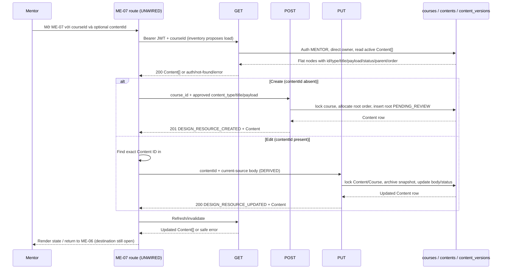

# ME-07 — Tạo/chỉnh sửa nội dung

> **Trạng thái DD:** `DD BLOCKED` — editor payload/type, order write, route mode and #51 request approval are unresolved.
> **Trạng thái triển khai:** `IMPLEMENTATION BLOCKED` — Study Web is `UNWIRED`; the mockup editor is a placeholder and current APIs do not persist every visible field.
> **Trạng thái runtime:** `RUNTIME NOT VERIFIED` — local API source and DDL artifacts do not verify Study Web, deployed APIs or live database.

## 1. Tổng quan màn hình

| Thuộc tính | Đặc tả |
|---|---|
| Screen ID / tên | ME-07 — Tạo/chỉnh sửa nội dung |
| Mục tiêu | Tạo Content mới hoặc sửa một Content đã tải trong course của Mentor; form chỉ được gửi khi data schema được duyệt. |
| Actor | Mentor. #49–#51 require Bearer JWT role `MENTOR`; current server code additionally requires direct course owner. |
| Route đề xuất | `/mentor/courses/:courseId/content/:contentId?`; route là inventory design, chưa có client router. Absent `contentId` candidate create mode; present ID candidate edit mode. |
| API đọc | GET `/api/v1/mentor/courses/{course_id}/content` (#49), returns collection `Content[]`, not a detail resource. |
| API create | POST `/api/v1/mentor/content` (#50), request requires `course_id`, `content_type`, `title`, `payload`. |
| API update | PUT `/api/v1/mentor/content/{content_id}` (#51), current source requires `content_type`, `title`, `payload`; body is not listed in the API catalog and API DD calls it DERIVED. |
| Màn hình liên quan | ME-06 ([cây nội dung DD](../ME-06_cay-noi-dung-khoa-hoc/ME-06.md)) opens the editor; ME-08 ([action mockup](../ME-08_xuat-ban-xoa-noi-dung/code.html)) handles publish/delete. |
| States trong inventory | `draft/dirty/validating/saving/conflict`; this DD adds loading/ready/empty/not-found/denied/saved/error to map current API outcomes. |
| Plan/ảnh chú thích | [ME-07_PLAN.md](./ME-07_PLAN.md), [screen_annotated.png](./screen_annotated.png), [ME-07_markers.json](./ME-07_markers.json), [SVG overlay](./ME-07_markers_overlay.svg). |

### Expected behavior

The inventory row [ME-07](../../../list_screen.md#L167) says editor fields follow `content_type/payload`, track dirty state, load with #49, create with #50 or update with #51, then refresh #49. AC-22 says Mentor must have course-management permission, reads the tree and chooses CRUD/publish/delete; its diagram represents five API branches (#49–#53). F08 orders ME-06 → ME-07 → ME-08 and says enable actions only when server confirms ownership/allowed transition.

### Current behavior

- The screenshot shows blank title/type/order controls and a placeholder editor marked “Đang chờ kết nối giao thức”; media input is visibly locked. “Lưu bản nháp” is disabled. Side panels show static data-quality/security text, a static “Đang đối soát” session status/progress, a promotional image and footer links.
- `code.html` contains 14 anchors (all `href="#"`), two inputs, one select, one disabled button and one image. There is no `<form>`, no custom event script, no fetch/XHR, no route binding and no API request. The two scripts are Tailwind config/loading only.
- The title has a visual required marker, but the input has no `required`/length rule. The select has sample options `theory`, `reading`, `practice`, but no `required` attribute. Order uses `type=number,min=1`. None of these controls has save/dirty validation logic.
- Study Web is `UNWIRED` in the current context and checkout; no runtime route, auth state, form state, cache or navigation is verified.

## 2. End-to-end flow and source trace

The diagram separates expected client choreography from current server behavior. The server routes/modules are local source, but the client lane and runtime are not wired.

### Read/hydrate: API #49

1. Route input is proposed `courseId:int64` and optional `contentId:int64`. Current route does not exist in Study Web. The inventory proposes GET #49 to find existing Content; if create mode also requires this fetch, that purpose is not specified beyond the course tree/context.
2. Route `GET /api/v1/mentor/courses/{course_id}/content` delegates to `get_course_contents`. Shared guard validates Bearer JWT and role `MENTOR` before DB. The handler parses signed int64; malformed/out-of-range course ID maps to 404.
3. Query `FIND_MENTOR_COURSE` reads `courses.id, mentor_id`. Missing course is 404; a principal other than `courses.mentor_id` is 403. AC-22 says “có quyền quản lý course”; current source has no assigned/co-owner relation.
4. Query `LIST_COURSE_CONTENTS` reads all nodes for that course with `deleted_at IS NULL`, ordered by `parent_id NULLS FIRST, content_order ASC, id ASC`. The response is a flat `Content[]`; there is no single-content detail endpoint in this screen’s inventory.
5. Current projection is `{id:int64, course_id:int64, content_type:string, title:string, payload:object, status:string, parent_id:int64|null, order:int32}`. It has no version field. The view validates mapping, same-course IDs, unique IDs, parents and cycles; invalid/DB projection returns safe 500 with rollback; no partial collection.
6. Empty collection is 200 `DESIGN_RESOURCE_RETRIEVED` with `data:[]`. The client should treat `contentId` absent as candidate create mode; if present, find exact ID in the collection and verify its `course_id` equals route `courseId`. Missing ID in result is an expected UI not-found state, not evidence of a new API status.

### Create: API #50 current source

| Request | Current contract |
|---|---|
| Method/path | `POST /api/v1/mentor/content` |
| Headers | `Authorization: Bearer <token>`; shared current-user guard requires role `MENTOR`. |
| Body | Strict `{course_id:int64, content_type:string, title:string, payload:object}`; extra fields forbidden. No `parent_id` or `order`. |
| Validation | Pydantic enforces presence/basic types and signed int64 for `course_id`; source does not validate content-type enum, payload subtype, title nonempty/length, or order. Framework/body validation maps to 422 `DESIGN_VALIDATION_ERROR`. |
| Success | 201 `DESIGN_RESOURCE_CREATED`; `data` is shared Content projection. |
| Errors | 401 auth; 403 role/course absent/direct-owner mismatch; 422 request validation; 500 safe DB/projection/commit failure. Missing course currently is not a 404 for #50. |

Current caller/callee/side effect: route in `app/api/v1.py` → `create_content` → auth guard → `LOCK_MENTOR_COURSE FOR UPDATE` → owner check → `NEXT_ROOT_CONTENT_ORDER` over active roots → `INSERT_CONTENT` with `parent_id=NULL`, generated order, and `status=PENDING_REVIEW` → projection validation → commit → success envelope. First root order is 0; concurrent creates serialize on course row. Any SQL/mapping/commit error rolls back safely. The request cannot place a node beneath a parent or choose the displayed order.

### Update: API #51 current source vs catalog

| Request | Current source | Catalog/approval |
|---|---|---|
| Method/path | `PUT /api/v1/mentor/content/{content_id}` | Same method/path. |
| Path | Raw content ID parsed as signed int64 in view; malformed/out-of-range → 404. | Catalog declares required int64 path. |
| Headers | Bearer JWT; role `MENTOR`. | Bearer JWT; Mentor. |
| Body | Strict full replacement `{content_type:string, title:string, payload:object}`; extra fields forbidden. | [Catalog #51](../../../../../../docs/lists/list_api.md#L161) records path only; no body schema. API DD labels body as DERIVED from #50 and not approved. |
| Success | 200 `DESIGN_RESOURCE_UPDATED`; returns shared Content projection. | `ApiEnvelope<Content>` and same code. |
| Errors | 401; missing/deleted ID 404; non-owner 403; framework body error 422; DB/snapshot/mapping/commit 500. No 409 branch or version precondition in current source. | Catalog lists 401/403/404/422/500, not 409. |

Current transaction: route → `update_content` → auth → parse ID → lock `contents` + `courses` → check direct owner → archive all current row fields in `content_versions` with `version_no=MAX+1` and `archived_by=mentor_id` → update `content_type/title/payload`, set current status `PENDING_REVIEW`, preserve `course_id/parent_id/content_order` → validate mapping → commit → response. `contents` current revision has no explicit version number, and response has no version token. The row lock serializes updates through this endpoint, but does not provide optimistic conflict detection or tell the editor that its local form was stale.

### Persistence / source status

- Checked-in legacy `DB.sql` defines `contents` and `content_versions`; migrations 006/007 define the same candidate tables. These are local artifacts only; no live database probe occurred. UUID V1-PILOT `content_blocks` is a different model and must not be substituted.
- Local route/module/test source exists for #49–#51. Test source covers auth, ownership, create order, #51 snapshot/update, body validation, rollback and OpenAPI. It was read/inspected, not executed. Fake DB tests do not prove PostgreSQL schema, migration rollout or deployed route.
- API DD [#50](../../../../../../apps/study-server/docs/dd/50_mentor_content_create/02_Overview.md) and [#51](../../../../../../apps/study-server/docs/dd/51_mentor_content_update/02_Overview.md) remain `Draft — Needs Confirmation`; #51 body, history model, lifecycle and identity are DERIVED/open.

## 3. Data mapping and field rules

### Form field mapping

| Field/UI | Create source | Edit source | Request/validation status |
|---|---|---|---|
| `courseId` route | From ME-06 route/context candidate | Same | #50 body requires `course_id`; #51 has no course field. Server derives content’s course for authorization. Route syntax/client parsing is not implemented. |
| `contentId` route | Absent → candidate create mode | Required for candidate edit mode | #49 collection must contain this exact ID and same route course before enabling edit. #51 path takes it; never submit it in body. |
| `title` | Blank form value | From `Content.title` | #50/#51 require a string. Blank/whitespace and max-length rules are not enforced by current model; screenshot indicates required but does not define normalization/limit. |
| `content_type` | Blank select | From `Content.content_type` | APIs require a string but leave it open. HTML option values `theory/reading/practice` are sample values without enum approval. |
| `payload` | No source UI value; must be a JSON object | Current `Content.payload` object from #49 | Required by #50/#51; subtype/schema/editor/asset URI rules are `OPEN`. Placeholder is not payload data. |
| `sort_order` UI / `order` response | #50 generates root order | #49 returns int32 `order`; #51 preserves current order | UI’s positive-number field cannot be written through #50/#51. Create starts at root order 0; reordering/update order needs contract/API. Disable or remove the editable field until approved. |
| `parent_id` | #50 always writes `NULL` | #51 preserves current value | Not in either mutation request. Cannot choose/change parent from this form. |
| `status` / “Lưu bản nháp” | #50 sets `PENDING_REVIEW` | #51 resets current row to `PENDING_REVIEW` | No status field in body. “Draft” label is not a current approved enum mapping. |
| `version` | No initial version returned | #51 writes a prior-state snapshot | No version number/current-version pointer in #49/#50/#51 response; no concurrency token. |

### Error and side-effect boundary

- Do not merge API #50 or #51 into one route. Select method using create/edit mode and `contentId`, then invalidate/reload #49 only after server success.
- Do not pass UI `sort_order`, `parent_id`, session progress, owner, status or version in either request; current Pydantic models forbid undeclared body fields.
- #50 success creates exactly one root Content with server-derived order/status. #51 success creates a version-history snapshot and changes current status/content. Both commit internally in current implementation and return one Content item.
- There is no idempotency key. If a POST times out after the server may have committed, automatic retry can create a duplicate root. A client must not blindly retry ambiguous create failures; the UI retry/resolution policy is open.
- #51’s row lock prevents simultaneous #51 transactions from updating at once but has no optimistic token/409. Do not show a server-backed `conflict` outcome as current behavior; any stale-form warning requires a version/concurrency contract.

## 4. Element specification — 31 markers

Source coordinates and labels are in [ME-07_markers.json](./ME-07_markers.json); every marker below maps one-to-one with the JSON, SVG and annotated image.

| # / Element ID | Name, type, position | Data, visibility, validation | Event/output |
|---:|---|---|---|
| 1 `ME07-EL-01` | Study2Work LMS Mentor logo/link; header left | Static brand; anchor `href="#"`. | EV-10; destination not wired. |
| 2 `ME07-EL-02` | Primary Mentor navigation group; header | Tổng quan, Khóa học phụ trách, Chấm bài, Hộp thư hỗ trợ, Thông báo; all destinations `#`. | EV-10; no route source. |
| 3 `ME07-EL-03` | Notification icon/link | Static icon/red dot; `href="#"`; no unread API/count. | EV-10. |
| 4 `ME07-EL-04` | Mentor name/role/avatar | “TS. Vũ Thành Đạt” and role are mockup text; no profile API in #49–#51. | No event handler; account menu is not present. |
| 5 `ME07-EL-05` | Breadcrumb: course list → course detail → content manager → current editor | All earlier segments are anchors `#`; course ID/name is not in #49 Content response. | EV-10; exact route/return context open. |
| 6 `ME07-EL-06` | Icon + “Hệ thống phân phối giáo trình số” kicker | Static page branding; no server field. | None. |
| 7 `ME07-EL-07` | H1 “Tạo và chỉnh sửa nội dung bài giảng” | Static title shared by create/edit screenshot; does not identify route mode. | Mode comes from route proposal, not this text. |
| 8 `ME07-EL-08` | “Chế độ kiểm duyệt: Khóa học chuẩn hóa” badge | Not returned by #49–#51; approved course moderation mode source not found in this flow. | Static only; do not gate API by badge. |
| 9 `ME07-EL-09` | Title text input `content_title` | Placeholder “Nhập tiêu đề phần hoặc bài học...”; screenshot marks required. HTML input has no `required`, max length, default or error text. API requires string but accepts no defined nonempty/length rules. | EV-03; dirty + candidate required validation; exact trim/length unresolved. |
| 10 `ME07-EL-10` | Content type select `content_type` | Placeholder + values `theory`, `reading`, `practice`; visual required mark but no `required` attr. API accepts an open string; enum/schema unconfirmed. | EV-04; not ready to submit as canonical type. |
| 11 `ME07-EL-11` | Number input `sort_order` | HTML `min=1`, no explicit step/max/required; label says positive integer. #49 maps `content_order` to int32 `order`; #50 generates root order from 0 and #51 preserves order. | EV-05; unsaved/incompatible field; block editing until API/UX decision. |
| 12 `ME07-EL-12` | “Nội dung chi tiết” label + “Đang chờ kết nối giao thức” state | Label is plain text, not associated with an editor control. Sync status is hardcoded; no sync endpoint. | EV-06; placeholder only. |
| 13 `ME07-EL-13` | Rich editor panel placeholder | Static icon/title/help text says editor formats are being aligned; no textarea/editor/input, payload serialization or autosave source. | No current input event; #50/#51 payload object remains blocked. |
| 14 `ME07-EL-14` | Locked multi-media entry note | Static lock icon/text; no upload widget, asset API or rule in ME-07 inventory. | No event; do not activate upload behavior here. |
| 15 `ME07-EL-15` | “Hủy thay đổi” anchor | `href="#"`; no dirty guard, destination or undo semantics. | EV-09; target ME-06 is a candidate, requires approved route/unsaved confirmation. |
| 16 `ME07-EL-16` | “Lưu bản nháp” button | `disabled` and `aria-disabled="true"` in HTML; title says permission validation in progress. No form/submit handler. | EV-07/EV-08 when enabled only after contract; current state is disabled. |
| 17 `ME07-EL-17` | “Quy chuẩn dữ liệu” side panel heading | Static section heading; not an API response. | None. |
| 18 `ME07-EL-18` | “Bảo mật hệ thống” callout | Copy claims save is limited to a properly authorized lecturer; #50/#51 use direct course owner. Copy is not authorization evidence. | Read-only note. |
| 19 `ME07-EL-19` | Title guideline row | Static suggestion to use a concise title; not a length rule or server validator. | None. |
| 20 `ME07-EL-20` | Resource-type guideline row | Static copy asks for matching resource type; no link between content type and payload is defined. | None. |
| 21 `ME07-EL-21` | Order guideline row | Static copy says order controls tree placement; current mutation endpoints do not accept/change it. | None; discrepancy with #50/#51. |
| 22 `ME07-EL-22` | Session-validation panel heading | Static “Trạng thái xác thực phiên”; no client session-validation source is present. | None. |
| 23 `ME07-EL-23` | “Đang đối soát” status badge | Hardcoded state, not returned by #49–#51 or a separate session API in this flow. | None; do not use as auth guard. |
| 24 `ME07-EL-24` | Progress bar | Static width `2/3`; no total/step value, role, `aria-valuenow` or server progress source. | None; not a verified authorization progress metric. |
| 25 `ME07-EL-25` | Rights/reconciliation explanatory text | Hardcoded claim about course-domain assignment and automatic permission after verification. Current APIs check direct owner per request. | Read-only; copy needs product/security approval. |
| 26 `ME07-EL-26` | Pedagogy promotional image | External/static image in HTML; not Content payload, not user/course data. HTML supplies `data-alt` rather than semantic `alt`. | No event. For implementation use an approved local/managed asset and meaningful alt or mark decorative. |
| 27 `ME07-EL-27` | “Không gian sư phạm” caption | Static marketing text, no API mapping. | No event. |
| 28 `ME07-EL-28` | Footer brand/legal text | Static copy; not form result. | No event. |
| 29 `ME07-EL-29` | Footer “Quy chế Giảng viên” link | `href="#"`; target not in source. | EV-10. |
| 30 `ME07-EL-30` | Footer “Tiêu chuẩn đánh giá” link | `href="#"`; target not in source. | EV-10. |
| 31 `ME07-EL-31` | Footer “Hỗ trợ kỹ thuật” link | `href="#"`; target not in source. | EV-10. |

## 5. Detailed event specification

### ME07-EV-01 — Resolve editor mode from route

- **Trigger:** open proposed ME-07 route.
- **Input:** `courseId` and optional `contentId` from path; Bearer session is required by the server APIs. No navigation state or loaded route exists in current Study Web.
- **Processing:** choose candidate create mode if `contentId` absent, edit mode if present; keep both IDs out of query-string secrets. API #50 needs course ID in body; #51 needs Content ID in path. The optional route syntax is from inventory only.
- **Output:** create form starts blank; edit form remains loading until #49 row is found. Exact entrypoints from ME-06 are not implemented.
- **Errors:** malformed IDs are eventually rejected by server paths (API #49 invalid course → 404; #51 invalid content ID → 404). Client route validation and user message are open.

### ME07-EV-02 — Load edit data with GET #49

- **Trigger:** route contains `contentId`; inventory proposes GET #49 to find existing Content. Create mode may also load #49 for course context; whether that extra fetch is required is unresolved.
- **Request:** `GET /api/v1/mentor/courses/{course_id}/content`, Bearer JWT, no body/query.
- **Steps:** auth role MENTOR → parse course int64 → direct-owner check → fetch every active Content row → validate flat projection/tree → return envelope. Client finds row where `data[].id == contentId` and confirms `course_id == route courseId` before populating title/type/payload; `order/status/parent_id` are preserved as read-only data unless field-write support is approved.
- **Success:** 200 `DESIGN_RESOURCE_RETRIEVED`; empty tree is 200 with `data:[]`. An edit ID absent from the collection becomes UI not-found. Do not invent a second detail API.
- **Errors:** 401; 403 role/owner; 404 bad/missing course; 500 DB/projection/tree failure. No partial collection. Cache policy, retry and loading feedback are not implemented.
- **Side effect:** none; #49 is read-only.

### ME07-EV-03 — Edit title

- **Trigger/input:** text input #9 `content_title` change.
- **Current markup:** input text field, no required/max-length/trim attribute or event logic.
- **Expected candidate:** store raw input in local form state and mark dirty; show validation only after title rule is approved. The visual star indicates required, and #50/#51 require the field to exist and be a string, but current server does not define nonempty, whitespace or length validation.
- **Output:** no request on keystroke; preserve unsaved text locally. On change/cancel/reload, unsaved-state policy requires explicit design.

### ME07-EV-04 — Choose content type

- **Trigger/input:** select #10 change; sample values `theory`, `reading`, `practice`.
- **Current:** no change handler; no server enum/payload correspondence.
- **Expected candidate:** set `content_type`, dirty state and select the matching subtype editor only after the allowed type list and payload schema are approved.
- **Output/error:** no API request on selection. Empty selection should not submit while visually required, but accepted values and validation code remain open; do not send these labels as a finalized enum by assumption.

### ME07-EV-05 — Change display order

- **Trigger/input:** numeric field #11.
- **Mockup rule:** `min=1`, label “Số nguyên dương”.
- **Current API:** #50 takes no order and allocates root order starting at 0; #51 does not take order and preserves current placement. #49 exposes `order:int32` only.
- **Output/status:** `BLOCKED`. Do not include `sort_order` in POST/PUT bodies (extra fields are forbidden). Decide whether to remove/disable the input, make it read-only, or add an approved reorder contract; do not silently coerce between 0-based and 1-based values.

### ME07-EV-06 — Enter detailed content/media

- **Trigger:** interact with panel #13 or locked note #14.
- **Current:** no contenteditable/textarea/upload control; the panel explicitly says it is waiting for protocol integration and locks media.
- **Expected:** a type-specific editor must serialize exactly one approved JSON object `payload` for #50/#51; media upload needs its own approved API/asset reference contract. No media API is part of ME-07’s inventory.
- **Output/status:** no current event/request; save cannot be enabled until payload schema/editor mapping exists. Do not send arbitrary HTML or infer Markdown/media keys.

### ME07-EV-07 — Create Content with POST #50

- **Trigger:** save action while in create mode. Current button is disabled; event is a contract candidate only.
- **Preconditions:** Mentor session, course access accepted by server, approved `content_type/title/payload`, valid `courseId`; agreed destination after create.
- **Request:** `POST /api/v1/mentor/content`; `Authorization: Bearer`; strict body `{course_id:int64, content_type:string, title:string, payload:object}`. No parent/order/status/version.
- **Processing:** Pydantic shape validation → MENTOR guard → lock course → compare numeric JWT principal to `courses.mentor_id` → compute next active root order (first 0) → insert Content root with `PENDING_REVIEW` → verify returned projection → commit.
- **Success:** HTTP 201 `DESIGN_RESOURCE_CREATED`, `data:Content`. Keep returned ID/type/title/payload/status/parent/order; inventory expects refresh/invalidate #49. Show a success state only after server success. Whether to stay in editor or return to ME-06 is not defined.
- **Errors:** 401 auth; 403 role, missing course or wrong direct owner; 422 body shape; 500 safe DB/mapping/commit error. The server has no idempotency key; do not auto-repeat an ambiguous network timeout, as a second POST may create a duplicate.
- **Side effect:** inserts one root; not an update of existing node.

### ME07-EV-08 — Update Content with PUT #51

- **Trigger:** save action while in edit mode with a current Content ID. Current button is disabled.
- **Preconditions:** #49 resolved exact row for the route course; user is Mentor owner; approved full-replacement body and payload schema; no server version token is available.
- **Request:** `PUT /api/v1/mentor/content/{content_id}`. Current-source body is `{content_type,title,payload}` and extra fields are rejected. This body is DERIVED and missing from catalog; do not declare it finalized until owner approval.
- **Processing:** auth → parse ID → lock current Content and Course → direct-owner check → insert prior state into `content_versions` with `version_no=MAX+1`/`archived_by` → update three body fields, set current status `PENDING_REVIEW`, retain course/parent/order → validate returned Content → commit.
- **Success:** HTTP 200 `DESIGN_RESOURCE_UPDATED` + Content, no `version` field. Refresh #49 per inventory; it returns current rows but cannot select an archived version.
- **Errors:** 401; malformed/missing/deleted ID 404; non-owner 403; invalid body 422; database/snapshot/update/mapping/commit 500. There is no 409/current-version check; stale forms are not detected by API source.
- **Side effect:** snapshot plus current-row update in one transaction. A PUT can reset a previously published current row to `PENDING_REVIEW`; public-reader behavior/version promotion remains an open lifecycle decision.

### ME07-EV-09 — Cancel unsaved work

- **Trigger:** click #15.
- **Current:** link targets `#`; no dirty-state handler or destination.
- **Candidate:** return to ME-06 with `courseId`, preserving no secret in URL. If dirty, show an accessible discard confirmation only after confirmation behavior/copy is decided. Never silently POST/PUT on cancel.
- **Output:** return destination and whether newly saved server state must be reloaded are open; no current runtime behavior.

### ME07-EV-10 — Header, breadcrumb and footer navigation

- **Trigger:** click #1–#5 or #29–#31.
- **Current:** all anchors are `href="#"`; profile is static. No notification/auth/profile/route handler exists.
- **Expected:** route map and course context must be bound from approved navigation contract; the current name/course/title sample does not provide `courseId`. These shell actions do not mutate Content.

### ME07-EV-11 — Render side panels and session message

- **Trigger:** screen render (elements #8, #17–#28).
- **Current:** mode label, data rules, “Đang đối soát”, two-thirds progress and image/caption are static. #49–#51 do not provide these values, status or progress.
- **Expected:** render policy text only when approved; never use a badge/progress bar as authorization. Server authorization remains the per-request MENTOR/direct-owner check. Use approved image source and semantic alt text; no event/API call is implied.

## 6. State, security and accessibility matrix

| State | Entry condition | Required UI behavior / evidence |
|---|---|---|
| `create-ready` | No `contentId`; course context available | Blank fields. Save remains disabled until body contract exists; source API can only create a root PENDING_REVIEW Content. |
| `edit-loading` | `contentId` present, #49 in flight | Do not show fixture values as loaded form data. |
| `ready` | #49 contains matching Content | Map current fields; preserve raw status/order/parent/ID. Payload editor is unavailable until subtype contract. |
| `empty` | #49 returns `data:[]` in create context | Treat as valid collection; edit mode resolves to not-found. |
| `dirty` | Any editable field changes | Client state candidate only; current static HTML has no dirty tracking. Cancel/discard behavior is open. |
| `validating` | User attempts save | Validate only approved field/type/payload rules; current client/server do not define all rules. |
| `saving-create` | POST #50 pending | Prevent repeat submit; no automatic retry after ambiguous timeout. |
| `saving-update` | PUT #51 pending | No version precondition; no server 409 conflict semantics. |
| `saved-await-refresh` | #50/#51 success before #49 refresh | Keep response visible; invalidate/reload #49 per inventory. Exact route destination open. |
| `denied` | 401/403 | Distinguish authentication from course ownership; no protected form/save action. Source authorization is direct owner, not assignment. |
| `not-found` | #49 course missing/invalid or edit ID not in result; #51 Content missing | Do not populate sample form; `#51` malformed/missing ID maps 404. |
| `validation-error` | #50/#51 body 422 | Keep local input where safe; field-level error contract and copy not defined. |
| `error` | API 500/network error | Show retry/leave state without claiming save succeeded. Safe backend error has no internal SQL details. |
| `conflict` | Inventory state only | Not source-backed: #51 has no version token/409. Do not claim conflict detection exists until API contract changes. |
| `current-mock-disabled` | Existing code.html | Save has `disabled` and `aria-disabled=true`; this is current static state, not an authorization result. |

Security and accessibility notes:

- Do not rely on `courseId`, UI badge or session-progress panel as access control; #50/#51 perform server checks, currently direct owner. Do not transmit JWT in query strings.
- Treat `payload` as untrusted JSON. Define subtype validation and safe rendering before allowing rich HTML, Markdown, asset URLs or external links.
- The editor header currently has no associated form control; future editor needs a programmatic label, keyboard support, focus order and validation/error association. Input controls should retain visible labels and focus state.
- Current `img` uses `data-alt` rather than `alt`; progress is a plain `div` without progressbar semantics/value. The mockup imports remote Plus Jakarta Sans while the Study Web guide says not to add remote font imports and targets responsive layout/visible focus/44px controls. These are design-source gaps, not runtime claims.

## 7. Discrepancies and decisions required

| Topic | Expected/mockup | Current evidence | Impact/status |
|---|---|---|---|
| Create vs edit route | Optional `contentId` route, shared editor title | No client router; screenshot has empty fields and does not reveal mode | Define distinct entry mode and data precondition. |
| Read before create | Inventory says GET #49 then create/update | #49 can list tree; #50 rechecks ownership; create does not need tree for order because server allocates it | Confirm whether #49 is always loaded or only in edit mode. |
| PUT body | Catalog path only | Code expects strict `{content_type,title,payload}`; API DD #51 says DERIVED/open | Update catalog and approve body before implementation. |
| Title | Mockup required star | API requires string presence but has no nonempty, whitespace or max-length rule | Define trim/length and field error behavior. |
| Type | Three select values | API type open string; no subtype models | Approve enum and each payload schema. |
| Display order | Positive order input and tree-placement guidance | #50 autogenerates root order from 0; #51 preserves order | Remove/disable field or add approved order API; do not send it to current routes. |
| Parent/sections | Text says position within chapter | #50 hardcodes root; #51 preserves parent | Child create/move unsupported by current APIs. |
| Detail editor/media | Rich editor and media area implied | Placeholder only; no asset endpoint in ME-07 inventory; payload shape open | Editor/payload and media flow block the primary screen action. |
| Save status | “Lưu bản nháp” | #50/#51 set `PENDING_REVIEW`; label/status lifecycle not approved | Confirm create/update status and whether save means draft or review submission. |
| Version/conflict | Inventory says `conflict`; AC says Content + version | #51 archives old row; response lacks version; no 409 | Define current revision/version selector and optimistic concurrency, or remove conflict promise. |
| Authorization | AC-22 says Mentor with course-management access | #49–#51 check direct `courses.mentor_id` | Confirm assignment/co-owner authorization; current UI copy overstates domain reconciliation. |
| Session badge/progress | “Đang đối soát”, 2/3 progress | No route/API data source | Remove or map to approved auth/session contract. |
| Live DB/runtime | Content tables exist in repository | DDL/migrations 006/007 local; live migration not verified; Study Web `UNWIRED` | No runtime/deployment claim. |

## 8. Acceptance criteria

1. `courseId` and optional `contentId` determine a documented create/edit mode; edit must locate an active matching row from #49 and must not confuse Content ID with lecture ID.
2. #49 fields map without fabricated data; all IDs/status/parent/order are preserved; version is reported as unavailable in the current response.
3. Create body contains exactly `course_id/content_type/title/payload`; edit uses only the source body when approved; no `sort_order`, `parent_id`, `status`, owner or version is added to current request bodies.
4. API responses are mapped precisely: #50 201 `DESIGN_RESOURCE_CREATED`; #51 200 `DESIGN_RESOURCE_UPDATED`; errors 401/403/404/422/500 as above. Empty collection, edit not-found, denied and network/server error have distinct UI states.
5. No save-success state before server success; no blind retry for ambiguous POST; #49 is refreshed after mutation per inventory; status/version effects are shown accurately.
6. All 31 marker IDs match one DD element and the image; every visible control has an event or explicit static/blocked state.
7. Study Web route/form, keyboard/accessibility/reflow, session handling, cache and deployed data are verified before `RUNTIME VERIFIED` is set.

## 9. Source references

- Inventory: [`list_screen.md` ME-07](../../../list_screen.md#L167); F08 at [§F08](../../../list_screen.md#L273).
- AC-22: `apps/study-server/docs/diagrams/AC_UNICA/AC_03_MENTOR_TEACHING.drawio` (`diagram id="AC22"`).
- Routes: `apps/study-server/app/api/v1.py` API #49–#51 route declarations.
- Current code: `apps/study-server/app/modules/mentor/api_49_mentor_content_list/{models.py,query.py,view.py,validate.py}`; `api_50_mentor_content_create/{models.py,query.py,view.py}`; `api_51_mentor_content_update/{models.py,query.py,view.py,validate.py}`.
- Focused test source: `apps/study-server/tests/modules/mentor/api_50_mentor_content_create/test_mentor_content_create.py`, `api_51_mentor_content_update/test_mentor_content_update.py` (inspected, not run).
- API DD: [#50 Overview](../../../../../../apps/study-server/docs/dd/50_mentor_content_create/02_Overview.md), [#50 open questions](../../../../../../apps/study-server/docs/dd/50_mentor_content_create/OPEN_QUESTIONS.md), [#51 Overview](../../../../../../apps/study-server/docs/dd/51_mentor_content_update/02_Overview.md), [#51 open questions](../../../../../../apps/study-server/docs/dd/51_mentor_content_update/OPEN_QUESTIONS.md).
- Persistence: `infra/postgres/study-server/DB.sql`, migrations `006_contents.sql` / `007_content_versions.sql`; live status unknown.
- Visual target: `.agents/web-study/design.md` is intended-only, not current client/runtime evidence.

