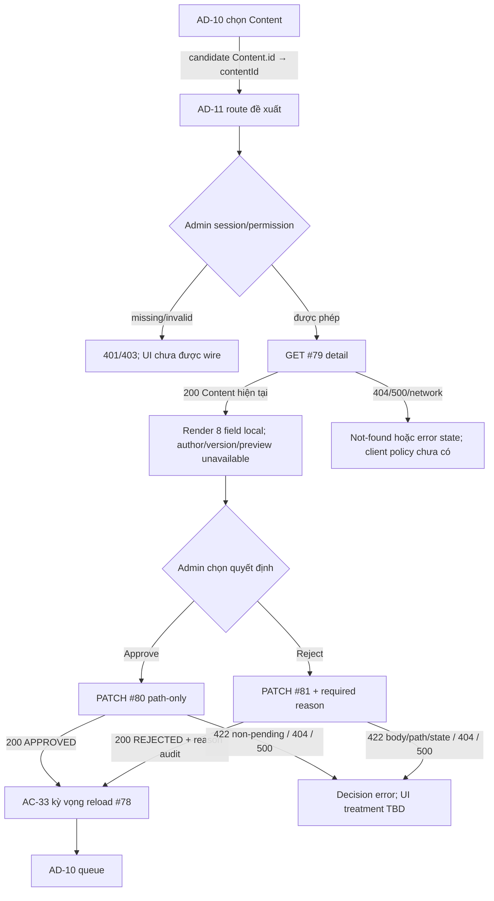

# AD-11 — Thẩm định và phê duyệt nội dung bài giảng

> **Detailed Design:** `DD BLOCKED` · **Implementation:** `IMPLEMENTATION BLOCKED` · **Study Web runtime:** `NOT VERIFIED` (`UNWIRED` trong checkout hiện tại)<br>
> **Screen:** AD-11 · **Actor expected:** Admin theo AC-33; moderation-specific permission chưa xác nhận · **Route đề xuất:** `/admin/content/:contentId/review` · **AC:** AC-33 · **APIs:** #79, #80, #81<br>
> **Assets:** [screen nguồn](./screen.png) · [screen có marker](./screen_annotated.png) · [marker map](./AD-11_markers.json) · [kế hoạch](./AD-11_PLAN.md) · [inventory](../../../list_screen.md)

## A. Tổng quan màn hình

### Expected behavior

Inventory row 69 mô tả AD-11 là màn hình thẩm định nội dung được chọn từ AD-10. Luồng AC-33 dự kiến lấy chi tiết qua #79, chọn một nhánh quyết định: #80 approve hoặc #81 reject với lý do, rồi làm mới queue #78. AC-33 gọi tới metadata tác giả/phiên bản; các quy tắc duyệt và publish cần được giải quyết trước khi UI/BE được triển khai.

API catalog `docs/lists/list_api.md` quy định:

| API | Request contract | Success | Catalog errors |
|---|---|---|---|
| #79 `GET /api/v1/admin/content/{content_id}` | Bearer/Admin; path `content_id:int64!`; không body/query | 200 `ApiEnvelope<Content>` | 401, 403, 404, 500 |
| #80 `PATCH /api/v1/admin/content/{content_id}/approve` | Bearer/Admin; path `content_id:int64!`; không body/query | 200 `ApiEnvelope<Content>` | 401, 403, 404, 422, 500 |
| #81 `PATCH /api/v1/admin/content/{content_id}/reject` | Bearer/Admin; path `content_id:int64!`; body `{reason:string!}` | 200 `ApiEnvelope<Content>` | 401, 403, 404, 422, 500 |

### Current behavior theo asset và source

- **Study Web:** checkout hiện không có editable `src`, package manifest, router hay API client cho Study Web; thư mục `dist` là artifact ignored và không chứng minh route/API caller. Không có runtime AD-11 đã được xác minh.
- **Prototype:** `code.html` là trang tĩnh. Back link, navigation và footer anchors dùng `href="#"`; notification không có handler. Approve/reject buttons disabled. Textarea `#review-comments` disabled. Không có form submission, fetch/XHR, URL API, media element, decoder, timer hay event handler ứng dụng.
- **Preview và metadata:** hiển thị “Chưa liên kết ID”, preview rỗng, title/author/course/date là `--`, Content ID `NULL`, version `N/A`. Đây là placeholder tĩnh, không phải response thật.
- **Decision panel:** trạng thái Khóa; copy giải thích policy ownership còn chờ đối soát. Label ghi reason “Tùy chọn”, trong khi catalog #81 yêu cầu có field `reason`. Button approve ghi “Phê duyệt xuất bản”; current #80 chỉ chuyển Content sang `APPROVED`, không `PUBLISHED`.
- **Rubric:** ba criterion được đánh dấu check, đồng thời progress ghi `0/3 tiêu chí được nạp`. Không có API/model/rubric state được tìm thấy trong flow này; coi đây là copy trình bày mẫu.
- **API #79 local source:** đọc active logical Content row và trả direct projection đúng tám field: `id`, `course_id`, `content_type`, `title`, object `payload`, `status`, nullable `parent_id`, `order`. Không có author, course title, submitted date, revision/version hay signed media locator. Detail không lọc trạng thái `PENDING_REVIEW` và không đọc `content_versions`.
- **API #80 local source:** shared `ADMIN` guard; khóa active Content row; chỉ cho phép `PENDING_REVIEW → APPROVED`; ghi một decision/audit candidate với actor JWT `sub`, trạng thái cũ/mới và reason `NULL`; commit sau khi response projection hợp lệ. Không ghi version, không phát notification, không publish.
- **API #81 local source:** strict JSON body `{reason:string}`; shared `ADMIN` guard; khóa active pending row; chuyển `PENDING_REVIEW → REJECTED`; ghi một decision row với actor, trạng thái cũ/mới và reason nguyên văn; response Content không trả reason. Empty string hiện được chấp nhận; không có trim/min/max/blank-only rule trong catalog/source.
- **Error behavior local:** #79 sai định dạng/overflow path → 404; missing/soft-deleted → 404. #80/#81 sai/overflow path → 422; missing/deleted → 404; current status khác pending → 422; query/update/audit/projection/commit error → safe 500 + rollback. #81 body schema errors xảy ra tại FastAPI trước khi handler chạy.
- **Persistence/auth limits:** Migration 011 là checked-in BIGINT audit candidate, không phải bằng chứng schema đã deploy. Legacy BIGINT `contents` và V1-PILOT UUID content/review model khác nhau; live DB chưa xác minh. Shared `ADMIN` không chứng minh moderation-specific permission. Local tests dùng fake DB và không xác nhận PostgreSQL hoặc live policy.

### Expected và current discrepancy

| Chủ đề | Expected / design | Current source/prototype | Trạng thái và ảnh hưởng |
|---|---|---|---|
| Trạng thái sau approve | AC-33 diagram node #9 ghi `APPROVED/PUBLISHED + audit`; mockup nói “phê duyệt xuất bản”. | #80 catalog/source chuyển sang `APPROVED`; Mentor #52 mới có nhánh riêng `APPROVED ↔ PUBLISHED`. | `DISCREPANCY`: không được hiển thị success như đã publish nếu chỉ gọi #80. Product owner phải chốt semantics/nội dung CTA. |
| Reason từ chối | #81 yêu cầu field `reason:string!`. | UI ghi “Tùy chọn” và textarea disabled; local schema cho phép empty string, giữ nguyên whitespace. | `DISCREPANCY`: form chưa thể đáp ứng contract; required/blank/length/copy chưa thống nhất. |
| Author/version và nội dung preview | AC #79 yêu cầu review metadata; preview cần render Content. | #79 chỉ có tám Content field, không author/version/course title/submitted time hoặc media URL. | `BLOCKER`: không dựng metadata, revision hoặc secure renderer từ placeholder. |
| Revision/stale item | Handoff queue → detail → decision cần nhất quán. | #79/#80/#81 chỉ dùng logical `content_id`; không request version/expected-row token; #79 không lọc pending. | `OPEN`: quyết định có thể tác động logical row hiện hành, không bảo đảm revision Admin vừa xem; stale behavior chưa có 409 contract. |
| Permission | AC actor Admin. | Current APIs kiểm tra role `ADMIN`. | Shared role chưa chứng minh permission kiểm duyệt cụ thể; owner cần chốt scope. |
| Audit/schema | AC yêu cầu audit decision. | #80/#81 dùng migration 011 như local candidate; fake DB tests. | `DERIVED`; live schema, migration deployment, grants và retention/access chưa xác minh. |
| Rubric/renderer/runtime | Mockup thể hiện rubric và secure player. | Không có nguồn rubric/renderer hay frontend route/client. | `UNWIRED`; không có runtime evidence hoặc scoring/publish gate. |

### Tác nhân, điều kiện vào và dữ liệu sở hữu

- **Actor expected:** Admin theo AC-33/catalog. Request phải có Bearer JWT với role `ADMIN` theo current source. Không suy ra vai trò này cho phép mọi hành động moderation.
- **Điều kiện vào expected:** AD-10 chọn một Content pending, chuyển `Content.id` số nguyên tới path `content_id`, và route nhận diện Screen ID. Inventory route là đề xuất; frontend hiện chưa wire. #79 local có thể trả một Content active ở status bất kỳ.
- **Dữ liệu canonical local:** #79 `data` là Content hiện tại, các field mapping nằm trong C. `payload` là object nhưng không có media-specific schema/URL trong response contract dùng ở màn này.
- **Dữ liệu không có:** author identity/display name, course name, submitted timestamp, review version, audit history, preview token/asset URL, rubric, rubric result, ownership grant hay moderator permission details.
- **Source of truth:** AC/index + API catalog cho expected flow; direct router/modules/query/models/tests cho current local behavior; screenshot/HTML chỉ cho presentation. API DD #79–#81 đều còn Draft/Needs Confirmation.

## B. Luồng tổng quát



Luồng trên tách **expected navigation** khỏi **current endpoint evidence**. Chưa có client để xác minh route guards, selection handoff, form state, disabled-state release, success notification, query preservation, cache invalidation hay queue refresh.

### Source trace

```text
Expected: AD-10 #78 item → Content.id → AD-11 contentId → GET #79
          → PATCH #80 OR PATCH #81(reason) → reload AD-10/#78 (AC-33)
Current: no Study Web caller; #79 reads active Content row → direct Content;
         #80 PENDING_REVIEW→APPROVED + audit; #81 PENDING_REVIEW→REJECTED
         + reason-bearing audit row. No revision token connects read to mutation.
```

Nguồn chính: [inventory](../../../list_screen.md), [API catalog](../../../../../../docs/lists/list_api.md), [AC-33 diagram](../../../../../study-server/docs/diagrams/AC_UNICA/AC_04_ADMIN_MANAGEMENT.drawio), [router #79–#81](../../../../../study-server/app/api/v1.py), [#79 module](../../../../../study-server/app/modules/admin/api_79_admin_content_detail/), [#80 module](../../../../../study-server/app/modules/admin/api_80_admin_content_approve/), [#81 module](../../../../../study-server/app/modules/admin/api_81_admin_content_reject/).

## C. Thuộc tính từng phần tử

| # | Thành phần / vị trí trên ảnh nguồn (px) | Current asset/source | Trạng thái / dữ liệu | Sự kiện |
|---:|---|---|---|---|
| 1 | Brand Study2Work Admin, `(55,35)` | Logo/wordmark viết trong HTML. | Tĩnh; không chứng minh tenant/role. | EV-08 |
| 2 | Nav “Tổng quan”, `(350,35)` | Anchor `href="#"`. | Không có route handler. | EV-08 |
| 3 | Nav “Người dùng”, `(480,35)` | Anchor `href="#"`. | Không điều hướng. | EV-08 |
| 4 | Nav “Khóa học & Nội dung”, `(648,35)` | Anchor `href="#"`. | Tĩnh. | EV-08 |
| 5 | Nav “Kiểm duyệt” active, `(828,35)` | Active styling; anchor hash. | Không chứng minh route hiện hành. | EV-08 |
| 6 | Nav “Báo cáo”, `(945,35)` | Anchor `href="#"`. | Không có destination. | EV-08 |
| 7 | `SYSTEM NORMAL`, `(1135,35)` | Static status badge. | Không health API/monitoring evidence. | EV-08 |
| 8 | Notification bell, `(1255,35)` | Button không handler. | Không unread count/read API. | EV-08 |
| 9 | Admin identity/avatar, `(1520,35)` | Text/avatar tĩnh. | Không lấy từ JWT/profile. | EV-08 |
| 10 | Breadcrumb hệ thống, `(510,92)` | Breadcrumb shell tĩnh. | Không route state. | EV-08 |
| 11 | “Chuẩn xác thực RBAC”, `(1338,92)` | Static copy. | Không chứng minh auth/RBAC enforcement. | EV-08 |
| 12 | Breadcrumb “Kiểm duyệt đào tạo”, `(80,195)` | Breadcrumb text. | Không handler. | EV-08 |
| 13 | Breadcrumb “Hàng đợi chờ duyệt”, `(690,172)` | Breadcrumb text. | Hướng về AD-10 nhưng chưa có URL. | EV-08 |
| 14 | Crumb “Thẩm định nội dung”, `(550,195)` | Current-page chip tĩnh. | Không route source. | EV-08 |
| 15 | Back “Quay lại hàng đợi… (AD-10)”, `(1548,172)` | Anchor `href="#"`. | Không truyền filter/page/history. | EV-08 |
| 16 | Kicker “Cổng kiểm định chất lượng đào tạo”, `(365,238)` | Static text. | Không có moderation service/status source. | EV-08 |
| 17 | H1 “Thẩm định và phê duyệt nội dung bài giảng”, `(790,276)` | Static title. | Presentation only. | EV-08 |
| 18 | Subtitle mô tả preview/quyết định xuất bản, `(970,319)` | Static text. | “Xuất bản” vượt hành vi #80 local. | EV-08 |
| 19 | Lock-control icon, `(1165,301)` | Decorative icon. | Không phải state/API result. | EV-08 |
| 20 | “Cổng phê duyệt đang khóa (API #79/#80)”, `(1510,321)` | Static badge/copy. | Không có server gate response; ownership policy claim chưa có source. | EV-08 |
| 21 | Preview card title, `(520,403)` | Static header. | Chưa có preview caller/renderer. | EV-02 |
| 22 | Badge “Chưa liên kết ID”, `(1000,403)` | Static empty-state label. | Không bind route param. | EV-01 |
| 23 | Empty preview media/document icon, `(610,580)` | Decorative Material icon. | Không có `<video>`, iframe hoặc document renderer. | EV-02 |
| 24 | Empty heading, `(770,677)` | “Chưa có nội dung thẩm định được chọn”. | Static; AD-10 selection chưa được nối. | EV-01 |
| 25 | Instruction chọn item từ AD-10, `(850,722)` | Static paragraph. | Không handoff/click action. | EV-01 |
| 26 | Claim secure video + SCORM/PDF decoder, `(930,800)` | Static info strip. | Không source cho secure media, decoder hay `contentId` initialization. | EV-02 |
| 27 | Metadata card heading, `(750,967)` | “Thông tin xuất bản & Bản quyền”. | Static section. | EV-03 |
| 28 | Content title field, `(475,1080)` | Label + `--`. | #79 `data.title` available when populated; no current binding. | EV-03 |
| 29 | Author/lecturer field, `(985,1080)` | Label + `--`. | Không có author field/lookup trong #79. | EV-03 |
| 30 | Course field, `(475,1164)` | Label + `--`. | #79 có `course_id`; không có course name. | EV-03 |
| 31 | Submitted date field, `(985,1164)` | Label + `--`. | Không có submitted timestamp trong #79. | EV-03 |
| 32 | Content ID `NULL`, `(550,1238)` | Static string. | #79 trả `data.id:int64`; NULL không phải server value evidence. | EV-03 |
| 33 | Review version `N/A`, `(1000,1250)` | Static string. | #79 không trả version/revision ID. | EV-03 |
| 34 | Decision card heading, `(1395,403)` | Static “Quyết định kiểm duyệt”. | Chưa có form state. | EV-04–EV-06 |
| 35 | Badge “Khóa”, `(1508,420)` | Static badge. | Disabled controls được ghi trong HTML; không có policy API. | EV-04–EV-06 |
| 36 | Reason label + “Tùy chọn”, `(1068,481)` | Static `<label>`. | Conflicts with #81 required body field. | EV-04 |
| 37 | `#review-comments` textarea, disabled, `(1508,560)` | `rows=4`, placeholder copy, no `name`/validation. | Không nhận input; length/trim policy chưa có. | EV-04 |
| 38 | Ownership-policy warning, `(1508,702)` | Static alert copy. | Không có policy endpoint/authorization detail. | EV-04–EV-06 |
| 39 | Approve button, `(1508,811)` | Disabled button; label “Phê duyệt xuất bản”. | #80 path-only; source target `APPROVED`, không publish. | EV-05 |
| 40 | Reject/request-changes button, `(1508,876)` | Disabled button; label gộp “Từ chối / Yêu cầu chỉnh sửa”. | #81 chỉ định `REJECTED`; không phân biệt request-revision. | EV-06 |
| 41 | “Quy trình 3 bước … (API #81)”, `(1508,936)` | Static copy. | API #81 là endpoint decision; không có workflow orchestration evidence. | EV-06 |
| 42 | Rubric heading, `(1390,1054)` | “Tiêu chí đánh giá chuẩn”. | Tĩnh, không rubric source. | EV-07 |
| 43 | “Rubric v2” badge, `(1508,1054)` | Static version label. | Không rubric version API/config. | EV-07 |
| 44 | Criterion copyright, `(1067,1150)` | Static checked criterion + explanatory text. | Không evidence review result/policy. | EV-07 |
| 45 | Criterion video resolution, `(1067,1275)` | Static checked Full HD/stereo statement. | Không có media metadata/validation source. | EV-07 |
| 46 | Criterion practice materials, `(1067,1380)` | Static checked materials statement. | Không có rubric data source. | EV-07 |
| 47 | “0/3 tiêu chí được nạp” progress, `(1508,1457)` | Static counter/progress bar. | Contradicts three checked criteria; no dynamic loading. | EV-07 |
| 48 | Footer copyright/privacy/RBAC/support, `(1548,1550)` | Footer text and `href="#"` links. | Static; destinations unimplemented. | EV-08 |

## D. Đặc tả chi tiết từng sự kiện

### EV-01 — Vào detail và tải Content

- **Trigger:** route entry bằng AD-10 selection hoặc browser reload; candidate route `/admin/content/:contentId/review`.
- **Input:** numeric `Content.id` → `contentId` route param → path `content_id:int64!` cho #79. Không truyền author/version vì #78 không cung cấp; không tạo query/body ngoài catalog.
- **Expected sequence:** Admin mở item từ queue; GET #79; nhận Content; sau một decision thành công AC-33 dự kiến refresh #78. Quy tắc giữ filter/page/back link chưa được duyệt.
- **Current #79 processing:** shared Bearer/JWT `ADMIN` validation chạy trước parse path và DB. Signed-int64 path invalid/overflow hiện map 404 (catalog mapping); query active row bằng bind parameter. Response mapping kiểm tra đúng requested ID và Content shape. Không filter `PENDING_REVIEW`; không đọc `content_versions`; không commit/mutate.
- **Response:** 200 `ApiEnvelope<Content>` với direct `data`; các field đúng theo `ContentResponse`: `id`, `course_id`, `content_type`, `title`, object `payload`, `status`, nullable `parent_id`, `order`. Không `items`/pagination.
- **Errors/current boundary:** 401 unauthenticated, 403 role denied, 404 invalid/missing/soft-deleted, 500 query/mapping failure (safe envelope + rollback). Network/timeout behavior chưa có client source. Route #78 static được đăng ký trước dynamic #79; local test source có coverage route precedence.
- **State mapping:** valid response có thể cấp dữ liệu Content vào `ready`, nhưng không thể lấp metadata author/version hoặc preview. 404/malformed ID cần not-found/error state; exact UI copy/redirect chưa được định nghĩa.

### EV-02 — Render preview

- **Trigger:** #79 success và `data.payload` có dữ liệu; marker #21–#26.
- **Current behavior:** preview luôn ở empty-state prototype; không `<video>`, iframe, fetch, signed URL, file/object-storage endpoint, SCORM/PDF package parser hay route param binding.
- **API boundary:** #79 chỉ cam kết object `payload` qua Content response; không được suy ra schema media, asset locator, authorization, expiry, sandboxing, decoder hoặc Content-Disposition. Không render HTML trong payload như trusted content.
- **Output:** current UI giữ placeholder; expected behavior phải có payload schema và secure preview contract trước implementation. Loading/failure/unsupported content states chưa được chốt.

### EV-03 — Hiển thị metadata

- **Trigger:** map `data` từ #79 vào preview metadata và field cards #28–#33.
- **Mapping được hỗ trợ:** `data.id` → Content ID; `data.title` → title; `data.course_id` → numeric course ID; `data.content_type` → type nếu UI cần; `data.status` → current logical status; `data.payload`, `data.parent_id`, `data.order` thuộc Content model nhưng screenshot không có field rõ để trình bày.
- **Không mapping:** author/lecturer name, course title, submitted date, review version/revision, rubric status. Không dùng `archived_by` hoặc current user làm author; không lấy timestamp từ file hay audit candidate để giả submitted date.
- **Empty/NULL:** screenshot text `NULL`/`N/A` là literal static; không đại diện null values từ API. Nullable `parent_id` không phải Content ID. API #79 đọc active row có thể trả status không pending; client chưa có status gate.

### EV-04 — Nhập lý do từ chối

- **Trigger:** Admin focus/typing vào #37; current textarea `disabled`.
- **Input contract #81:** JSON `{ "reason": string }`; field required theo API catalog. Current Pydantic model strict `str`, `extra="forbid"`; FastAPI body validation chạy trước view auth. Thiếu field, sai kiểu hoặc extra field trả 422.
- **Current prototype:** không nhập được; label ghi “Tùy chọn”. Đây là discrepancy cần sửa sau khi contract owner chốt required/blank rule.
- **Current source semantics:** empty string được chấp nhận và preserved đúng nguyên văn; không trim, không min/max, không blank-only rule. Không tự thêm client validation/char counter/required policy mới. Catalog không định nghĩa độ dài, reason code, plain-text/HTML rules hay localization.
- **Future event boundary:** #81 chỉ gọi khi Admin xác nhận reject sau form data được phép nhập; giữ nguyên reason string khi gửi trừ khi approved contract đổi. Chống double click/in-flight state, dirty state, confirm dialog, reason validation feedback và focus behavior cần design/implementation decision.

### EV-05 — Approve

- **Trigger:** click #39 sau khi owner policy mở khóa. Hiện button disabled; không có JS handler.
- **Request:** `PATCH /api/v1/admin/content/{content_id}/approve`, Bearer/Admin, numeric signed-int64 path; không body, không query. Không gửi `reason`, `status`, version ID, expected version hay idempotency key ngoài contract.
- **Current server processing:** shared `ADMIN` auth → path validation (#80 malformed/overflow→422) → lock active row → require current status `PENDING_REVIEW` → update sang `APPROVED` → validate direct Content projection → append one audit row with JWT numeric `sub`, previous/new status, `reason=NULL` → commit. Error pada query/update/audit/projection/commit rolls back and returns safe 500; missing/deleted 404; non-pending 422.
- **Response/output:** HTTP 200 `ApiEnvelope<Content>`; direct eight-field Content. AC-33 diagram says `APPROVED/PUBLISHED`; local #80 writes only `APPROVED`. Mentor #52 separately changes `APPROVED ↔ PUBLISHED` under Mentor/course-owner path. Do not report published on #80 success or silently call #52 from Admin UI.
- **Concurrency/retry:** lock protects current row at call time; #79 and #80 have no shared revision token. After successful transition, retry may return 422 because status is no longer pending; API has no idempotency contract. Client retry policy and stale message open.
- **Post-success:** AC-33 expects queue reload. Whether AD-11 stays, returns to AD-10, or preserves filters/history is not source-backed.

### EV-06 — Reject / request changes

- **Trigger:** click #40 after valid required `reason`; currently disabled. “Request changes” and “Reject” are visually one control.
- **Request:** `PATCH /api/v1/admin/content/{content_id}/reject`, Bearer/Admin, path `content_id:int64!`, strict JSON `{reason:string!}`; no other request fields.
- **Current processing:** FastAPI validates JSON model before view; for a valid body shared `ADMIN` auth runs before raw path parsing/DB. Path invalid/overflow→422; active row lock; require `PENDING_REVIEW`; update to `REJECTED`; insert one reason-bearing `content_review_audit_logs` candidate row with numeric JWT `sub`, old/new status and exact body reason; validate direct Content response; commit. Missing/deleted→404; non-pending→422; query/update/decision/projection/commit failure→safe 500 + rollback.
- **Response/output:** 200 `ApiEnvelope<Content>` with Content projection; response does not return reason. Audit physical mapping to migration 011 and pending-state gate are DERIVED; live schema/deployment unverified. #78’s local pending filter will exclude the now rejected row on reload, but AC/catalog queue cardinality still differs from local Page behavior.
- **Semantics:** API represents `REJECTED`, not a separate “revision requested” state. No notification/mentor inbox/correction workflow exists in #81 contract. Do not promise that the author is notified or can resubmit as an effect of this endpoint.
- **Retry/stale:** no revision token/idempotency key; current logical row is evaluated at mutation time. Repeat after success may return 422. UX for 404/422 conflict and preserving entered reason is undecided.

### EV-07 — Rubric evaluation

- **Trigger:** view criteria #44–#47; no user-triggered interaction exists in HTML.
- **Current UI:** three check icons appear selected, while progress says `0/3 tiêu chí được nạp`; bar is static. No rubric fetch, state model, score, checkbox semantics or handler.
- **API boundary:** #79–#81 do not return rubric, criterion result or quality score. No evidence that these criteria are a required approval gate or that Full HD/stereo is an approved rule for every Content type.
- **Outcome:** treat labels as prototype copy, not verified checks. Before implementation decide whether rubric is informational or decision-enforcing, source/version, criterion applicability by `content_type`, authoring/edit permissions and what progress means. Do not block/allow approval based on static ticks.

### EV-08 — Shell, status copy, back and footer navigation

- **Trigger:** shell/breadcrumb/back/notification/footer link click, or display of status badges #7/#11/#16/#20.
- **Current behavior:** five top nav links, back link and footer anchors use `href="#"`; notification has no handler. Breadcrumb/status/RBAC/portal copy is static; no monitoring/auth/rubric/support call.
- **AC navigation:** AC-33 expects queue reload after successful decision, and inventory links AD-11 back to AD-10. Exact success route, history/back fallback, query preservation, focus return, refresh/cache behavior and browser refresh/deep-link behavior remain unspecified/unwired.
- **Errors:** 401/403 route treatment (login vs access denied), session refresh, unauthorized button gating, network retry, trace display and return-to-queue timing have no Study Web source. Do not infer from visible RBAC badge.

## E. Ma trận trạng thái và điều hướng

| State | Điều kiện | UI/data cần biểu diễn | Chuyển tiếp / giới hạn |
|---|---|---|---|
| `UNWIRED` | Current checkout thiếu Study Web source/router/client. | Chỉ có prototype static; không có request/runtime. | Current status. Runtime state chỉ được xác nhận sau khi frontend wire và verify riêng. |
| `loading-detail` | Route hợp lệ, GET #79 pending (target). | Loading shell/content; không hiển thị metadata cũ của Content khác. | 200→`ready`; auth/not-found/service error→error state. Client chưa wire. |
| `ready` | #79 trả Content shape hợp lệ. | Hiển thị field được hỗ trợ; author/version/preview unavailable cho tới khi có contract. | Approve→`approving`; reject form→`rejecting`; back action chưa route. |
| `preview-unavailable` | Payload không có schema/asset access contract. | Giữ placeholder/error có thông tin; không khẳng định secure renderer đã chạy. | Recovery behavior/content-type copy cần chốt. |
| `approving` | mutation action đang gọi PATCH #80 (bodyless). | Disable duplicate submit; preserve current item context. | 200→`decision-success`; 401/403/404/422/500/network→error state. Pending UI chưa có. |
| `rejecting` | Required reason đã nhập và PATCH #81 đang chạy. | Disable duplicate submit; body string exact; không clear reason khi lỗi nếu policy duyệt. | 200→`decision-success`; body/path/status 422, 401/403,404,500/network→error state. |
| `decision-success` | #80 200 status APPROVED hoặc #81 200 status REJECTED. | Show returned Content/status accurately; do not call #80 “published”. | AC-33 expects queue reload; route/cache behavior TBD. |
| `not-found/deleted` | #79 404; current source treats missing/tombstone alike. | Message and return path TBD; do not reveal deleted-row details. | Return AD-10/history semantics TBD. |
| `stale-or-not-pending` | #80/#81 422 non-pending, or resource was deleted. | Could represent changed/previously reviewed Content; exact cause/status payload is not guaranteed by screen contract. | Reload detail/queue vs conflict message TBD; no stale revision 409 exists. |
| `unauthorized` | 401 from auth helper. | Session/login flow not specified here. | Do not retry mutations automatically; auth-interceptor behavior not verified for Study Web. |
| `forbidden` | 403 shared role or future moderation authorization. | Access denied state; details must not expose policy internals. | Route/back behavior TBD. |
| `validation-error` | 422 #80 path/state, #81 body/path/state. | Correct field only for known #81 body validation; state/path cause is not reliably classified by current UI contract. | Preserve input where safe; exact mapping/codes require contract review. |
| `service/network-error` | 500 or transport failure. | Safe message; trace ID policy belongs to app-wide client convention. | Manual retry and mutation-uncertain handling TBD; no idempotency key. |

### Điều hướng và dữ liệu handoff

| Từ | Hành động | Đến | Data | Bằng chứng |
|---|---|---|---|---|
| AD-10 | Chọn một pending Content | AD-11 `/admin/content/:contentId/review` | Candidate `Content.id:int64` → `contentId`; không version | Inventory + AC-33 expected; current route/click absent. |
| AD-11 | Load detail | #79 | `content_id` path | Catalog + local route; local detail does not require pending status. |
| AD-11 | Approve | #80 | `content_id`; bodyless | Catalog/source. Local result `APPROVED`; not publish. |
| AD-11 | Reject | #81 | `content_id`, `reason:string` | Catalog/source. Local result `REJECTED`; no revision-request distinction. |
| AD-11 | Decision success | Reload AD-10/#78 | Current filters/page should be considered; no approved preservation rule | AC-33 expected; client not wired. |
| AD-11 | Back/browser history | AD-10 candidate | Potential Content ID, prior queue URL/filter/page | Mock link is `#`; no behavior source. |

Deep link with malformed/missing route param, empty detail, reload, queue return state, scroll/focus restoration, unsaved reason confirmation, action duplication, and permission redirect remain implementation decisions. Do not add a frontend flow until response cardinality, revision identity, permission and decision-state rules are resolved.

## F. Tiêu chí nghiệm thu và blockers

- [x] Giữ nguyên `screen.png` và `code.html`; có plan được tạo trước marker/DD.
- [x] Annotated PNG 2× từ ảnh gốc; 48 JSON/SVG markers ordered, unique và in-bounds.
- [x] Phần C có một hàng duy nhất cho từng marker #1–#48.
- [x] Expected AC/catalog và current prototype/server source được tách riêng.
- [x] EV-01…EV-08 có trigger, input, processing, output/error và source boundary.
- [x] Mô tả #79 direct eight-field Content; #80 `APPROVED`; #81 `REJECTED`/reason; auth/error/transaction behavior; không gán publish hoặc renderer không có nguồn.
- [x] Có state matrix, handoff AD-10/#78 và unresolved navigation/revision behavior.
- [ ] Owner đồng bộ AC `APPROVED/PUBLISHED` với #80 `APPROVED` và quyết định semantics CTA/publish owner.
- [ ] Owner đồng bộ reason required/empty/whitespace/length/format với UI; mở textarea sau khi policy duyệt.
- [ ] Quyết định source cho author, course title, submitted date, version/revision identity; xác định stale/deleted state và decision concurrency.
- [ ] Quyết định moderation-specific permission; xác nhận live schema/migration 011, grants và retention/access.
- [ ] Cung cấp Content payload/media preview contract và secure renderer nếu còn yêu cầu; xác nhận rubric source/version/applicability/result semantics.
- [ ] Wire Study Web route/API/auth/UI; chốt loading/error/duplicate-submit/retry/success navigation và #78 refresh policy.
- [ ] Reconcile queue/#79/#80/#81 identity và ensure displayed revision is decision revision, hoặc phê duyệt rõ current-logical-row semantics.

**Trạng thái hiện tại:** `DD BLOCKED` · `IMPLEMENTATION BLOCKED` · `RUNTIME NOT VERIFIED`. Route/modules/test source của #79–#81 tồn tại local và được inventory đánh dấu `R`; API DD vẫn Draft. Test files được đọc làm source evidence nhưng không chạy trong phiên này. Fake DB tests không chứng minh live PostgreSQL/schema/deployment/authorization policy.
