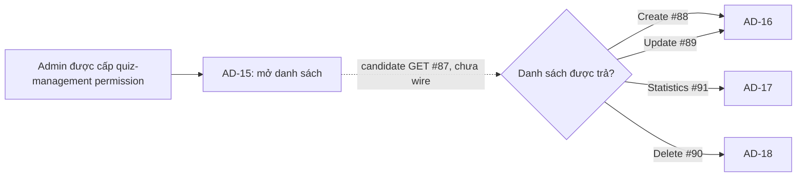

# AD-15 — Danh sách bài kiểm tra

> **Screen:** AD-15 · **Actor theo thiết kế:** Admin có quyền quản lý quiz theo AC-35 · **Route đề xuất:** `/admin/quizzes` · **API chính:** #87 · **Liên quan:** AD-16 tạo/sửa, AD-17 thống kê, AD-18 xác nhận xóa. 
> **Trạng thái màn hình:** `DD BLOCKED` · `IMPLEMENTATION BLOCKED` · `RUNTIME NOT VERIFIED` · **API source:** route/module/query/model/test source #87 có trong checkout; API DD còn Draft; live schema/deployment chưa xác minh. 
> **Tài sản:** [ảnh nguồn](./screen.png) · [ảnh đánh số](./screen_annotated.png) · [bản đồ marker](./AD-15_markers.json) · [kế hoạch](./AD-15_PLAN.md) · [inventory](../../../list_screen.md)

## A. Tổng quan màn hình

### Mục tiêu và trạng thái chứng cứ

AD-15 là trang quản trị danh sách bài kiểm tra, dự kiến giúp Admin lọc danh sách theo khóa/trạng thái, mở AD-16 để tạo hoặc chỉnh sửa, AD-17 để xem thống kê, và AD-18 để xác nhận xóa. Inventory đề xuất `/admin/quizzes`; đây chưa phải route đã được xác minh trong Study Web.

| Thuộc tính | Expected behavior | Current evidence |
|---|---|---|
| Actor/quyền | Admin có `quiz management permission` theo AC-35. | Local API #87 chỉ kiểm tra role `ADMIN`; chưa có policy source cho permission riêng. |
| Route | `/admin/quizzes` theo inventory. | Study Web hiện không có editable source/router/API client; route chưa được wire (`UNWIRED`). |
| Dữ liệu danh sách | Quiz theo khóa học/trạng thái; AC-35 gọi #87 trước khi chọn thao tác. | Catalog #87 khai báo `ApiEnvelope<Quiz>`; local source trả `ApiEnvelope<Page<Quiz>>` với metadata hạn chế. |
| Tìm/lọc/phân trang | Prototype có ô tìm, khóa học, trạng thái và trang. | Search không có trong #87; course option là slug nhưng API nhận `int64`; status option chưa có mapping; local page cố định size 20. |
| Handoff | Create/Update → AD-16 (#88/#89), Statistics → AD-17 (#91), Delete → AD-18 (#90). | Đây là luồng AC-35/danh mục. Các thao tác không hiện trên ảnh empty state và chưa có client handler. |
| Trạng thái triển khai | Tài liệu có thể mô tả contract candidate và chặn rõ chỗ thiếu. | Source UI không có; không có runtime evidence cho màn hình. |

### API #87 — contract đối chiếu

| Thành phần | Catalog/API DD trực tiếp | Local source #87 | Quyết định cho AD-15 |
|---|---|---|---|
| Request | `GET /api/v1/admin/quizzes`; Bearer JWT/Admin; query tùy chọn `course:int64`, `status:string`, `page:int32`; không body. | Route chuyển raw query đến module. Shared `ADMIN` guard chạy trước query validation và truy vấn DB. | Chỉ các query có nguồn và mapping được owner xác nhận mới được gửi. Không tự thêm search/code/size/sort. |
| Response | Catalog khai báo `ApiEnvelope<Quiz>`; API DD #87 còn `Draft — Needs Confirmation`. | Envelope thành công gồm `success`, `businessCode`, `message`, `data`, `meta`, `traceId`; `data` là `Page<Quiz>` với `items` và `pagination`. `businessCode=DESIGN_RESOURCE_RETRIEVED`; message phụ thuộc có item hay rỗng. | Cardinality catalog/AC và source chưa thống nhất; client không được chốt mapping list trước khi có quyết định. |
| Local query | Không nêu page size/default/order hay status enum trong catalog. | `course` là signed int64; `page` signed int32 >=1, mặc định 1; `status` giữ nguyên chuỗi; count và list dùng cùng exact filters; loại `DELETED`; size cố định 20; `id ASC`; không commit. | Đây là hành vi local source, chưa được coi là API contract đã duyệt. |
| Local projection | Catalog gọi kiểu `Quiz` nhưng chưa giải quyết yêu cầu page/list. | Mỗi item có `id`, `course_id`, `title`, nullable `duration_minutes`, `passing_score` dạng decimal string, `questions=[]`. | Không có quiz code, course title, question count, status; không suy ra các giá trị này. |
| Lỗi | Catalog: 401/403/500. | 401 `DESIGN_AUTHENTICATION_REQUIRED`, 403 `DESIGN_ACCESS_DENIED`, lỗi query/projection 500 `DESIGN_INTERNAL_ERROR`; invalid `course`/`page` local trả 422 `DESIGN_VALIDATION_ERROR` trước DB. | 422 là local derived behavior chưa có trong catalog; UI mapping vẫn chờ contract. |
| Empty/page | Catalog không quy định chi tiết. | Empty hoặc page vượt tổng trả 200; `total_pages=0` khi total=0; message `No quizzes found.` | Không đồng nhất `0/0` của prototype với trạng thái lỗi hoặc “chưa đồng bộ”. |

### Discrepancy và điều kiện chặn

1. **Response shape/cardinality:** catalog trực tiếp `ApiEnvelope<Quiz>` khác AC/list intent và local `ApiEnvelope<Page<Quiz>>`; cần owner duyệt trước khi wire UI.
2. **Thiếu cột:** ảnh có mã bài thi, khóa học, số câu hỏi và trạng thái nhưng #87 không trả các trường này. `questions=[]` là projection chưa hydrate, không phải số câu hỏi bằng 0.
3. **Search/course/status:** tìm theo tên/mã chưa có query; course select dùng slug, #87 cần numeric ID; `draft/active/closed` không có enum/mapping đã duyệt trong khi source lọc status theo raw exact text.
4. **Permission:** AC-35 yêu cầu quiz-management permission; source chỉ kiểm tra `ADMIN`. Không coi role Admin tương đương permission nghiệp vụ riêng.
5. **Schema:** source truy vấn legacy bảng `quizzes` với ID BIGINT; `DB.sql` cho phép một số cột cần projection là nullable. V1-PILOT dùng UUID `assessments`/question/options model khác. Không có bằng chứng live schema/deployment.
6. **UI/runtime:** Study Web không có source/router/client; controls/anchors trong prototype không được wire. “System normal”, scoring-engine ready, “chưa đồng bộ”, RBAC assurance và security V3 là copy tĩnh, không phải kết quả đo từ server.
7. **Visual target:** prototype rộng 1600px, cobalt và font kiểu Plus Jakarta; `.agents/web-study/design.md` hướng tới ocean-blue, Inter/system và bố cục centered/responsive. Cần áp dụng design target khi có implementation, không coi prototype là runtime.

Không có retry, timeout, deduplication, cache invalidation hay stale-response rule được #87/catalog xác định. Không có client/runtime behavior nào được xác minh trong phiên này.

## B. Luồng hoạt động tổng thể

### Luồng AC-35 và ranh giới

Sơ đồ thể hiện expected handoff theo AC-35. Route, quyền chi tiết, data mapping và các click hiện chưa có UI implementation evidence. Không gọi các mutation/statistics API từ màn hình danh sách khi chưa chuyển sang màn hình/luồng tương ứng.

### EV-01 — Mở màn hình và tải danh sách (Load, candidate)

1. **Điều kiện/input:** entry candidate từ Admin shell vào `/admin/quizzes`; session phải có Bearer JWT. AC-35 yêu cầu quiz-management permission. Route guard và cách biểu diễn permission chưa có source.
2. **Khởi tạo:** nếu owner duyệt contract và client được wire, tạo trạng thái loading. Chỉ tạo query từ filter có mapping đã duyệt. API hiện không khai báo search, size hay sort.
3. **Request candidate:** `GET /api/v1/admin/quizzes`; headers `Authorization: Bearer <JWT>`; không body. Query trực tiếp catalog: `course?:int64`, `status?:string`, `page?:int32`. Không gửi course slug hoặc giá trị search; không gửi `page=0`.
4. **Server current behavior:** shared guard kiểm tra `ADMIN` trước validate query/DB; `course` parse signed int64; `page` parse signed int32 >=1/default 1; `status` không trim/normalize/enum-check. Local count/list sử dụng exact filters, bỏ `DELETED`, size 20, `id ASC`.
5. **Success mapping:** HTTP 200 common envelope có `data.items` và `data.pagination` ở local source. Catalog lại mô tả `data: Quiz`; cho đến khi được giải quyết, không chốt DTO/state table row. Source item gồm `id`, `course_id`, `title`, `duration_minutes?`, `passing_score`, `questions=[]`.
6. **State:** request thành công với item → candidate ready; `items=[]` → empty; `total_pages=0` được local source khi không có kết quả. Prototype `0/0` không phân biệt empty và not-synced.
7. **Lỗi:** 401 yêu cầu xử lý phiên theo auth flow chung; 403 access denied; 422 có thể phát sinh từ local parser dù catalog không khai báo; 500 safe internal error; lỗi mạng/timeout chưa có policy. Không tự retry.
8. **Output:** chỉ sau contract/route approval mới render các field có nguồn. Không tạo fallback course title/code/count/status từ mockup. Runtime hiện: `UNWIRED`.

### EV-02 — Nhập tên/mã tìm kiếm (Input, chưa được hỗ trợ)

- **Trigger/input:** marker #22; chuỗi do Admin nhập. HTML hiện không gắn listener hoặc API request.
- **Validation/processing:** không có giới hạn/trim/debounce contract được tìm thấy. Không suy ra quy tắc từ placeholder.
- **API:** #87 không có query `q`, `name` hay `code`; không gửi giá trị tìm kiếm trong request.
- **Kết quả:** không đổi danh sách. Control hiện chỉ là static prototype input; muốn bật tìm kiếm cần API/query contract và UI state design được phê duyệt.

### EV-03 — Chọn khóa học (Change, mapping bị chặn)

- **Trigger/input:** marker #23; prototype option values là slug như `cs-foundations`, `frontend-eng`.
- **Validation:** #87 nhận `course` signed int64, nhưng không có source map từ slug sang numeric `course_id` hoặc options loader. Không parse slug thành ID.
- **Request/state:** không gửi request cho đến có option source/mapping; filter update/page reset/cache behavior chưa xác định.
- **Kết quả:** không lọc theo slug. Khi được wire, chỉ dùng numeric ID và response mapping đã duyệt.

### EV-04 — Chọn trạng thái (Change, enum chưa được chốt)

- **Trigger/input:** marker #24; prototype values `draft`, `active`, `closed`.
- **Current backend:** giữ raw `status` và so khớp exact text; không trim, case-normalize hoặc validate enum ở module #87.
- **Xử lý:** không tự đổi `active` thành một giá trị khác hoặc thêm mapping từ giao diện. Không gọi API cho đến khi status enum/casing và option source được duyệt.
- **Kết quả:** behavior filter hiện không hoạt động. Quy tắc reset trang/cache sau đổi filter chưa được xác nhận.

### EV-05 — Refresh danh sách (Click, hiện chỉ là animation)

- **Trigger:** marker #25 hoặc #37. Hai control trong `code.html` chỉ xoay icon trong 800 ms; không có fetch.
- **Candidate khi wire:** có thể yêu cầu GET #87 với query hiện hành đã được duyệt. API không quy định retry, deduplication, timeout, cache hay giữ trang/filter khi refresh.
- **Success/error:** phải dùng response/error mapping được owner chốt; hiện không có UI handler để cập nhật bảng/empty/error.
- **Kết quả hiện tại:** animation cục bộ, không chứng minh dữ liệu đã được đồng bộ.

### EV-06 — Mở bộ lọc nâng cao (Click, disabled)

- Marker #26 hiện disabled; không có event handler, panel/modal hoặc query parameter tương ứng trong #87.
- Click không thực hiện hành động. Không tạo filter field hoặc endpoint bổ sung từ biểu tượng/copy trong mockup.

### EV-07 — Tạo bài kiểm tra (Click/handoff AD-16)

- Marker #21 hiện disabled, không có handler. AC-35 mô tả Create qua API #88 và builder thuộc AD-16.
- Khi route/permission/API #88 và handoff được duyệt, điều hướng candidate tới AD-16. AD-15 không gửi POST #88.
- Request body, success destination, validation và cache invalidation thuộc DD/API #88/AD-16; không được suy ra ở đây. Hiện click không đổi route.

### EV-08 — Phân trang (Click, local source có page nhưng UI chưa wire)

- **Input:** marker #40 previous, #41 next; prototype hiển thị `Trang 0 / 0` và hai nút disabled.
- **Contract/local:** catalog có `page?:int32`; source dùng page 1-based, mặc định 1, size cố định 20, `total_pages=0` khi total rỗng. Không có `size` query.
- **Validation:** không gửi page <1 hoặc vượt int32. Quy tắc cho late page là response 200 với `items=[]`, không tự lùi trang.
- **Kết quả:** hiện không có hành động. UI page indicator format và reset page sau filter chưa được quyết định.

### EV-09 — Mở quiz để cập nhật (Row action/handoff AD-16)

- AC-35 tham chiếu Update #89 → AD-16. Ảnh hiện là empty state, không có row/action button quan sát được.
- Chỉ khi có row data và action contract được duyệt mới truyền ID quiz lấy từ response đã xác nhận. Không suy ra numeric/string route ID trước khi response contract được thống nhất.
- AD-15 không gọi PUT #89; thiếu route/GET detail, request body và mapping là trách nhiệm DD AD-16/API #89.

### EV-10 — Mở xác nhận xóa (Row action/handoff AD-18)

- AC-35 tham chiếu Delete #90 → AD-18. Không có row action hoặc dialog trong ảnh empty state.
- Khi được duyệt, truyền ID từ row contract sang AD-18; việc xác nhận, dependency/attempt impact và DELETE #90 thuộc AD-18.
- Không gọi DELETE tại danh sách và không dự đoán optimistic removal, conflict behavior hoặc restore.

### EV-11 — Mở thống kê (Row action/handoff AD-17)

- AC-35 tham chiếu Statistics #91 → AD-17; không có action hiện tại trong empty state.
- Candidate handoff dùng ID quiz từ row contract. AD-15 không tính analytics từ `questions=[]` hay Quiz metadata.
- API #91 catalog/source response chưa đủ để khẳng định các KPI trong inventory; không tạo thống kê tại danh sách.

### EV-12 — Điều hướng Admin shell/breadcrumb/footer

- **Trigger:** marker #2–#6, #8, #10–#15 và #48–#50. Trong HTML, anchor destinations dùng `#`; notification control không có listener. #7/#9/#13/#16 và #45–#47 là nội dung tĩnh.
- **Processing:** không có route, profile, health, RBAC, privacy, support hay security API được nối vào các phần tử này.
- **Kết quả:** click không chuyển màn hình/không tải dữ liệu theo source hiện tại. Route đích và session-expiry/back policy cần tuân theo app shell contract khi Study Web được wire; chưa được suy diễn ở AD-15.

## C. Đặc tả chi tiết từng element

Tọa độ là pixel trên ảnh nguồn 1600×1394; ảnh đánh số được render 2× thành 3200×2788. Trạng thái `static`, `disabled` và giá trị hiển thị mô tả HTML/screenshot hiện tại. Các trạng thái loading/ready/error là target state có điều kiện, không phải implementation evidence.

| ID | Thành phần / vị trí (x,y) | Thuộc tính, nguồn và trạng thái hiện tại | Event |
|---:|---|---|---|
| 1 | Khối brand Study2Work Admin `(15,22)` | Nhãn/nhận diện tĩnh; không có dữ liệu tenant hoặc session binding. | EV-12 |
| 2 | Admin nav “Tổng quan” `(350,64)` | Anchor `href="#"`; không có destination handler. | EV-12 |
| 3 | Admin nav “Người dùng” `(475,64)` | Anchor `href="#"`; route chưa được wire. | EV-12 |
| 4 | Admin nav “Khóa học và Nội dung” `(675,64)` | Active style tĩnh; không chứng minh route content đang hoạt động. | EV-12 |
| 5 | Admin nav “Kiểm duyệt” `(850,64)` | Anchor `href="#"`; không có route handler. | EV-12 |
| 6 | Admin nav “Báo cáo” `(1000,64)` | Anchor `href="#"`; không có route handler. | EV-12 |
| 7 | Badge “SYSTEM NORMAL” `(1155,64)` | Copy tĩnh; không có health probe/API. | — |
| 8 | Nút Notifications `(1285,64)` | Button tĩnh, không có click listener hoặc notification source. | EV-12 |
| 9 | Admin identity/avatar `(1550,64)` | Tên/role/avatar tĩnh; không lấy từ JWT/profile API. | — |
| 10 | Breadcrumb toàn cục “Hệ thống” `(45,118)` | Nội dung breadcrumb tĩnh; route không được gắn. | EV-12 |
| 11 | Breadcrumb toàn cục “Quản trị trung tâm” `(205,118)` | Nội dung tĩnh; không có destination handler. | EV-12 |
| 12 | Breadcrumb “Không gian làm việc” `(380,118)` | Nội dung tĩnh; không có destination handler. | EV-12 |
| 13 | Copy bảo đảm RBAC `(1535,118)` | Copy tĩnh; không phải kết quả authorization/policy service. | — |
| 14 | Breadcrumb cục bộ “Quản trị khảo thí” `(65,197)` | Static label/link; route đích không có trong source. | EV-12 |
| 15 | Breadcrumb hiện tại “Danh sách bài kiểm tra” `(285,197)` | Nhãn trang hiện tại, không có route behavior. | EV-12 |
| 16 | Badge trạng thái scoring engine `(1440,197)` | Trạng thái “sẵn sàng” tĩnh; không có readiness API. | — |
| 17 | Badge nhóm “KHẢO THÍ & ĐÁNH GIÁ” `(125,255)` | Badge tĩnh, chỉ phân loại nội dung. | — |
| 18 | Screen ID `AD-15` `(235,255)` | Text tĩnh; không gắn tracker/build version. | — |
| 19 | Tiêu đề “Quản lý ngân hàng bài kiểm tra” `(610,284)` | Heading tĩnh, không tạo data contract. | — |
| 20 | Subtitle trang `(890,320)` | Copy tĩnh; không phải trạng thái backend. | — |
| 21 | CTA tạo bài kiểm tra `(1535,340)` | Button disabled; expected handoff AD-16, không gọi #88 từ trang này. | EV-07 |
| 22 | Ô tìm tên/mã quiz `(300,450)` | Text input; prototype không có listener/debounce/validation. Search/code không nằm trong #87. | EV-02 |
| 23 | Select khóa học `(770,450)` | Option hiện là slug; #87 nhận `course:int64`; không có map/options source. | EV-03 |
| 24 | Select trạng thái `(1085,450)` | Options `draft/active/closed`; chưa có enum mapping được duyệt. | EV-04 |
| 25 | Nút refresh toolbar `(1285,450)` | Chỉ xoay icon 800 ms; không fetch/cache update. | EV-05 |
| 26 | Nút bộ lọc nâng cao `(1470,450)` | Disabled; không có panel/event/query contract. | EV-06 |
| 27 | Header bảng “Mã bài thi” `(115,491)` | Cột được mockup đặt ra; #87 không trả quiz code. Không render giá trị suy đoán. | — |
| 28 | Header bảng “Tiêu đề bài kiểm tra” `(365,491)` | Candidate mapping `title` từ local response; catalog cardinality chưa chốt. | EV-01 |
| 29 | Header bảng “Khóa học” `(740,491)` | Local response chỉ có `course_id`, không có title; không có course lookup contract tại màn này. | EV-01 |
| 30 | Header bảng “Số câu hỏi” `(1035,491)` | #87 trả `questions=[]` chưa hydrate; không suy ra count bằng độ dài mảng. | EV-01 |
| 31 | Header bảng “Thời lượng” `(1180,491)` | Candidate `duration_minutes?`; nullable theo local projection; đơn vị hiển thị cần contract/UI mapping. | EV-01 |
| 32 | Header bảng “Trạng thái” `(1350,491)` | Local projection không trả status; prototype option không xác nhận row status. | EV-01 |
| 33 | Header bảng “Thao tác” `(1510,491)` | Header tĩnh; không có row actions trong screenshot empty state. | EV-09 / EV-10 / EV-11 |
| 34 | Icon empty state `(862,707)` | Icon trang trí; không chứng minh empty hay synchronization state. | — |
| 35 | Heading empty state `(1028,790)` | Copy tĩnh; source không tự tải danh sách để xác nhận empty. | EV-01 |
| 36 | Copy giải thích empty state `(1110,844)` | Nội dung prototype; “chưa đồng bộ” không phải trạng thái API #87. | EV-01 |
| 37 | Nút refresh trong empty state `(975,930)` | Chỉ xoay icon 800 ms; không fetch. | EV-05 |
| 38 | Tóm tắt số kết quả `(340,1110)` | Hiển thị `0 of 0` tĩnh; local API có `total`, nhưng chưa có binding. | EV-01 |
| 39 | Chỉ báo trang `0 / 0` `(1080,1045)` | Hiển thị tĩnh; source candidate page bắt đầu từ 1; empty local response có `total_pages=0`. | EV-08 |
| 40 | Nút trang trước `(1300,1166)` | Disabled trong ảnh; không có page state/event. | EV-08 |
| 41 | Nút trang sau `(1460,1166)` | Disabled trong ảnh; không có page state/event. | EV-08 |
| 42 | Icon thông tin chính sách `(46,1200)` | Icon trang trí; không có policy API. | — |
| 43 | Heading chính sách đánh giá số `(340,1200)` | Copy tĩnh; không chứng minh cấu hình quiz. | — |
| 44 | Copy question-bank/activation `(1145,1270)` | Quy tắc hiển thị chưa truy vết tới API #87/AC contract cụ thể; không dùng làm validation. | — |
| 45 | Badge “Exam security V3” `(1450,1200)` | Copy tĩnh; không phải security/version response. | — |
| 46 | Footer copyright `(125,1312)` | Nội dung tĩnh, không có event/API. | — |
| 47 | Footer mô tả hệ thống `(370,1312)` | Copy tĩnh; không phải trạng thái vận hành. | — |
| 48 | Footer Privacy `(950,1312)` | Anchor `href="#"`; chưa có destination. | EV-12 |
| 49 | Footer chuẩn RBAC `(1220,1312)` | Anchor `href="#"`; chưa có destination; không thay thế permission check. | EV-12 |
| 50 | Footer Technical Support `(1480,1312)` | Anchor `href="#"`; chưa có destination/ticket handler. | EV-12 |

## D. Đặc tả sự kiện và xử lý dữ liệu

| Event | Trigger / loại | Tiền điều kiện | Input → xử lý → output | API / lỗi / cập nhật |
|---|---|---|---|---|
| EV-01 | Mở danh sách / Load | Route, auth và permission đã được owner duyệt; UI/client được wire. | Session + filter đã được duyệt → gọi GET → đọc envelope → chỉ map fields theo response contract đã chốt → chọn ready/empty/error. | Candidate #87. 200 local `Page<Quiz>` khác catalog `Quiz`; 401/403/500 catalog, local có thêm 422. Không retry/cache policy. |
| EV-02 | Nhập tìm kiếm / Input | Search contract và query parameter được bổ sung/phê duyệt. Hiện chưa đạt. | Chuỗi input → hiện không chuẩn hóa/gửi đi vì chưa có validation/query definition → không đổi data. | Không có search trong #87; không gọi API. |
| EV-03 | Đổi khóa học / Change | Có options source và slug→numeric ID mapping đã duyệt. Hiện chưa đạt. | Slug UI → không thể chuyển thành `course:int64` bằng chứng hiện có → không gửi request. | #87 không có course-list API dependency được xác nhận tại AD-15; không gọi với slug. |
| EV-04 | Đổi status / Change | Status vocabulary/casing được owner chốt. Hiện chưa đạt. | `draft/active/closed` → không có mapping → không gửi request. | Source #87 giữ exact raw status, không enum-check; không tự normalize. |
| EV-05 | Refresh / Click | Client wired; query được duyệt. | Filter/page state → candidate GET #87 → process response theo contract → cập nhật list state. | Hiện chỉ animation 800 ms. Retry, timeout, dedupe, cache policy chưa định nghĩa; không retry tự động. |
| EV-06 | Advanced filters / Click | Control hiện disabled; chưa có filter model/design. | Click không được thực hiện → state không đổi. | Không có handler/API/query. |
| EV-07 | Tạo quiz / Click + navigation | CTA được enable sau khi route, permission và AD-16 contract duyệt. | Không có request body ở AD-15 → điều hướng candidate AD-16. | #88 thuộc AD-16; không POST từ AD-15. Current CTA disabled. |
| EV-08 | Previous/next / Click | Paginator được wire và page contract được duyệt. | Current page + direction → tính candidate page; chỉ gửi page int32 >=1. Local fallback 1-based, size 20. | Candidate GET #87; empty late page là 200 với `items=[]`; chưa có quy tắc auto-correct. Current buttons disabled. |
| EV-09 | Edit row / Click + navigation | Row/quiz ID hợp lệ từ response contract và action được duyệt. | Quiz ID → chuyển candidate sang AD-16; không dựng update body ở list. | #89 thuộc AD-16. Ảnh empty không có action; GET detail/edit data contract còn thiếu. |
| EV-10 | Delete row / Click + navigation | Row/action và policy attempts được AD-18 phê duyệt. | Quiz ID → chuyển candidate AD-18; không mutation tại list. | #90 thuộc AD-18; không DELETE tại AD-15. Confirmation/conflict behavior chưa chốt. |
| EV-11 | Statistics row / Click + navigation | Quiz ID và #91 response được thống nhất với AD-17. | Quiz ID → mở candidate AD-17; không tính KPI từ Quiz list. | #91 thuộc AD-17; analytics fields chưa xác nhận. |
| EV-12 | Shell/breadcrumb/footer / Click | Destination/session shell contract có thật. | Click anchor/button → hiện không có route/handler; không làm thay đổi data. | Không có API. Current anchors `#`; notification không có listener; identity/RBAC/system copy tĩnh. |

### Response/error mapping cho EV-01, EV-05 và EV-08

| Kết quả | Bằng chứng local #87 | Xử lý target có thể ghi nhận | Giới hạn |
|---|---|---|---|
| 200 có items | `success=true`, `businessCode=DESIGN_RESOURCE_RETRIEVED`, local `data.items`, `data.pagination`; quiz item metadata-only. | Candidate ready state khi client được wire và response contract được thống nhất. | Catalog chỉ khai báo `ApiEnvelope<Quiz>`; không map bốn cột thiếu. |
| 200 rỗng | Message `No quizzes found.`; `items=[]`, `total=0`, `total_pages=0`. | Candidate empty state. | Không đồng nghĩa chưa đồng bộ hoặc API lỗi. |
| 401 | `DESIGN_AUTHENTICATION_REQUIRED` theo shared auth contract. | Giao cho auth/session flow đã được xác nhận. | Recovery route/session refresh chưa thuộc AD-15. |
| 403 | `DESIGN_ACCESS_DENIED`. | Hiển thị access-denied state theo shared shell khi có implementation. | Fine-grained permission mapping chưa có; local gate là role `ADMIN`. |
| 422 | Local derived parser cho course/page sai định dạng hoặc ngoài range. | Validation error state nếu contract sau này giữ 422. | Catalog #87 không liệt kê 422; response mapping chưa được owner duyệt. |
| 500 | `DESIGN_INTERNAL_ERROR`; local query/count/projection failure rollback và trả safe error. | Candidate service-error state, giữ dữ liệu chỉ theo policy app chung. | Không có retry rule; nullable legacy fields có thể làm projection fail. |
| Network/timeout | Không có UI client source/policy. | Chưa chốt. | Không tự đặt retry, stale fallback hay toast copy. |

## E. Ma trận trạng thái và điều hướng

### Trạng thái

| State | Điều kiện | Hiện tại / đích |
|---|---|---|
| `static-prototype` | Mở `code.html` như hiện có. | Có thật trong asset; không fetch. Controls có thể disabled hoặc chỉ là static. |
| `loading` | Client candidate bắt đầu #87 sau khi route/quyền/contract được duyệt. | Target; chưa có source Study Web. |
| `ready` | API trả collection có item theo response contract đã thống nhất. | Target; không được render field chưa có mapping. |
| `empty` | API trả collection rỗng hợp lệ. | Local candidate #87 trả 200/`items=[]`; không gắn nhãn sync failure. |
| `filtered-empty` | Filter được duyệt, request hợp lệ nhưng không có item. | Chưa phân biệt trong prototype/API; UI copy cần được chốt. |
| `unauthenticated` | API 401. | Error source-backed; recovery theo auth shell contract, chưa mô tả thêm. |
| `forbidden` | API 403. | Error source-backed; quyền quiz-management chưa được map vào source. |
| `validation-error` | Local parser 422 với course/page invalid. | Local behavior; catalog chưa liệt kê 422. |
| `service-error` | API 500 hoặc lỗi query/projection. | Source-backed local; retry/retention policy chưa có. |
| `network-error` | Request không có response. | Không có client source/policy; hành vi chờ contract chung. |

### Điều hướng và dữ liệu trao đổi

| Từ | Sự kiện/điều kiện | Đích | Dữ liệu candidate | Trạng thái xác minh |
|---|---|---|---|---|
| Admin shell | Mở `/admin/quizzes` | AD-15 | Session/Admin identity; route và permission guard | Route chưa tồn tại trong Study Web checkout. |
| AD-15 | Create #88 | AD-16 | Chưa có quiz ID; query/filter carry-over chưa chốt. | Expected theo AC-35, CTA hiện disabled. |
| AD-15 row | Update #89 | AD-16 | Quiz ID theo response contract đã duyệt. | Row action không hiện ở empty screenshot; GET detail/schema thiếu. |
| AD-15 row | Statistics #91 | AD-17 | Quiz ID theo response contract đã duyệt. | Expected; #91 response chưa chứng minh analytics fields. |
| AD-15 row | Delete #90 | AD-18 | Quiz ID theo response contract đã duyệt. | Expected; delete/attempt policy thuộc AD-18. |
| AD-16/17/18 | Quay lại danh sách | AD-15 | Filter/page/history preservation chưa được quy định. | Không tự đặt cache invalidation hoặc success reload. |

Phiên hết hạn, back behavior, deep-link authorization, query-string persistence, duplicate click prevention và concurrent refresh behavior cần kế thừa hoặc chờ app-level contract; không có evidence để chỉ định riêng tại AD-15.

## F. Tiêu chí nghiệm thu

- [x] Kế hoạch được lập trước markers/ảnh đánh số/DD; scope chỉ AD-15.
- [x] `screen.png` và `code.html` được giữ nguyên; hash nguồn được ghi trong worklog.
- [x] 50 marker tuần tự được mô tả một-một tại §C và có trong JSON/SVG; ảnh annotated 2×.
- [x] AC-35, inventory, catalog/API DD #87 và local route/module/query/model/test/DDL được đối chiếu; expected/current và discrepancy tách rõ.
- [x] Mọi element đánh số có loại/mục đích, nguồn/state hiện tại và event hoặc ghi rõ không có event.
- [x] EV-01…EV-12 có trigger, điều kiện, input, xử lý, API/handoff, kết quả và ngoại lệ trong giới hạn bằng chứng.
- [x] Trạng thái empty/loading/auth/forbidden/validation/service/network được phân biệt; 422 local được đánh dấu derived ngoài catalog.
- [x] Điều hướng AD-16/17/18 và ID/filter transfer được gắn nhãn expected/candidate, chưa tuyên bố route chạy thật.
- [x] Relative artifact links, annotation bounds/order/mapping và source hashes đã được audit tĩnh.
- [x] Status riêng: `DD BLOCKED`; `IMPLEMENTATION BLOCKED`; `RUNTIME NOT VERIFIED`.
- [ ] Owner chốt response list/page, field projection, search/course/status mapping, permission và schema live.
- [ ] Study Web route/client được implement; API/runtime behavior được xác minh trong môi trường phù hợp.

### Nguồn truy vết chính

- `apps/study-client/docs/list_screen.md` row 73, §8.1 và reverse index #087.
- AC-35: `apps/study-server/docs/diagrams/AC_UNICA/AC_04_ADMIN_MANAGEMENT.drawio` và `apps/study-server/docs/diagrams/AC_UNICA/00_AC_API_INDEX.md`.
- API catalog: `docs/lists/list_api.md`, API #87. API DD #87 hiện `Draft — Needs Confirmation`.
- Local API: `apps/study-server/app/api/v1.py`; `apps/study-server/app/modules/admin/api_87_admin_quizzes_list/` (view, models, query, validate) và `apps/study-server/tests/modules/admin/api_87_admin_quizzes_list/test_admin_quizzes_list.py`.
- Candidate schema: `infra/postgres/study-server/DB.sql`; source này không xác nhận live schema/deployment. Study Web design target: `.agents/web-study/design.md`.
