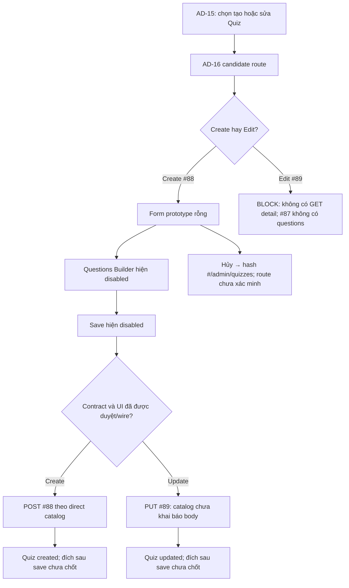

# AD-16 — Tạo/chỉnh sửa bài kiểm tra

> **Trạng thái:** `DD BLOCKED` · `IMPLEMENTATION BLOCKED` · `RUNTIME NOT VERIFIED` 
> **Phạm vi:** Màn hình quản trị bài kiểm tra, AC-35, chỉ Screen ID AD-16. 
> **Quy ước chứng cứ:** `EXPECTED` là yêu cầu/contract; `CURRENT` là ảnh, HTML hoặc source hiện tại; `DERIVED` là hành vi chỉ có trong triển khai local nhưng chưa được owner duyệt; `BLOCKER` là điều kiện chưa đủ để triển khai an toàn.

Ảnh nguồn [screen.png](screen.png) được giữ nguyên. Ảnh đánh số [screen_annotated.png](screen_annotated.png) có 35 marker; [AD-16_markers.json](AD-16_markers.json) là bản đồ ID/tọa độ, [AD-16_markers.svg](AD-16_markers.svg) là overlay có thể kiểm tra. Kế hoạch được lập trước các artifact này tại [AD-16_PLAN.md](AD-16_PLAN.md).

## A. Tổng quan màn hình

### A.1. Mục tiêu, actor và trạng thái

| Thuộc tính | Đặc tả và bằng chứng |
|---|---|
| Screen ID / tên | `AD-16` — Tạo/chỉnh sửa quiz (Page); tiêu đề prototype “Thiết lập và biên tập bài kiểm tra trắc nghiệm”. |
| Mục tiêu | Cung cấp luồng cấu hình Quiz và Question/Choice để thực hiện nhánh CREATE API #88 hoặc UPDATE API #89 theo AC-35. |
| Actor | `EXPECTED`: Admin có `quiz management permission` theo AC-35. `CURRENT`: local endpoint dùng shared role guard `ADMIN`; mapping permission chi tiết chưa được xác nhận. |
| Điều kiện vào | Create đi từ AD-15 qua nhánh #88. Edit đi từ AD-15 qua #89 với Quiz ID. ID local/API là int64, nhưng route UI và truyền ID chưa được wire/duyệt. Yêu cầu authentication/authorization theo catalog là Bearer JWT, role Admin. |
| Điều kiện sau | AC-35 nêu Quiz được tạo/cập nhật. Nơi chuyển đến sau thành công, cách refetch AD-15, giữ filter/page, và điều kiện đi tiếp AD-17 chưa được định nghĩa. |
| Route | Candidate inventory: `/admin/quizzes/new` hoặc `/admin/quizzes/:quizId/edit`. Không có Study Web router/source trong checkout để xác minh route hoạt động. |
| Quan hệ màn hình | AD-15 là entry point/list; AD-17 là statistics screen tiếp theo theo AC-35. Nút Hủy quay về hash `#/admin/quizzes` trong HTML nhưng runtime navigation chưa được xác minh. |
| Triển khai UI | `UNWIRED`: folder Study Web hiện không có editable `src/`, package manifest, router hoặc API client. Screenshot/HTML chỉ là prototype tĩnh. |

### A.2. Contract API và current source

| API | Contract trực tiếp trong catalog | Current local source (không thay thế contract) |
|---|---|---|
| #88 Create | `POST /api/v1/admin/quizzes`; Bearer JWT/Admin; body `{config:string!, questions:string!}`; response `ApiEnvelope<Quiz>`; 201 `DESIGN_RESOURCE_CREATED`; 401/403/422/500. API DD `Draft — Needs Confirmation`. | Route #88 parse raw body sau shared `ADMIN` guard. Strict outer body gồm đúng hai chuỗi `config`, `questions`; validator decode hai chuỗi JSON và áp dụng nested shape `config{course_id:int,title:string,duration_minutes?:int|null,passing_score:string}`, `questions[{text,type,choices[{text,is_correct?}]}]`. Shape này là `DERIVED`. Local code chỉ xác nhận Course tồn tại, ghi Quiz + Question + Choice theo thứ tự request (candidate order zero-based), map response rồi mới commit; lỗi sau khi bắt đầu transaction rollback. Response local có `is_correct`. |
| #89 Update | `PUT /api/v1/admin/quizzes/{quiz_id}`; Bearer JWT/Admin; path `quiz_id:int64!`; catalog **không khai báo body**; response `ApiEnvelope<Quiz>`; 200 `DESIGN_RESOURCE_UPDATED`; 401/403/404/422/500. API DD `Draft — Needs Confirmation`. | Route local nhận raw body và path; shared `ADMIN` guard chạy trước parse. Local handler yêu cầu positive int64 và reuse validator/body như #88. Khóa Quiz/children; nếu có attempt hoặc answer history trả 422 trước write; xác nhận Course tồn tại (local fallback cho phép chuyển Quiz sang Course khác), không thấy policy course-status/enrollment; cập nhật metadata rồi xóa Choices trước Questions và thêm replacement set theo request order (candidate order zero-based); response mapping hoàn tất trước commit. Local source không có optimistic version. Body, full replacement, history refusal, course move, locks và tombstone handling là `DERIVED`. |

Không có `GET /api/v1/admin/quizzes/{quiz_id}` để tải dữ liệu edit. #87 là list metadata-only trong local source (`questions=[]`), còn catalog response cardinality cũng khác local Page projection. Vì vậy AD-16 không có nguồn xác nhận để prefill Quiz và Question Builder khi mở edit route. Không gọi #87 thay thế detail.

### A.3. Quy tắc dữ liệu, bảo mật và blocker

- Direct catalog chỉ công bố top-level body strings cho #88; cấu trúc JSON bên trong hai chuỗi chưa được catalog/API DD duyệt. Local nested fields, QuestionType `SINGLE_CHOICE|MULTIPLE_CHOICE|TRUE_FALSE`, `is_correct` mặc định false, thứ tự câu hỏi/lựa chọn và giới hạn storage là `DERIVED`.
- Local validator không yêu cầu title có ký tự tối thiểu hoặc Question/Choice array có số lượng tối thiểu; không suy ra câu hỏi rỗng được chấp nhận theo business policy chỉ vì local model cho phép. Cần owner chốt ràng buộc Quiz/Question/Choice.
- UI hiện đánh dấu tên và khóa học là bắt buộc, nhưng HTML không đặt thuộc tính `required`; local validator không yêu cầu title có ký tự tối thiểu. Local #88 yêu cầu `course_id` signed int64, title tối đa 200 ký tự, `duration_minutes` int32 nullable, `passing_score` decimal string lưu được trong NUMERIC(5,2) (local helper cho phép đến ±999.99). Đây là kiểm tra storage của source, không xác nhận business range.
- Prototype đặt `min=1,max=300` cho duration và `min=0,max=100` cho điểm. Các khoảng này không có trong contract catalog hoặc AC-35. UI score dùng number input nhưng local request nhận string; chuyển đổi/chính xác thập phân chưa có mapping được duyệt. UI hiện không có course option hoặc ID source.
- Local migration `013_quiz_question_type_and_choice_order.sql` bổ sung `question_type` nullable và `quiz_choices.sort_order`; đây là candidate trên legacy BIGINT schema, không chứng minh migration đã deploy. V1-PILOT dùng UUID `assessments/questions/options`, không được trộn với ID/schema hiện tại của API #88/#89.
- Admin response local có answer key `is_correct`; bất kỳ mapping nào sang Student API #28 phải loại bỏ field này. AC-35 permission chi tiết và local shared `ADMIN` guard chưa được reconcile.
- Các thông báo autosave, Safe Mode, RBAC, “SYSTEM NORMAL”, schema sync và Questions Builder Gate chỉ là copy prototype. Không có localStorage, API call, form submit hay auth check phía client.
- `.agents/web-study/design.md` là target ocean-blue, Inter/system, centered/responsive; prototype hiện dùng full-width cobalt/Plus Jakarta. Target design là quy chuẩn hướng tới, không phải bằng chứng runtime.

## B. Luồng hoạt động tổng thể

1. **Entry:** AD-15 là luồng trước theo AC-35. Inventory đề xuất create/edit route; hiện không có Study Web route để resolve hoặc kiểm tra session.
2. **Authentication/authorization:** API catalog yêu cầu Bearer JWT/Admin. AC-35 dùng `quiz management permission`; source local chỉ kiểm tra shared `ADMIN`. UI chưa có guard. Khi thiếu auth, catalog liệt kê 401; thiếu quyền, 403. Client response/navigation chưa được thiết kế.
3. **Khởi tạo:** Screenshot hiện render config rỗng và Questions rỗng. Không có API options/load. Course select chỉ có placeholder. Create default ngoài dữ liệu rỗng chưa được xác định. Edit cần Quiz detail nhưng endpoint không tồn tại; không được dựng data từ URL hoặc #87.
4. **Nhập liệu:** Các input không có event listener/validation. Question/Choice controls không tồn tại; Add Question và Save disabled. Giao diện không thể tạo request chứa Question set.
5. **Mutation:** Khi contract và UI được duyệt, create dùng #88; update cần chốt request body trước khi dùng #89. Direct catalog và current local handler có khác biệt; xem EV-05/EV-06. Hiện không có request được gửi.
6. **Response:** Catalog thành công trả `ApiEnvelope<Quiz>`. Local code sinh ID Quiz/Question/Choice và response Admin có `is_correct`; mapping frontend, cache, retry, idempotency, toast và route sau save chưa có. Không được gửi answer key qua Student API.
7. **Lỗi và trạng thái:** Catalog #88/#89 nêu 401/403/422/500; #89 thêm 404. Local #89 dùng 422 cho history conflict. Prototype không thể biểu diễn loading, field errors, permission errors, save success hoặc conflict hiện hành.
8. **Rời màn hình:** Hủy có hash `#/admin/quizzes`; hash đích không chứng minh route có runtime. AD-17 được mở từ nhánh statistics của AD-15, không có nút/điều hướng trực tiếp từ prototype AD-16. Bảo toàn draft/filter/page hoặc cảnh báo thay đổi chưa lưu không được xác nhận.

## C. Đặc tả chi tiết từng element

Tọa độ `(x,y)` là tâm marker trên ảnh nguồn 1600×1402. Tọa độ này khớp với thứ tự trong JSON, SVG và ảnh annotated. Element tĩnh được mô tả là copy/layout, không tạo data contract.

| ID / tọa độ | Tên và loại | Vị trí, thuộc tính, dữ liệu và trạng thái hiện tại | Event |
|---|---|---|---|
| 1 `(276,18)` | Study2Work brand block — branding | Header trên cùng bên trái; logo “S”, Study2Work, LMS, ADMIN PORTAL. HTML là div tĩnh, không phải link. | — |
| 2 `(336,13)` | Tổng quan — navigation link | Header top nav; anchor `href="#"`, không có route handler. | EV-09 |
| 3 `(455,13)` | Người dùng — navigation link | Header top nav; anchor `href="#"`; destination không xác minh. | EV-09 |
| 4 `(599,13)` | Khóa học & Nội dung — navigation link | Header top nav; anchor `href="#"`; destination không xác minh. | EV-09 |
| 5 `(817,13)` | Kiểm duyệt — navigation link | Header top nav; anchor `href="#"`; destination không xác minh. | EV-09 |
| 6 `(959,13)` | Báo cáo — navigation link | Header top nav; anchor `href="#"`; destination không xác minh. | EV-09 |
| 7 `(1085,13)` | SYSTEM NORMAL — status badge | Copy/pulse tĩnh; không có health check/API nguồn. Không coi là backend health. | — |
| 8 `(1276,14)` | Notifications — button | Icon bell và chấm đỏ; button không có listener, không có notification request. | EV-09 |
| 9 `(1357,15)` | Admin identity/avatar — identity block | Tên “TS. Quản Trị Viên”, role copy và avatar tĩnh; không chứng minh session/current user. | — |
| 10 `(37,76)` | Global breadcrumb trail — navigation region | Hệ thống > Quản trị trung tâm > Không gian làm việc; spans/copy, không có href/router. | EV-09 |
| 11 `(1520,76)` | Chuẩn xác thực RBAC — status copy | Header góc phải; icon/copy tĩnh. Không chứng minh policy/authorization. | — |
| 12 `(40,134)` | Local breadcrumb trail — breadcrumb | Quản trị khảo thí > Danh sách bài kiểm tra > Thiết lập bài kiểm tra; copy prototype, không có router evidence. | EV-09 |
| 13 `(1176,167)` | Quay lại danh sách bài kiểm tra (AD-15) — link/button | Góc phải cạnh title; anchor `#/admin/quizzes`. Handoff mong đợi AD-15; route chưa được xác minh. | EV-07 |
| 14 `(40,170)` | Page title — heading | “Thiết lập và biên tập bài kiểm tra trắc nghiệm”; copy tĩnh, không thay đổi theo mode/ID. | — |
| 15 `(54,262)` | Safe Mode — alert/information banner | Dải xanh dưới title, gồm icon, nhãn, mô tả hạn chế edit sâu. Static copy; không có server read/feature gate evidence. | EV-08 |
| 16 `(66,421)` | Cấu hình chung bài thi — section heading | Card trái, nhãn “PHẦN 1 / 2”; chỉ là cấu trúc trình bày. | — |
| 17 `(55,513)` | Tên bài kiểm tra — text input group | Label có dấu `*`, copy “Bắt buộc”, text placeholder và helper. Input `id=quiz-title`, type text; không có `required`, maxLength hoặc listener. Local #88 nested fallback nhận strict string, max 200 theo candidate storage; không có min. Value hiện rỗng; `dirty/error` chưa wire. | EV-03 |
| 18 `(55,647)` | Khóa học áp dụng — select group | Label có dấu `*`/“Bắt buộc”; select `id=course-select` chỉ có placeholder disabled/selected, chưa có option/value. Local fallback yêu cầu `course_id:int64` và kiểm tra Course tồn tại; slug→ID/options source chưa có. | EV-03 |
| 19 `(54,797)` | Thời gian làm bài — number input group | Nhãn phút, placeholder `-- phút`, helper “Để trống nếu không giới hạn”; HTML `min=1,max=300`, không `required`. Local fallback nullable strict int, int32 range; 1–300 chưa phải business rule. | EV-03 |
| 20 `(640,798)` | Điểm đạt yêu cầu — number input group | Nhãn `%`, placeholder `-- %`, helper ngưỡng hoàn thành; HTML `min=0,max=100`, không `required`. Local fallback yêu cầu `passing_score` strict string biểu diễn được NUMERIC(5,2); map number→decimal string và 0–100 chưa duyệt. | EV-03 |
| 21 `(612,942)` | Tự động lưu bản ghi nháp — information card | Card xanh trong cấu hình; copy khẳng định lưu cục bộ. Không có localStorage, state persistence hoặc request trong HTML; chỉ là claim tĩnh. | EV-08 |
| 22 `(706,421)` | Ngân hàng câu hỏi & Đáp án — section heading | Card phải, nhãn “PHẦN 2 / 2”; không có dữ liệu câu hỏi. | — |
| 23 `(1512,502)` | Schema notice — information banner | Copy nói schema câu hỏi/thang điểm đang chờ chuẩn hóa. Là prototype notice, không phản ánh live schema/deployment. | EV-08 |
| 24 `(1095,641)` | Empty-state icon — decorative icon | Icon ballot ở giữa khung Questions; không có action/data. | — |
| 25 `(734,752)` | Empty-state heading — heading | “Chưa có câu hỏi nào được thêm vào bài kiểm tra”; empty state hiện trên prototype, không phải API result. | — |
| 26 `(1502,796)` | Empty-state description — supporting text | Copy mô tả chưa ghi nhận câu hỏi và chờ đồng bộ schema; không phải trạng thái backend. | — |
| 27 `(903,888)` | Thêm câu hỏi mới — disabled button | Button `disabled`, `aria-disabled=true`, có badge “Chức năng tạm khóa”; không có question/choice editor hay click handler. | EV-04 |
| 28 `(1511,1045)` | Questions Builder Gate — information notice | Notice lock ở cuối card; copy claim gate an toàn. Không có runtime gate/service evidence. | EV-08 |
| 29 `(55,1206)` | Trạng thái xác thực/RBAC — status strip | Dải cuối form khẳng định đã ghi nhận quyền Admin khảo thí; static text/icon, không phải auth result. | — |
| 30 `(1138,1208)` | Hủy bỏ — link/button | Anchor `#/admin/quizzes`. Không có dirty-state prompt, draft cleanup hoặc route runtime xác minh. | EV-07 |
| 31 `(1515,1208)` | Lưu bài kiểm tra — disabled button | Button `disabled`, `aria-disabled=true`; tooltip child ẩn khi không hover ghi “Vui lòng hoàn thiện cấu trúc câu hỏi hợp lệ”. Không có submit handler. | EV-05, EV-06 |
| 32 `(24,1334)` | Footer brand/copyright — footer text | “© 2025 Study2Work LMS. Hệ thống quản trị trung tâm.” Copy tĩnh. | — |
| 33 `(882,1347)` | Quy chế bảo mật dữ liệu — footer link | Anchor `href="#"`; destination/content không được cấu hình. | EV-09 |
| 34 `(1116,1347)` | Tiêu chuẩn phân quyền RBAC — footer link | Anchor `href="#"`; không phải bằng chứng policy hoặc tài liệu đã link. | EV-09 |
| 35 `(1382,1347)` | Hỗ trợ kỹ thuật hệ thống — footer link | Anchor `href="#"`; không có support handler. | EV-09 |

## D. Đặc tả sự kiện và xử lý dữ liệu

### EV-01 — Khởi tạo mode tạo (Load)

- **Element/kích hoạt:** Route candidate `/admin/quizzes/new`; hiện chưa có client route.
- **Đầu vào:** URL, session/auth state và permission cần có theo AC-35; form values ban đầu không nhận từ màn trước ngoài mode create.
- **Quy trình:** (1) Resolve route và mode; hiện không có router. (2) Kiểm tra Bearer/session và quiz-management permission; chưa có UI guard. (3) Nếu quyền hợp lệ, cần tải course options và defaults, nhưng không có API/source được chỉ định cho options/defaults. (4) Không gọi #87 để lấy course options trừ khi contract và mapping được duyệt. (5) Render blank config/questions như prototype chỉ làm trạng thái mẫu. (6) Chỉ enable builder/save sau khi schema/validation/permission/UI được duyệt.
- **API/output:** Không có request hiện tại. #88 chỉ chạy khi submit hợp lệ; create entry không tự POST. Destination sau create chưa xác định.
- **Ngoại lệ/trạng thái:** Loading, unauthorized, forbidden, error và empty course option chưa có UI implementation. Không thể đánh dấu create `ready` từ screenshot.

### EV-02 — Khởi tạo mode chỉnh sửa (Load)

- **Element/kích hoạt:** Candidate `/admin/quizzes/:quizId/edit`, truy cập từ action của một Quiz trong AD-15.
- **Đầu vào:** `quizId` route param. Catalog #89 khai báo `int64!`; format/positive check phía UI chưa được contract hóa.
- **Quy trình:** (1) Parse route ID theo contract đã chốt; (2) kiểm tra auth/permission; (3) cần GET admin Quiz detail để lấy config, Questions, Choices; (4) endpoint này không tồn tại. #87 list không phải detail và source local trả `questions=[]`; (5) không render dữ liệu giả, không gửi PUT, giữ edit state `blocked` và yêu cầu contract detail + question schema.
- **API/output:** Không có GET detail. #89 là mutation, không thể dùng làm read. Không tự dùng #87 để prefill.
- **Ngoại lệ/trạng thái:** Quiz missing/deleted và permission response chỉ có thể xác định sau khi có endpoint/load flow; catalog #89 404 chỉ áp dụng lúc mutation. Current screenshot không có ID/value.

### EV-03 — Thay đổi cấu hình chung (Input/Change)

- **Element:** #17–#20. Hiện không có listener, local UI state, error rendering hoặc submit path.
- **Đầu vào:** `title` text; course selector hiện chỉ có placeholder; duration optional number; passing score number. Phía server local #88/#89 fallback nhận `course_id` strict int64, `title` strict string, `duration_minutes` optional strict int/null, `passing_score` strict string. Đây là local derived request shape.
- **Quy trình:** (1) Nhận giá trị đã nhập. (2) Các native HTML `min/max` hiện hữu là hint prototype; không suy ra business validation. (3) Chưa có quy tắc normalize whitespace, required title, chọn course, decimal separator, rounding, bỏ trống duration hoặc đổi `%` thành request string. (4) Không gọi API khi field thay đổi. (5) Dirty/invalid state chưa implement; không claim autosave.
- **Kết quả/ngoại lệ:** Không có state change observable ngoài HTML control. Cần owner chốt required/range/precision, course ID source và mapping trước khi lập trình validator. Local fallback hiện kiểm tra title max 200, duration int32, score numeric fit; các checks này không xác nhận UI business policy.

### EV-04 — Thêm câu hỏi (Click)

- **Element:** #27 disabled Add Question. No event handler; không có question/choice inputs.
- **Tiền điều kiện:** Questions schema/type, editor behavior, answer-choice constraints, ordering, validation, source options và persistence semantics cần được xác nhận. Local #88 fallback shape có `questions[]`, từng item có `text`, `type`, `choices[]`, và Choice có `text`, `is_correct`.
- **Quy trình hiện tại:** (1) Browser không phát click cho disabled button. (2) Không tạo Question/Choice object. (3) Không cập nhật `questions` state/cache. (4) Không gọi API. (5) Gate/temporary-lock copy giữ nguyên.
- **Kết quả:** Empty state tiếp tục hiện. Không thể hoàn tất payload tạo/sửa; đây là blocker chính cho Save.

### EV-05 — Lưu Quiz mới (#88)

- **Element/kích hoạt:** #31 Save; disabled trong prototype, vì vậy hiện không có Submit event.
- **Tiền điều kiện expected:** Create mode; Admin session/quiz-management permission; form config và question schema hợp lệ; course option map sang ID; Save được enable theo rule đã duyệt. Các điều kiện này chưa đạt.
- **Đầu vào/candidate request:** Direct catalog quy định body top-level `{config:string!, questions:string!}`. Catalog không định nghĩa JSON fields bên trong. Local #88 fallback yêu cầu hai chuỗi JSON và nested shape trong §A.2; shape này `DERIVED`.
- **Quy trình khi có thể triển khai:** (1) Chuẩn hóa config/question input theo contract owner duyệt. (2) Validate client-side theo cùng contract; không dùng min/max prototype như business rule nếu chưa duyệt. (3) Encode `config` và `questions` thành hai string theo catalog. (4) Gửi `POST /api/v1/admin/quizzes` với Bearer JWT; không có header/idempotency key bổ sung được quy định. (5) Đọc HTTP/business code và envelope. (6) 201 `DESIGN_RESOURCE_CREATED`: nhận `Quiz` response; direct catalog schema không nêu chi tiết nested properties. Local source response dự kiến có IDs và answer keys nhưng là derived. (7) Cập nhật UI/cache hoặc điều hướng chỉ sau khi success mapping và destination được chốt; hiện chưa có chính sách. (8) Không retry tự động hoặc dedupe khi chưa có policy.
- **Lỗi:** 401 `DESIGN_AUTHENTICATION_REQUIRED`, 403 `DESIGN_ACCESS_DENIED`, 422 `DESIGN_VALIDATION_ERROR`, 500 `DESIGN_INTERNAL_ERROR` theo catalog. Local fallback 422 khi body/nested JSON/shape/course invalid; 500/query/mapping/commit lỗi rollback sau khi đã vào transaction. Không có runtime client error view.
- **Đầu ra hiện tại:** Không gửi request; button disabled và Questions rỗng.

### EV-06 — Cập nhật Quiz hiện hữu (#89)

- **Element/kích hoạt:** #31 Save trong edit mode; disabled và edit mode không hydrate được.
- **Tiền điều kiện expected:** Edit route có ID đã xác minh, Quiz data/question set đã load, permission hợp lệ, dirty state có thay đổi và #89 body contract được phê duyệt. Hiện thiếu GET detail/body contract.
- **Đầu vào:** Direct catalog chỉ khai báo `quiz_id:int64!` trong path; không khai báo request body. Không thể xác định cập nhật config/question bằng API trực tiếp này.
- **Quy trình khi có thể triển khai:** (1) Validate ID/data theo contract đã duyệt. (2) Không gửi PUT cho tới khi body được thêm/chốt trong catalog/DD. (3) Local source fallback hiện parse positive int64 và reuse body #88; đây là `DERIVED`, không phải cách gọi được phê duyệt. (4) Local source lock quiz/child rows, kiểm tra attempt/answer history trước write, xác nhận target course, update Quiz, thay toàn bộ Choices/Questions theo request order, map response rồi commit. (5) Response local 200 mapping trả Quiz admin; giữ `status` và `created_at`. (6) UI/cache/route sau success cần owner quyết định; không tự invalidation/refetch.
- **Lỗi direct catalog:** 401/403/404/422/500 với business code tương ứng trong API catalog. Local fallback: 404 nếu Quiz không tồn tại/đã `DELETED`; 422 nếu path/body/Course invalid hoặc có attempt/answer history; 500 cho query/mapping/commit lỗi và rollback. History conflict hiện dùng HTTP 422, không phải 409.
- **Đầu ra hiện tại:** Không có edit data, body hoặc request; không có UI conflict/error state.

### EV-07 — Hủy/quay về AD-15 (Click)

- **Element:** #13 và #30; anchors trỏ `#/admin/quizzes`. #13 ở header, #30 ở footer action.
- **Đầu vào/quy trình:** (1) Browser xử lý anchor hash; HTML không khai báo router/listener. (2) Không gọi API. (3) Không có dirty-state check, draft restore hoặc query/page/filter preservation. (4) Destination AD-15 là expected handoff theo inventory, nhưng runtime chưa xác minh.
- **Kết quả/ngoại lệ:** Prototype hash đổi theo browser behavior; không khẳng định Study app render AD-15. Unsaved-change prompt và clear/preserve draft là open decision.

### EV-08 — Safe Mode, autosave, schema và builder gate copy

- **Element:** #15, #21, #23, #28. Đây là message regions, không phải action control.
- **Đầu vào/quy trình:** Không có event, API, timer, browser storage hoặc feature flag. Copy được render tĩnh từ HTML. “Autosave locally”, “schema đang chờ”, “SYSTEM NORMAL” và “Gate active” không phải server state.
- **Kết quả:** Không có dữ liệu được lưu/tải và không đổi trạng thái khi message hiển thị. Nếu cần autosave/gate, cần định nghĩa storage scope, lifecycle, recovery, schema version và security behavior trong contract riêng.

### EV-09 — Admin shell, breadcrumb và footer links (Click)

- **Element:** #2–#6, #8, #10–#12, #33–#35.
- **Đầu vào/quy trình:** Anchor/nav click. Top nav/footer dùng `href="#"`; breadcrumb phần lớn là spans; notification button không có handler. Không có route resolver, API call hoặc auth/session transition trong HTML.
- **Kết quả:** Chỉ browser fragment/default control behavior; destination thực tế không xác minh. Không suy ra route, logout, notification panel, role change hoặc help center.

### EV-10 — Validation, auth và API failure states

- **Nguồn:** API catalog #88/#89 và current local handlers; không có client runtime để map.
- **Quy trình response candidate:** (1) Nhận HTTP status + envelope/businessCode. (2) 401 yêu cầu xử lý phiên; refresh/login/redirect policy chưa được quy định. (3) 403 hiển thị access denied; detail/masking policy chưa có. (4) 422 hiển thị field/business validation theo error payload đã thống nhất; #89 local history refusal cũng là 422. (5) 404 ở #89 biểu thị Quiz không tồn tại theo catalog/local source, local source cũng trả 404 cho tombstone. (6) 500 hiển thị lỗi tổng quát/trace ID nếu contract xác nhận; không lộ SQL/body. (7) Không retry, replay hoặc giữ form/cache nếu policy chưa có.
- **Current result:** Không có loading, inline field error, auth error, API error, success toast hoặc conflict view. Trạng thái này là thiết kế candidate, chưa implement.

## E. Ma trận trạng thái và điều hướng

### E.1. Trạng thái

| Trạng thái | Điều kiện chuyển vào | Hiển thị/đầu ra | Tình trạng chứng cứ |
|---|---|---|---|
| Prototype blank/draft | Mở ảnh hiện tại | Config trống, Questions rỗng, Save/Add disabled | `CURRENT` static screenshot; không phải persisted draft. |
| Loading | Route/API đang tải | Chưa có loading component | `EXPECTED_CANDIDATE`; chưa implement. |
| Ready/clean | Data/options tải thành công hoặc create defaults sẵn sàng | Chưa có xác định fields/options | `BLOCKER`; đặc biệt edit thiếu GET detail. |
| Dirty | User thay đổi config/question | Không có dirty tracker | `EXPECTED_CANDIDATE`; autosave claim không có source. |
| Invalid | Validation thất bại | Chưa có field-level errors | Ranges/required/precision unresolved; API local 422 is source fallback only. |
| Saving | Mutation đang gửi | Button vẫn disabled tĩnh, không loading state | `EXPECTED_CANDIDATE`; duplicate-submit policy open. |
| Created | #88 returns 201 success | Response/copy/navigation/cache undefined | `EXPECTED`; direct contract status only. |
| Updated | #89 returns 200 success | Response/copy/navigation/cache undefined | `EXPECTED`; direct body missing. |
| Not found | #89 returns 404 | No error panel | `EXPECTED` API response; local tombstone mapping derived. |
| Conflict/history blocked | Local #89 detects attempt/answer history | No conflict UI; source returns 422 | `DERIVED`; catalog does not define attempt policy. |
| Unauthorized/forbidden | 401/403 | No session/access UI | Catalog errors; client handling open. |
| Service error | 500 or network failure | No error/retry UI | API 500 catalog; network/timeout policy absent. |

Không đồng nhất `conflict` trong inventory với HTTP 409: catalog #89 không liệt kê 409 và local history rejection là 422. Cần owner/API contract chốt status và policy trước implementation.

### E.2. Điều hướng và dữ liệu trao đổi

| Từ | Điều kiện/event | Đích | Dữ liệu cần truyền | Trạng thái |
|---|---|---|---|---|
| AD-15 | Create action / #88 | AD-16 create candidate | Không có Quiz ID; course/filter state carry-over chưa quy định. | AC-35 expected; AD-15 CTA hiện disabled và Study route chưa wire. |
| AD-15 row | Update action / #89 | AD-16 edit candidate | Quiz ID theo response đã duyệt; local/catalog candidate int64. | Detail GET/question set missing; không thể populate. |
| AD-16 | Cancel/back #13/#30 | AD-15 candidate `#/admin/quizzes` | Không có form payload; dirty draft/filter/page retention chưa rõ. | Hash hiện có trong HTML, router chưa xác minh. |
| AD-16 create/update success | #88/#89 | Chưa xác định; có thể AD-15 theo quy trình list nhưng không được suy ra | `Quiz.id`/response nếu contract chuẩn hóa; update ID từ route. | Owner cần chốt success destination, refetch/cache và duplicate-submit policy. |
| AD-15 | Statistics action | AD-17 | Quiz ID theo API/list response đã duyệt. | Không có nút đi AD-17 trực tiếp từ AD-16; API #91 thuộc AD-17. |

## F. Tiêu chí nghiệm thu

- [x] Có ảnh gốc được giữ nguyên và annotated image 2×; 35 marker tuần tự, unique, bounded và ánh xạ một-một tới §C.
- [x] Các element tĩnh, controls, trạng thái disabled, copy và navigation anchors quan sát được đều được mô tả.
- [x] EV-01…EV-10 có trigger, đầu vào, bước xử lý, API boundary, kết quả và ngoại lệ; current behavior tách khỏi expected/candidate.
- [x] API #88/#89 direct catalog được ghi tách biệt với local server source; API DD status vẫn Draft.
- [x] Thiếu detail GET, #89 body, question/course schema, form rules, permission, storage deployment và post-save navigation được ghi thành blocker; không tự thêm contract.
- [ ] Có contract/decision để populate edit screen và question/choice builder.
- [ ] Có request body/validation/permission mapping được owner duyệt và API DD #88/#89 không còn open cho các quyết định AD-16 cần dùng.
- [ ] Có Study Web route/client/auth implementation để xác minh runtime behavior.

**Kết luận:** Tài liệu mô tả đầy đủ prototype và source fallback, nhưng chưa đạt `DD READY` vì edit initialization và mutation payload/UI question builder thiếu contract. Trạng thái màn hình là `DD BLOCKED`; implementation `BLOCKED`; runtime `NOT VERIFIED`.

### Nguồn truy vết chính

- [Screen inventory row 74 và flow Admin quiz](../../../list_screen.md)
- [API catalog #87–#91](../../../../../../docs/lists/list_api.md)
- [AC-35 Admin quiz diagram](../../../../../../apps/study-server/docs/diagrams/AC_UNICA/AC_04_ADMIN_MANAGEMENT.drawio)
- [Study Server API #88 route](../../../../../../apps/study-server/app/api/v1.py#L2435), [#89 route](../../../../../../apps/study-server/app/api/v1.py#L2491)
- [API #88 local models](../../../../../../apps/study-server/app/modules/admin/api_88_admin_quizzes_create/models.py#L12), [validator](../../../../../../apps/study-server/app/modules/admin/api_88_admin_quizzes_create/validate.py#L73), [handler](../../../../../../apps/study-server/app/modules/admin/api_88_admin_quizzes_create/view.py#L271)
- [API #89 validator](../../../../../../apps/study-server/app/modules/admin/api_89_admin_quizzes_update/validate.py#L19), [query](../../../../../../apps/study-server/app/modules/admin/api_89_admin_quizzes_update/query.py#L1), [handler](../../../../../../apps/study-server/app/modules/admin/api_89_admin_quizzes_update/view.py#L310)
- [Study Server database context for Quiz APIs](../../../../../../.agents/server-study/database.md#api-88-admin-quiz-create)
- [Migration 013](../../../../../../infra/postgres/study-server/migrations/013_quiz_question_type_and_choice_order.sql)
- [API #88 open questions](../../../../../../apps/study-server/docs/dd/88_admin_quizzes_create/OPEN_QUESTIONS.md), [API #89 open questions](../../../../../../apps/study-server/docs/dd/89_admin_quizzes_update/OPEN_QUESTIONS.md)
- [Study Web target design](../../../../../../.agents/web-study/design.md)
