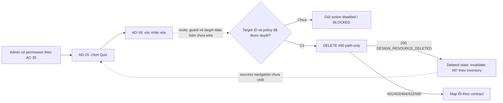

# AD-18 — Xác nhận xóa bài kiểm tra

> **Screen:** AD-18 · **Actor theo AC-35:** Admin có quiz-management permission · **Route candidate:** `/admin/quizzes/:quizId/delete` · **API candidate:** #90 `DELETE /api/v1/admin/quizzes/{quiz_id}` · **Entry/handoff:** [AD-15](../AD-15_danh-sach-bai-kiem-tra/AD-15.md).
> **Trạng thái:** `DD BLOCKED` · `IMPLEMENTATION BLOCKED` · `RUNTIME NOT VERIFIED` · **Study Web:** `UNWIRED` · **API #90:** route/module/query/model/validator/test source có trong Study Server; API DD vẫn `Draft — Needs Confirmation`; live schema/deployment chưa xác minh.
> **Tài sản:** [ảnh nguyên trạng](./screen.png) · [ảnh đánh số](./screen_annotated.png) · [bản đồ marker](./AD-18_markers.json) · [SVG marker](./AD-18_markers.svg) · [kế hoạch](./AD-18_PLAN.md) · [inventory](../../../list_screen.md).

## A. Tổng quan màn hình

AD-18 là màn hình xác nhận thao tác xóa quiz được AC-35 nối từ danh sách AD-15. Màn hình cần cho Admin nhận diện đúng Quiz, hiểu tác động tới attempts/history và đưa ra xác nhận tường minh. Đây là mục tiêu thiết kế; giao diện web hiện chưa được triển khai. Mockup có record placeholder, cảnh báo chính sách, trường lý do audit bị khóa và nút xóa bị disabled.

| Thuộc tính | Expected behavior / nguồn | Current behavior / bằng chứng |
|---|---|---|
| Actor | AC-35 yêu cầu Admin có quyền quản lý quiz. | API #90 dùng shared `ADMIN` role guard; chưa có source cho fine-grained quiz-management permission. |
| Điều kiện trước | Quiz được chọn từ AD-15 hoặc nhận `quizId` hợp lệ; người dùng đã xác thực và được phân quyền. | Inventory chỉ định URL candidate. Study Web checkout không có editable app source/router/API client; route chưa wire. Mockup hiện không chọn bản ghi. |
| Route | `/admin/quizzes/:quizId/delete`. | Không tìm thấy frontend route/runtime. HTML link dùng `href="#"`. |
| Dữ liệu target | Tên, ID và course giúp xác nhận đúng Quiz; attempts/history impact theo chính sách được duyệt. | Không có GET admin detail. #87 local list trả `id`, `course_id`, `title`, `duration_minutes`, `passing_score`, `questions=[]`; không trả course title hoặc counts/history. Không thể dựng nội dung hiện trên mockup từ contract #87 hiện tại. |
| Điều kiện sau | Inventory kỳ vọng #90 delete và invalidate #87; trạng thái `deleted` được liệt kê. | Cơ chế cache/navigation chưa có client. Exact success destination chưa được inventory/AC chốt. |
| Điều hướng | AD-15 → AD-18; quay lại AD-15. | Hai anchor của mockup đều `href="#"`; route history, giữ filter/page và handoff chưa có runtime evidence. |
| Bảo mật | Chỉ Admin có quyền nghiệp vụ; không gửi dữ liệu không có trong contract. | Local API kiểm tra role `ADMIN`, không body/query; authentication/authorization chạy trước parse path/DB. Role chưa chứng minh permission riêng. |
| Trạng thái triển khai | DD đủ traceable nhưng blocker phải được quyết định trước implementation. | API route/module/test source hiện có; Study Web `UNWIRED`; API DD Draft; live DB/deployment và runtime không xác minh. |

### API #90 — direct contract và local source

| Thành phần | API catalog / AC-35 | Study Server hiện tại | Tác động lên UI |
|---|---|---|---|
| Method/path | `DELETE /api/v1/admin/quizzes/{quiz_id}`; path `quiz_id:int64!`; không body/query. | Route đã đăng ký cùng path template; chỉ truyền Authorization và raw path. | Không truyền audit reason hoặc UI-only fields. `quizId` route param phải được map sang numeric `quiz_id`; slug/UUID không tương thích với candidate int64. |
| Auth | Bearer JWT; role Admin. AC-35 nêu quiz-management permission. | Shared guard chỉ cho `ADMIN`, trước path validation và DB. | Cần owner quyết định permission mapping/route guard; không xem `ADMIN` tự động tương đương permission nghiệp vụ. |
| Success | HTTP 200 `DESIGN_RESOURCE_DELETED`; `ApiEnvelope<DeleteResult>`, gồm `id:int64`, `status:"deleted"`, `deleted_at:date-time`. | Envelope trả `success`, `businessCode`, `message`, `data`, `meta`, `traceId`. Local map nhánh soft/repeat từ `updated_at`; nhánh hard lấy `CURRENT_TIMESTAMP`. | Chỉ xử lý success khi HTTP 200 và envelope hợp lệ. Không suy ra data target hoặc audit log từ response. |
| Errors | 401 `DESIGN_AUTHENTICATION_REQUIRED`; 403 `DESIGN_ACCESS_DENIED`; 404 `DESIGN_RESOURCE_NOT_FOUND`; 422 `DESIGN_VALIDATION_ERROR`; 500 `DESIGN_INTERNAL_ERROR`. Không có 409. | Cùng status/business codes trên route. Local validator trả 422 với lỗi `quiz_id` không phải positive signed-int64; lỗi này là validation, không phải dependency conflict. | Không tạo state/API branch 409. Unauthorized/forbidden/not-found/invalid-id/service error phải được phân biệt. |
| Attempt/history policy | AC-35 node n10: soft-delete nếu Quiz đã có attempts; không xác định no-attempt branch. | Local code soft-deletes khi có attempt **hoặc linked answer**; nếu không có hai loại history này thì hard-delete children rồi Quiz. Đây là nhánh `DERIVED`, chưa được owner duyệt. | Không hứa hành vi từ mockup hoặc local implementation cho đến khi policy được chốt. |
| Retry/idempotency | Catalog không quy định timeout/retry/idempotency hoặc DELETE lặp. | Local tombstone DELETE lặp trả 200 với timestamp cũ; đây là local behavior, chưa phải contract được duyệt. | Không tự động retry request mơ hồ cho đến khi retry/idempotency/reconciliation policy được xác nhận. |

### Discrepancy, blocker và trạng thái chứng cứ

1. **No-attempt delete:** AC-35 chỉ nói soft-delete nếu có attempts. Local #90 hard-delete khi không có attempt/answer, nhưng API DD đánh dấu nhánh này `DERIVED`; cần Product/BE duyệt trước khi bật action.
2. **Answer-only history:** local #90 soft-delete nếu có answer tham chiếu dù không có attempt. AC chỉ đề cập attempts; trường hợp này cần policy quyết định.
3. **Conflict:** row 76 của inventory nói “nếu conflict giữ nguyên màn”, nhưng #90 catalog không khai báo 409 và local #90 không trả dependency conflict cho history. Không đồng nhất HTTP 422 path validation với conflict. Đây là `DISCREPANCY` cần sửa contract/tracker sau khi owner quyết định.
4. **Race với attempt creation:** local #90 khóa Quiz trước khi kiểm tra history; không có current API #29 route/module trong checkout để chứng minh create-attempt có cùng lock/state guard. Không khẳng định cross-API race-safe.
5. **Permission:** AC-35 quiz-management permission khác với local role-only `ADMIN`; cần nguồn policy và cách guard.
6. **Visibility/lifecycle:** local #87 ẩn `status='DELETED'`; #89 từ chối sửa history/tombstone; #91 vẫn có thể trả thống kê từ Quiz/tombstone và attempt history. Cần duyệt hành vi sau xóa xuyên AC-35.
7. **Target data:** không có GET quiz detail. #87 không có course title/attempt count/history summary; HTML hiện hiển thị placeholder. Không thêm API hoặc trường dữ liệu theo suy đoán.
8. **Audit claim:** textarea/lý do kiểm toán bị disabled trong prototype; API #90 không nhận body. Không gửi reason hoặc khẳng định đã ghi audit event. Copy “ISO-27001”/“SAFE-GUARD” chỉ là nội dung mockup.
9. **Runtime/schema:** Study Web chưa wired; API #90 DD Draft; local legacy schema candidate không chứng minh live deployment. API test report là bằng chứng của lần chạy 2026-11-01, không phải runtime của màn hình ở phiên này.

## B. Luồng hoạt động tổng thể

Sơ đồ thể hiện expected flow và current blocker. Nét đứt biểu thị hành vi chưa có frontend evidence. `conflict` trong inventory không thể gắn vào #90 hiện tại vì direct catalog không có 409. Local code có soft/hard branches nhưng chưa được xem là policy đã duyệt.

### Trình tự vào và rời màn hình

1. **Entry:** AC-35/row 76 nối AD-15 tới AD-18 khi Admin chọn delete. Route là candidate; client router và permission guard hiện không có.
2. **Target:** route candidate chứa `quizId`. Cần quyết định handoff object từ #87 hay nguồn detail khác; ID phải map được sang `int64`. Không gọi một GET detail tự đặt ra. Với dữ liệu #87 hiện biết, chỉ map được ID, course ID, title và các trường response thực có; không thể khẳng định course title, question count hay attempt count.
3. **Preflight:** sau khi có route/auth/permission và target đã xác định, hiển thị xác nhận. Current mockup là trạng thái chưa chọn, không phải target loaded; confirm disabled.
4. **Confirm:** chỉ enable sau khi no-attempt/attempt/history policy, permission, data mapping và request contract được duyệt. Khi được phép, #90 chỉ nhận Bearer JWT và path `quiz_id`, không body/query.
5. **Response:** success 200 → `deleted` theo inventory và invalidate/refetch #87 theo inventory; exact cache mechanism/success navigation chưa có contract. Errors theo 401/403/404/422/500. Không có dependency conflict 409.
6. **Exit/cancel:** về AD-15 là expected relation; mockup anchors hiện `#`. Giữ filter/page/history state khi quay lại chưa được quy định.

## C. Đặc tả element

Tọa độ marker được lưu bằng source pixels trong [AD-18_markers.json](./AD-18_markers.json); ảnh hiển thị 2×. Các giá trị `--`/`Chưa chọn bản ghi`, trạng thái disabled và security/policy claims dưới đây là giá trị tĩnh của mockup, không phải dữ liệu runtime.

| ID | Tên và loại | Vị trí/mục đích | Tọa độ marker (x,y; source px) | Thuộc tính, nguồn và validation | Hiển thị/trạng thái | Event |
|---:|---|---|---|---|---|
| 1 | Brand Study2Work/Admin — brand group | Header trái; nhận diện hệ thống | (`16,36`) | Static text/logo; không nhận data | Visible; static | — |
| 2 | Tổng quan — navigation link | Header nav | (`355,61`) | HTML `href="#"`; destination chưa có | Visible; no route behavior | EV-06 |
| 3 | Người dùng — navigation link | Header nav | (`490,61`) | HTML `href="#"`; destination chưa có | Visible; no route behavior | EV-06 |
| 4 | Khóa học & Nội dung — navigation link | Header nav | (`660,61`) | HTML `href="#"`; destination chưa có | Visible; no route behavior | EV-06 |
| 5 | Kiểm duyệt — navigation link | Header nav | (`856,61`) | HTML `href="#"`; destination chưa có | Visible; no route behavior | EV-06 |
| 6 | Báo cáo — navigation link | Header nav | (`983,61`) | HTML `href="#"`; destination chưa có | Visible; no route behavior | EV-06 |
| 7 | System Normal badge — status copy | Header phải | (`1152,61`) | Literal mockup; không nối health API | Visible; không chứng minh hệ thống normal | — |
| 8 | Notifications — button | Header phải | (`1295,60`) | `button`, `aria-label=Notifications`; không listener | Visible; clickable-looking, no handler | EV-06 |
| 9 | Admin identity/avatar — profile group | Header phải | (`1584,61`) | Static “TS. Quản Trị Viên”/`ADMIN`; không đọc session | Visible; không chứng minh identity/permission runtime | — |
| 10 | Global breadcrumb — navigation text | Shell row | (`18,95`) | Static hierarchy; không có route handler trong HTML | Visible; static | — |
| 11 | RBAC assurance badge — claim | Shell row phải | (`1585,95`) | Static copy “Chuẩn xác thực RBAC”; không có guard evidence | Visible; static claim | — |
| 12 | Quản trị khảo thí — breadcrumb text | Local navigation rail | (`130,171`) | Current label; không link destination | Visible; static | — |
| 13 | Danh sách bài kiểm tra — breadcrumb link | Local navigation rail | (`333,171`) | `href="#"`; intended AD-15, no route | Visible; no navigation runtime | EV-02 |
| 14 | Xóa bài kiểm tra — current breadcrumb | Local navigation rail | (`508,171`) | Static current section | Visible; static | — |
| 15 | Quay lại danh sách bài kiểm tra (AD-15) — anchor/button style | Rail phải | (`1547,247`) | `href="#"`; intended AD-15. Filter/page handoff unspecified | Visible; no handler | EV-02 |
| 16 | Danger warning icon — decorative icon | Main panel header trái | (`346,390`) | Icon only; no independent action | Visible; decorative | — |
| 17 | Risk-of-learning-data-impact — eyebrow text | Main panel header | (`880,328`) | Static warning label | Visible; copy does not prove actual policy | — |
| 18 | Xác nhận gỡ bỏ bài kiểm tra khỏi hệ thống — heading | Main panel header | (`985,393`) | Static H1 | Visible | — |
| 19 | Thông tin bản ghi mục tiêu — section heading | Target record card | (`390,462`) | Static heading | Visible | — |
| 20 | Chưa chọn bản ghi — status pill | Target card right | (`1218,462`) | Static placeholder; no selected-record state source | Visible; placeholder | — |
| 21 | Tên bài thi — label/value card | Target card, column 1 | (`640,606`) | Current value `--`; potential source #87 `title`, only after approved handoff | Visible; mockup value unresolved | EV-01 |
| 22 | Mã định danh khảo thí — label/value card | Target card, column 2 | (`920,606`) | Current “Chưa chọn bản ghi”; candidate `quizId` / #87 `id`; map/format must be approved | Visible; placeholder | EV-01 |
| 23 | Khóa học liên kết — label/value card | Target card, column 3 | (`1200,606`) | Current `--`; #87 returns `course_id`, not course title | Visible; no valid display mapping | EV-01 |
| 24 | Attempt safety icon — decorative icon | Warning card left | (`350,770`) | Icon only; no data/action | Visible; decorative | — |
| 25 | Chính sách bảo toàn kết quả & Khóa an toàn — heading | Warning card | (`900,715`) | Static claim | Visible; not API policy | — |
| 26 | Attempt/history warning paragraph — warning text | Warning card body | (`1215,803`) | Static claim that delete is blocked and manual DB action is needed; conflicts with local #90 branches and unapproved policy | Visible; no data binding | — |
| 27 | Unresolved Attempts Policy — rule badge | Warning card bottom left | (`760,878`) | Static English copy; not a resolved policy enum | Visible; unsupported as runtime policy value | — |
| 28 | Khóa cứng (Read-Only) — status badge | Warning card bottom right | (`1160,878`) | Static copy; no UI state source beyond disabled elements in mockup | Visible; static | — |
| 29 | Lý do kiểm toán hệ thống — label | Audit region | (`625,927`) | Associates to `textarea#audit-reason`; whether required is not in #90 contract | Visible | EV-05 |
| 30 | ISO-27001 (Bị khóa theo chính sách) — policy copy | Audit label right | (`1217,927`) | Static claim, no policy source or server data | Visible; static | — |
| 31 | Audit reason — textarea | Audit region | (`380,1066`) | `disabled`; placeholder says reason required. #90 has no body; do not send value. No length/validation contract | Visible; Disabled/Readonly in mockup | EV-05 |
| 32 | Trường dữ liệu vô hiệu hóa — disabled hint | Textarea lower-right | (`1221,1095`) | Static hint with lock icon | Visible; static | — |
| 33 | Quay lại an toàn — anchor/button style | Bottom action row | (`685,1138`) | `href="#"`; no route behavior | Visible; enabled appearance, no handler | EV-03 |
| 34 | Xác nhận xóa vĩnh viễn — destructive button | Bottom action row | (`1225,1138`) | `disabled`, `aria-disabled="true"`; no click handler. API #90 has only path input | Visible; Disabled | EV-04 |
| 35 | Data protection auto-activated — footer copy | Inner panel footer left | (`735,1252`) | Static statement; no runtime control/system evidence | Visible; static claim | — |
| 36 | ED-TECH COMPLIANCE • SAFE-GUARD ENABLED — badge | Inner panel footer right | (`1254,1252`) | Static copy; no compliance/API state source | Visible; static claim | — |
| 37 | Copyright and central-admin label — footer text | Global footer left | (`468,1390`) | Literal © 2025 Study2Work LMS/system text | Visible; static | — |
| 38 | Quy chế bảo mật dữ liệu — footer link | Global footer | (`1090,1390`) | `href="#"`; destination unknown | Visible; no handler | EV-06 |
| 39 | Tiêu chuẩn phân quyền RBAC — footer link | Global footer | (`1368,1390`) | `href="#"`; destination unknown | Visible; no handler | EV-06 |
| 40 | Hỗ trợ kỹ thuật hệ thống — footer link | Global footer | (`1584,1390`) | `href="#"`; destination unknown | Visible; no handler | EV-06 |

### Quy tắc dùng chung cho elements

- Design source is the supplied static Admin prototype. No shared runtime component/theme behavior was found in Study Web source because app source is absent. Do not present prototype copy as Design System implementation.
- Disabled confirm and textarea do not accept keyboard, pointer or pasted input in the current HTML. A future enablement requires explicit approved state/policy; do not infer enablement from a selected row.
- Use semantic heading/labels and accessible disabled state when implementation is designed. Preserve a visible focus target and announce asynchronous result/errors; exact live regions/keyboard behavior are not defined by current source.
- Responsive layout is present only through Tailwind classes in the mockup; it is not tested in a running client. Narrow-screen order and sticky-shell behavior remain unverified.

## D. Đặc tả sự kiện

### EV-01 — Mở AD-18 và nạp/nhận diện target Quiz

- **Element/trigger:** AD-15 delete branch or direct route entry; candidate route param `quizId`.
- **Type/preconditions:** Route/load. Admin must have AC-35 quiz-management permission and valid authenticated session. These route guard checks are expected; no Study Web implementation exists.
- **Input/source:** `quizId` from URL or selected item handoff. Catalog #90 path is positive-int64-shaped `quiz_id`; #87 local list item includes `id`, `course_id`, `title`, `duration_minutes`, `passing_score`, `questions=[]`.
- **Sequence:** 1) Parse route param only after authentication/authorization policy is determined. 2) Validate ID mapping; do not parse arbitrary slug/UUID as int64. 3) Determine approved source for selected Quiz. 4) If handoff is #87 item, map only fields present in that response. 5) Do not invent a GET detail; no such API is listed/wired. 6) Do not show a fabricated course title or attempt count. 7) If the target cannot be resolved, keep confirm disabled and surface the owner-approved missing-target state; that state/copy is not specified.
- **API:** No API call is defined for page entry. #90 is mutation only; #87 is a list and is not a direct detail endpoint.
- **Output/exceptions:** Current mockup remains “Chưa chọn bản ghi” with `--`. Invalid ID could produce #90 422 only if a request is sent; an absent or hard-deleted Quiz maps to #90 404. A previously tombstoned Quiz gets HTTP 200 on repeat in local code, but that behavior is `DERIVED`, not approved contract. Exact route-state UX is open; no empty/error state is implemented.

### EV-02 — Return to AD-15

- **Elements/trigger:** #13 breadcrumb or #15 top return control; click.
- **Type/preconditions:** Navigation. Candidate destination `/admin/quizzes`; route has not been wired.
- **Input:** Current candidate `quizId`; possible source AD-15 page/filter state is not represented in URL/contract.
- **Sequence:** 1) Read current route/history if available. 2) Navigate to AD-15 using the approved router path. 3) Preserve filters/page only if the application defines that state handoff. 4) Do not send #90 or mutate cache. Current HTML uses `href="#"`; no navigation occurs to a verified destination.
- **Output/exceptions:** Expected screen relation is AD-15. Runtime destination, fallback when entry was direct, history behavior and state restoration need product/UI contract.

### EV-03 — Cancel safely

- **Element/trigger:** #33 safe-return link; click.
- **Type/preconditions:** Navigation/cancel before any delete request. Mockup has `href="#"` and no JS handler.
- **Input:** Current route/history; no body or mutation input.
- **Sequence:** 1) Confirm no DELETE request is in flight or initiated. 2) Navigate to approved safe destination (likely AD-15 or prior page; not yet chosen). 3) No state mutation or cache invalidation. 4) Current mockup has no handler; this is an expected action only.
- **Output/exceptions:** Remain on AD-18 until destination/routing is defined; no cancel confirmation or unsaved-data prompt is needed from current source because the audit textarea is disabled and no editable state exists.

### EV-04 — Confirm quiz deletion (disabled; candidate API flow)

- **Element/trigger:** #34 button, click when enabled in an approved implementation. Current HTML sets `disabled` and `aria-disabled="true"`; no handler exists, so currently no request can start.
- **Type/preconditions:** Submit/destructive action. Require resolved target, positive signed-int64 ID mapping, authenticated Admin, approved quiz-management permission, and owner-approved policy for attempts/answer-only/no-history and concurrent creation. Until all blockers are resolved, keep action unavailable.
- **Input:** Path `quiz_id:int64!`; Bearer JWT. No query and no request body. Do not include audit reason: #90 catalog is path-only and route reads no body.
- **Candidate request:** `DELETE /api/v1/admin/quizzes/{quiz_id}`. Current route passes raw path and Authorization to #90. Local validator authenticates/authorizes role `ADMIN` before positive signed-int64 parse. Positive-only/minimum and parser implementation are current local behavior; the fine-grained permission mapping is unresolved.
- **Backend current side effects (not approved policy):** #90 locks Quiz, then Quiz questions/choices, checks any `quiz_attempts` and linked `quiz_answers`. If attempt or answer exists, local branch sets `status='DELETED'`, updates `updated_at`, and preserves children/history. If neither exists, local branch deletes choices → questions → Quiz in one transaction. If already tombstoned, local code returns 200 with the old `updated_at`. These are source facts marked `DERIVED` in API DD, not front-end promises. AC-35 explicitly supports only soft-delete when attempts exist; it is silent on the other branches.
- **Response parsing:** On HTTP 200 require valid envelope and `businessCode=DESIGN_RESOURCE_DELETED`; data contract is `{id:int64,status:"deleted",deleted_at:date-time}`. Validate returned ID matches requested target before marking success. `message`, `meta`, and `traceId` follow envelope; do not use them as source for additional UI fields.
- **Success result:** Set candidate state `deleted` and invalidate/refetch #87 as inventory expects. Exact cache implementation, toast/copy, and navigation destination are undefined. #87 current query hides tombstones, but this is local source behavior; not an approved product lifecycle. Do not state audit was recorded unless a source is added.
- **Error mapping:** 401 → authentication/session handling per shared auth flow; 403 → access denied; 404 → target absent/not found; 422 → `quiz_id` validation in current local code, not conflict; 500 → safe service failure. Catalog does not define 409, so do not map history/attempts to a conflict response. Network/timeout/unknown outcome, retry, duplicate click and idempotency policy are not defined; do not auto-resend a destructive request until reconciliation behavior is approved.
- **Concurrency:** Local #90 parent lock alone does not establish safety against API #29 attempt creation; no matching local #29 route/module was found. Do not claim attempt race is closed.

### EV-05 — Audit reason field (disabled)

- **Element/trigger:** #31 textarea/#29 label; user input would ordinarily be `input/change`, but current textarea has `disabled` and no handler.
- **Input/validation:** Placeholder suggests a mandatory reason and ISO-27001 policy, but no approved field length, requiredness, policy source or #90 request body exists. Catalog and current route define no body.
- **Processing/output:** Current state is disabled; keyboard/pointer input produces no editable value and no request. Do not mark it required or send text. Enabling the control needs a separate approved API/contract and audit policy decision.

### EV-06 — Shell, notification, breadcrumb and footer controls

- **Elements/trigger:** #2–#6, #8, #10, #12–#15, #38–#40. The notification button has no listener; navigation anchors have `href="#"`; remaining shell copy is static.
- **Input/preconditions:** None available. No router, notification endpoint or identity/system-status provider in this screen source.
- **Processing/output:** No request, route change or state update. Do not invent link destinations or interpret “System Normal”/RBAC labels as current service state.

## E. Ma trận trạng thái và điều hướng

### State matrix

| State | Entry condition | UI/action rule | Exit/next | Evidence/status |
|---|---|---|---|---|
| `confirm` (inventory) | Target resolved, Admin permission and policy approved | Show correct target/impact; enable confirm only under approved rule | Confirm → `deleting`; cancel → AD-15/previous approved page | Inventory expected; current mockup has no selected target and confirm disabled. |
| `deleting` (inventory) | One approved #90 request in flight | Prevent duplicate user submission; exact loading copy/button behavior not in source | Success/error response | Expected state only; no client handler. |
| `conflict` (inventory) | Inventory says conflict keeps screen | No API #90 409 exists; #90 local history branches do not return conflict | Requires contract decision | Unsupported/discrepant; do not implement from current contract. |
| `deleted` (inventory) | Valid HTTP 200 `DESIGN_RESOURCE_DELETED` and response ID matches | Show approved success result; invalidate/refetch #87 per inventory | Destination/cache behavior unresolved | Expected state; exact transition/copy not defined. |
| `unauthenticated` | #90 returns 401 | Follow shared auth/session flow | Sign-in/session recovery | Catalog + local source; UI transition not wired. |
| `forbidden` | #90 returns 403 | Show safe access denial | Remain/return per shared policy | Catalog + local role guard; fine-grained permission unresolved. |
| `not-found` | #90 returns 404 for an absent/hard-deleted Quiz, or approved route lookup cannot resolve target | Avoid showing success; approved recovery link needed | AD-15 or safe page TBD | Catalog/local source. A tombstoned Quiz returns 200 on repeated DELETE in local code, but this is DERIVED. |
| `validation-error` | #90 returns 422 | Present ID/path validation failure; never call it a history conflict | Correct route/selection | Current local 422 applies to invalid positive-int64 path. |
| `service-error` | #90 returns 500 | Safe error; no raw database details | Remain/retry only under approved retry policy | Catalog/local safe error mapping; retry policy open. |
| `unknown-outcome` | Network failure/timeout after possible request | Do not claim deleted/not deleted or automatically repeat | Reconciliation behavior needs owner decision | Not in catalog or inventory state list; design decision required before client implementation. |
| `unwired` | Current checkout | Prototype only; disabled confirm, placeholder record, anchors `#` | No verified transition | Current Study Web status. |

### Navigation/data matrix

| From | Action | To | Data passed | Current evidence |
|---|---|---|---|---|
| AD-15 | Delete a Quiz | AD-18 candidate | `quizId` and preferably selected #87 item only after handoff schema is approved | AC-35/inventory relation; no Study Web route/client. |
| AD-18 | Top return/list breadcrumb | AD-15 candidate | Preserve ID/filter/page only if approved | Static `href="#"`; no runtime navigation. |
| AD-18 | Safe cancel | AD-15 or prior route (decision pending) | None required by API | Static `href="#"`; destination unresolved. |
| AD-18 | Successful #90 | `deleted` then destination TBD | `DeleteResult`; invalidate #87 per inventory | Catalog response; no cache/router client. |
| AD-18 | #90 401/403/404/422/500 | Error/recovery UI TBD | Error envelope / trace ID | Status set known; exact shared UI recovery is outside current source. |

### Authorization and data-handling controls

- Do not make API calls from an unverified client route. Server #90 must remain the authority for auth/resource checks; client state alone is not authorization.
- AC-35 requires quiz-management permission while current source checks role `ADMIN`. Resolve policy before enabling the action.
- Use only path `quiz_id` and Bearer token for API #90; never send the disabled audit reason or static screenshot labels as request data.
- A successful mutation must not erase, hide or claim erasure of attempt/answer history beyond an approved policy. Local source soft-delete/hard-delete distinction is explicitly not yet accepted.
- Treat `deleted_at` timestamp timezone/normalization, repeated delete result and ambiguous network result as unresolved API contract questions.

## F. Tiêu chí nghiệm thu

- [x] Có ảnh nguồn nguyên trạng, HTML nguồn; original hashes được ghi trong worklog.
- [x] Có 40 marker tuần tự trên ảnh đánh số; từng marker khớp một element row và marker JSON.
- [x] Ghi rõ route/UI hiện `UNWIRED`, mockup disabled/static và không có request handler.
- [x] Phân biệt AC-35/direct API catalog với local #90 branches; không coi local derived policy là approved.
- [x] Mô tả API method/path/auth/params/body/response/status/business codes; không tạo 409.
- [x] Ghi rõ target-data gap, permission gap, attempt race, lifecycle visibility và schema/runtime blockers.
- [x] Có state/navigation matrix, error/unknown-outcome handling limits và liên kết AD-15.
- [x] Giữ riêng trạng thái `DD BLOCKED`, `IMPLEMENTATION BLOCKED`, `RUNTIME NOT VERIFIED`.
- [ ] Owner duyệt no-attempt/answer-only/tombstone/race/permission/visibility policy; cần quyết định trước khi `DD READY`.
- [ ] Study Web route, selected-Quiz data handoff, action/error/recovery UI và cache invalidation được thiết kế/wire.
- [ ] Live schema/deployment và API contract/DD được xác minh/cập nhật trước runtime claim.
